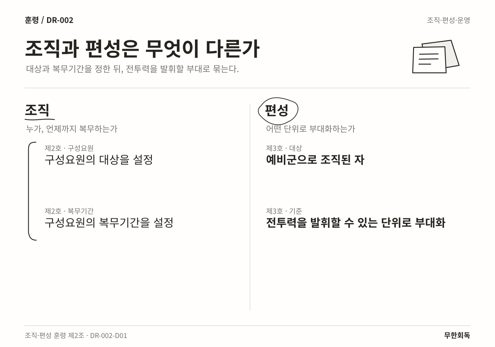
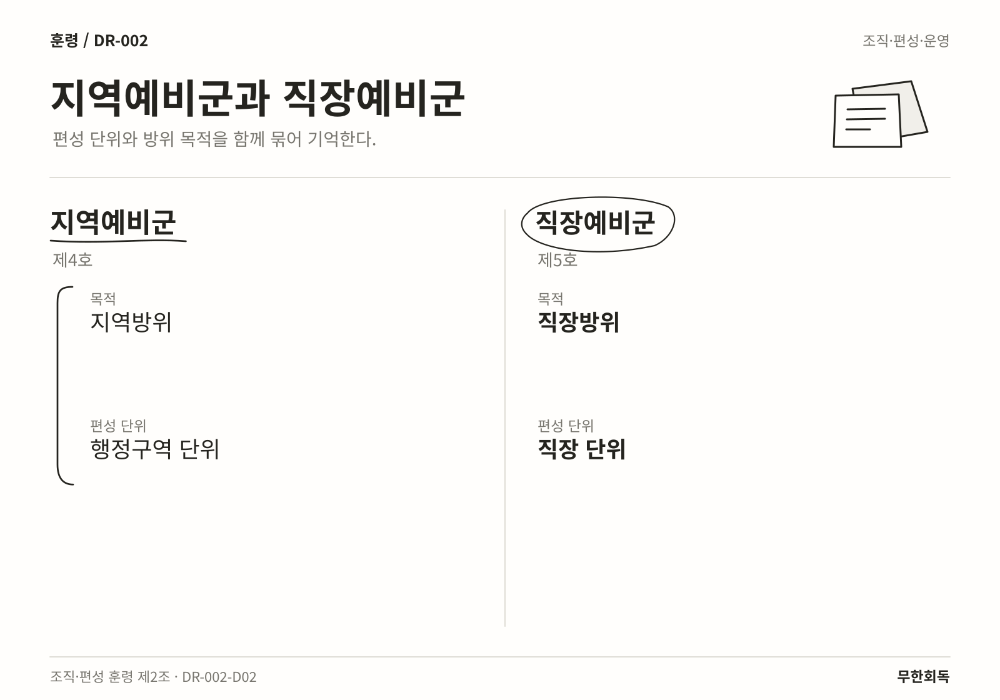
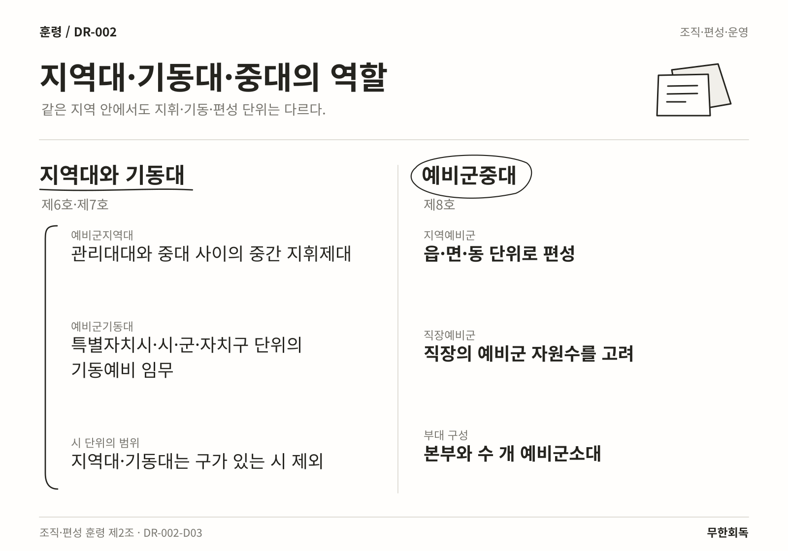
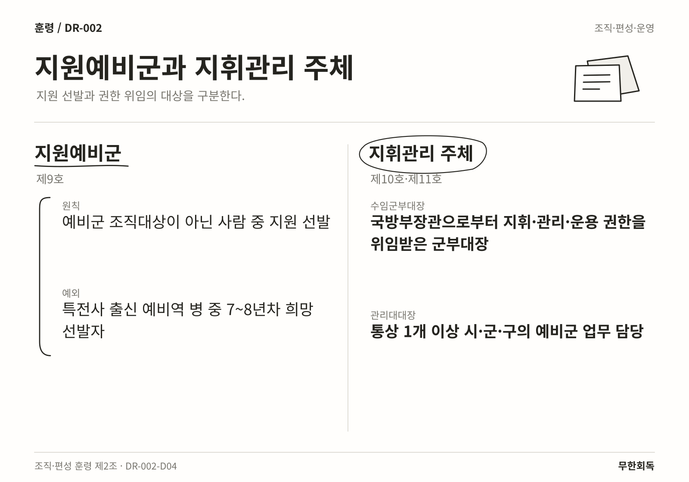
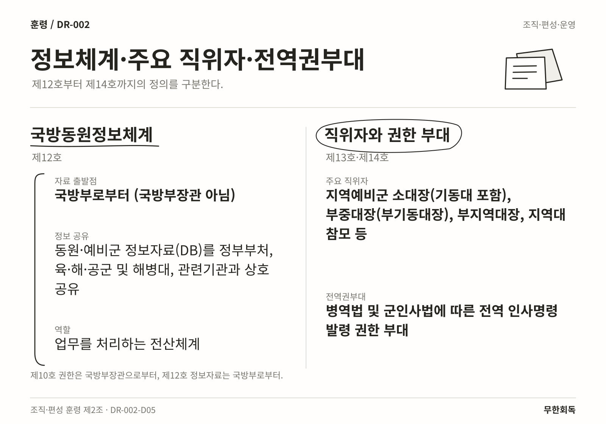

# DR-002 · 예비군 조직·편성과 운영에 관한 훈령 제2조, 정의

도식 **5장** · 1600 × 1120 · 흑백 편집형 디자인

[훈령 전체 목록](../../README.md) · [전체 매니페스트](../../diagrams-manifest.json)

## DR-002-D01 · 조직과 편성은 무엇이 다른가

[WebP](DR-002-D01-editorial-v1.webp) · [PNG](DR-002-D01-editorial-v1.png) · [SVG 원본](DR-002-D01-editorial-v1.svg)

근거: [조직·편성 훈령 제2조](https://www.law.go.kr/LSW/admRulLsInfoP.do?admRulSeq=2100000268674#J2-0:0) · 국방부훈령 제3104호

## DR-002-D02 · 지역예비군과 직장예비군

[WebP](DR-002-D02-editorial-v1.webp) · [PNG](DR-002-D02-editorial-v1.png) · [SVG 원본](DR-002-D02-editorial-v1.svg)

근거: [조직·편성 훈령 제2조](https://www.law.go.kr/LSW/admRulLsInfoP.do?admRulSeq=2100000268674#J2-0:0) · 국방부훈령 제3104호

## DR-002-D03 · 지역대·기동대·중대의 역할

[WebP](DR-002-D03-editorial-v1.webp) · [PNG](DR-002-D03-editorial-v1.png) · [SVG 원본](DR-002-D03-editorial-v1.svg)

근거: [조직·편성 훈령 제2조](https://www.law.go.kr/LSW/admRulLsInfoP.do?admRulSeq=2100000268674#J2-0:0) · 국방부훈령 제3104호

## DR-002-D04 · 지원예비군과 지휘관리 주체

[WebP](DR-002-D04-editorial-v1.webp) · [PNG](DR-002-D04-editorial-v1.png) · [SVG 원본](DR-002-D04-editorial-v1.svg)

근거: [조직·편성 훈령 제2조](https://www.law.go.kr/LSW/admRulLsInfoP.do?admRulSeq=2100000268674#J2-0:0) · 국방부훈령 제3104호

## DR-002-D05 · 정보체계·주요 직위자·전역권부대

[WebP](DR-002-D05-editorial-v1.webp) · [PNG](DR-002-D05-editorial-v1.png) · [SVG 원본](DR-002-D05-editorial-v1.svg)

근거: [조직·편성 훈령 제2조](https://www.law.go.kr/LSW/admRulLsInfoP.do?admRulSeq=2100000268674#J2-0:0) · 국방부훈령 제3104호

