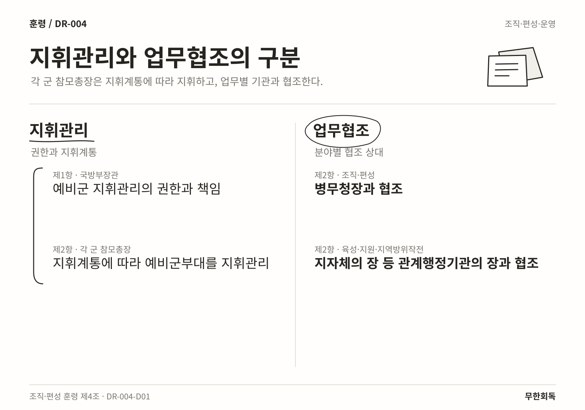
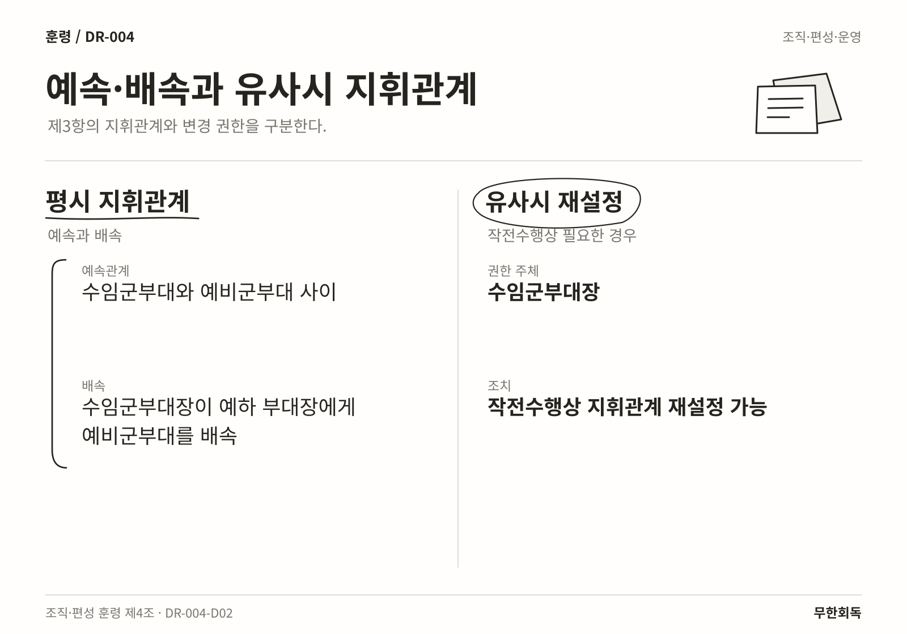
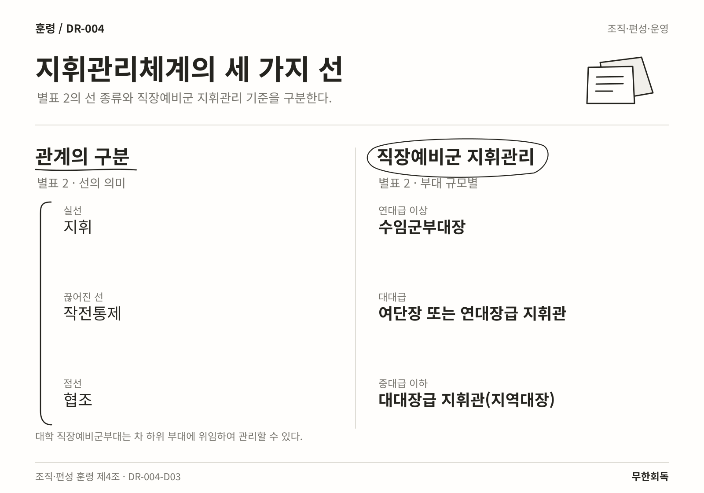

# DR-004 · 예비군 조직·편성과 운영에 관한 훈령 제4조, 예비군 지휘관리체계

도식 **3장** · 1600 × 1120 · 흑백 편집형 디자인

[훈령 전체 목록](../../README.md) · [전체 매니페스트](../../diagrams-manifest.json)

## DR-004-D01 · 지휘관리와 업무협조의 구분

[WebP](DR-004-D01-editorial-v1.webp) · [PNG](DR-004-D01-editorial-v1.png) · [SVG 원본](DR-004-D01-editorial-v1.svg)

근거: [조직·편성 훈령 제4조](https://www.law.go.kr/LSW/admRulLsInfoP.do?admRulSeq=2100000268674#J4-0:0) · 국방부훈령 제3104호

## DR-004-D02 · 예속·배속과 유사시 지휘관계

[WebP](DR-004-D02-editorial-v1.webp) · [PNG](DR-004-D02-editorial-v1.png) · [SVG 원본](DR-004-D02-editorial-v1.svg)

근거: [조직·편성 훈령 제4조](https://www.law.go.kr/LSW/admRulLsInfoP.do?admRulSeq=2100000268674#J4-0:0) · 국방부훈령 제3104호

## DR-004-D03 · 지휘관리체계의 세 가지 선

[WebP](DR-004-D03-editorial-v1.webp) · [PNG](DR-004-D03-editorial-v1.png) · [SVG 원본](DR-004-D03-editorial-v1.svg)

근거: [조직·편성 훈령 제4조](https://www.law.go.kr/LSW/admRulLsInfoP.do?admRulSeq=2100000268674#J4-0:0) · 국방부훈령 제3104호

