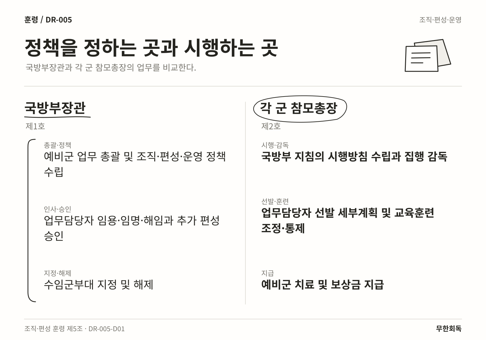
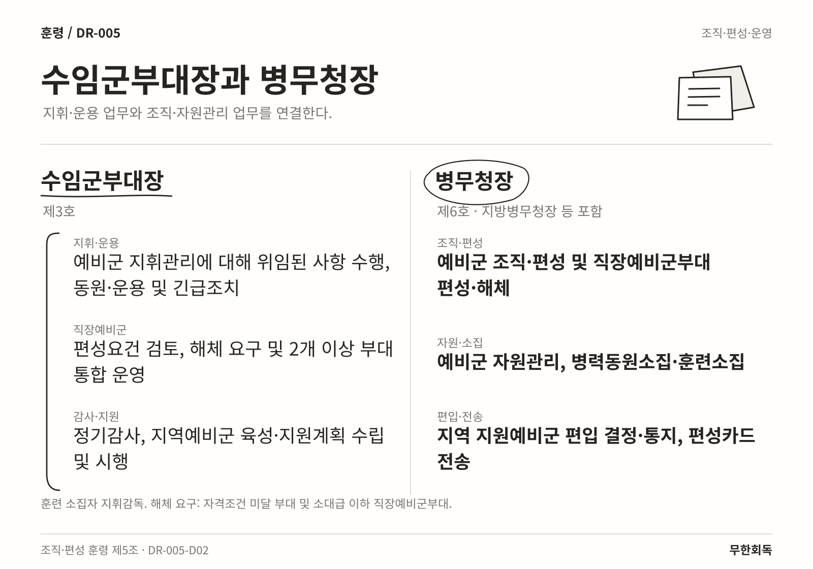
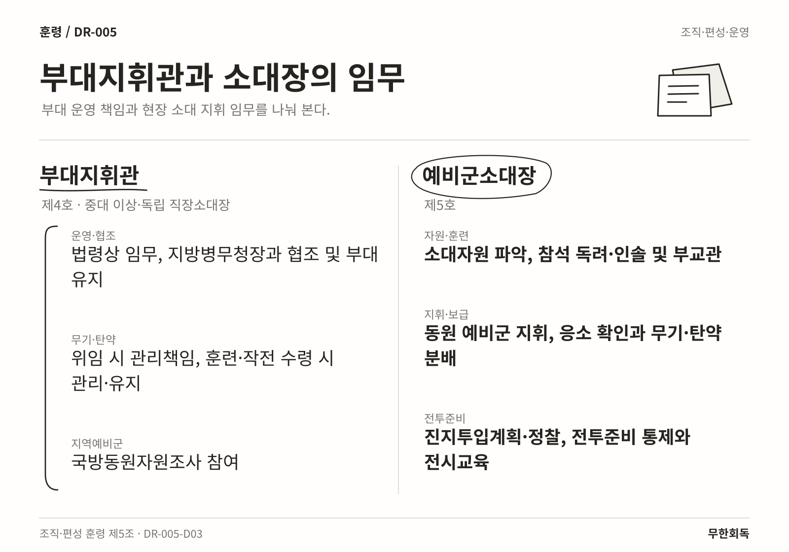
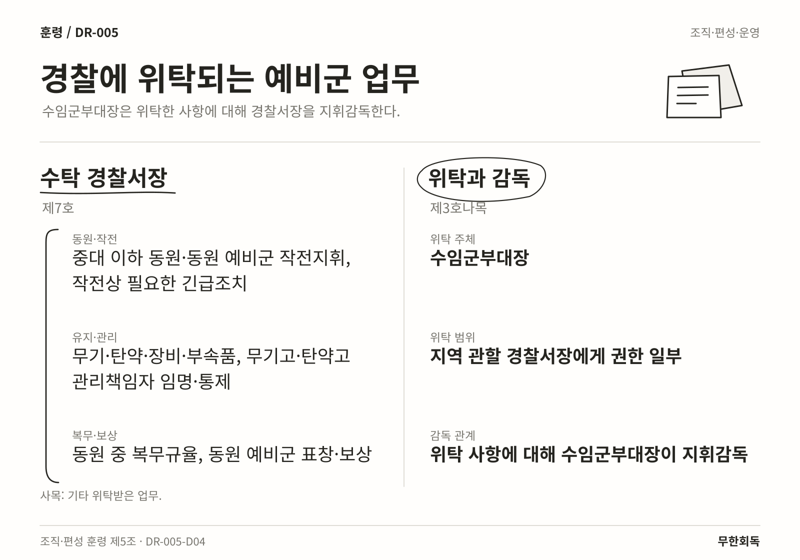
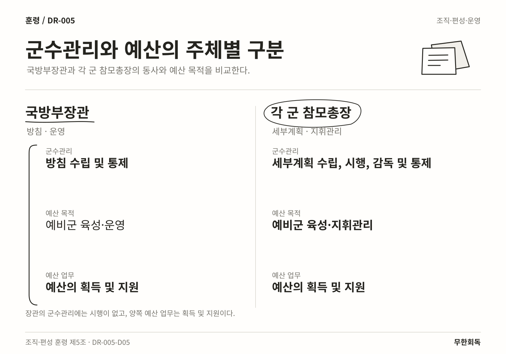
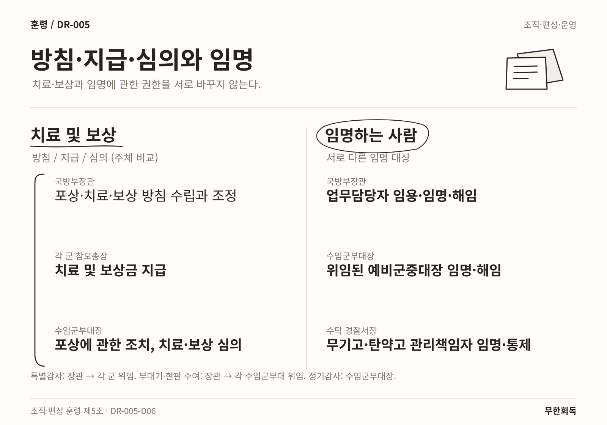
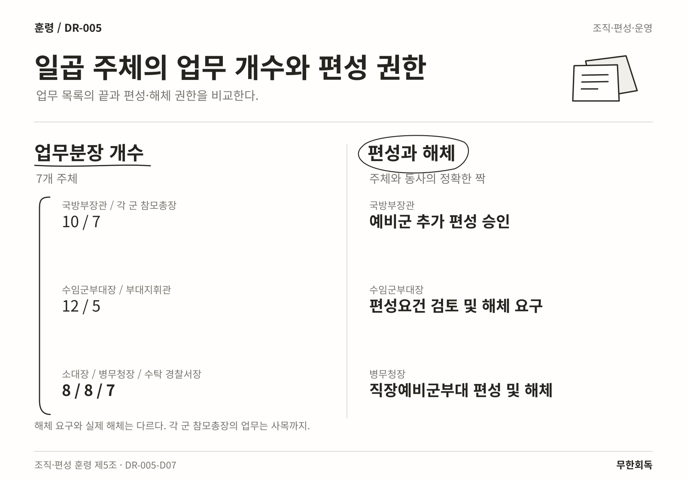

# DR-005 · 예비군 조직·편성과 운영에 관한 훈령 제5조, 예비군 조직·편성과 운영에 관한 업무분장

도식 **7장** · 1600 × 1120 · 흑백 편집형 디자인

[훈령 전체 목록](../../README.md) · [전체 매니페스트](../../diagrams-manifest.json)

## DR-005-D01 · 정책을 정하는 곳과 시행하는 곳

[WebP](DR-005-D01-editorial-v1.webp) · [PNG](DR-005-D01-editorial-v1.png) · [SVG 원본](DR-005-D01-editorial-v1.svg)

근거: [조직·편성 훈령 제5조](https://www.law.go.kr/LSW/admRulLsInfoP.do?admRulSeq=2100000268674#J5-0:0) · 국방부훈령 제3104호

## DR-005-D02 · 수임군부대장과 병무청장

[WebP](DR-005-D02-editorial-v1.webp) · [PNG](DR-005-D02-editorial-v1.png) · [SVG 원본](DR-005-D02-editorial-v1.svg)

근거: [조직·편성 훈령 제5조](https://www.law.go.kr/LSW/admRulLsInfoP.do?admRulSeq=2100000268674#J5-0:0) · 국방부훈령 제3104호

## DR-005-D03 · 부대지휘관과 소대장의 임무

[WebP](DR-005-D03-editorial-v1.webp) · [PNG](DR-005-D03-editorial-v1.png) · [SVG 원본](DR-005-D03-editorial-v1.svg)

근거: [조직·편성 훈령 제5조](https://www.law.go.kr/LSW/admRulLsInfoP.do?admRulSeq=2100000268674#J5-0:0) · 국방부훈령 제3104호

## DR-005-D04 · 경찰에 위탁되는 예비군 업무

[WebP](DR-005-D04-editorial-v1.webp) · [PNG](DR-005-D04-editorial-v1.png) · [SVG 원본](DR-005-D04-editorial-v1.svg)

근거: [조직·편성 훈령 제5조](https://www.law.go.kr/LSW/admRulLsInfoP.do?admRulSeq=2100000268674#J5-0:0) · 국방부훈령 제3104호

## DR-005-D05 · 군수관리와 예산의 주체별 구분

[WebP](DR-005-D05-editorial-v1.webp) · [PNG](DR-005-D05-editorial-v1.png) · [SVG 원본](DR-005-D05-editorial-v1.svg)

근거: [조직·편성 훈령 제5조](https://www.law.go.kr/LSW/admRulLsInfoP.do?admRulSeq=2100000268674#J5-0:0) · 국방부훈령 제3104호

## DR-005-D06 · 방침·지급·심의와 임명

[WebP](DR-005-D06-editorial-v1.webp) · [PNG](DR-005-D06-editorial-v1.png) · [SVG 원본](DR-005-D06-editorial-v1.svg)

근거: [조직·편성 훈령 제5조](https://www.law.go.kr/LSW/admRulLsInfoP.do?admRulSeq=2100000268674#J5-0:0) · 국방부훈령 제3104호

## DR-005-D07 · 일곱 주체의 업무 개수와 편성 권한

[WebP](DR-005-D07-editorial-v1.webp) · [PNG](DR-005-D07-editorial-v1.png) · [SVG 원본](DR-005-D07-editorial-v1.svg)

근거: [조직·편성 훈령 제5조](https://www.law.go.kr/LSW/admRulLsInfoP.do?admRulSeq=2100000268674#J5-0:0) · 국방부훈령 제3104호

## 제80회 스크립트 대조 기록 (2026-11-28)

- DR-005-D02, DR-005-D06: 공개 무손실 WebP 직접 검수 통과. PNG/WebP 픽셀 일치, 렌더 해시·레이아웃 검증 확인.
- 강의 전체 대조 상태: 추가 확인 필요 (상호 업무협조·전산명부/전송 및 명칭).
- [검수 기록](../../diagrams/production-queue.json) · [원고 기준](../../diagrams/SCRIPT-BASIS.md)
