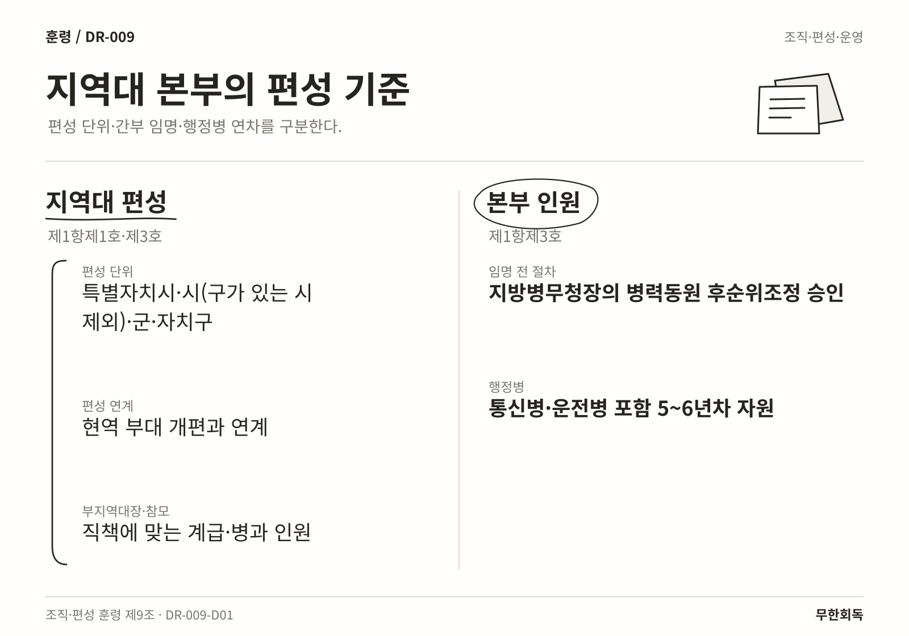
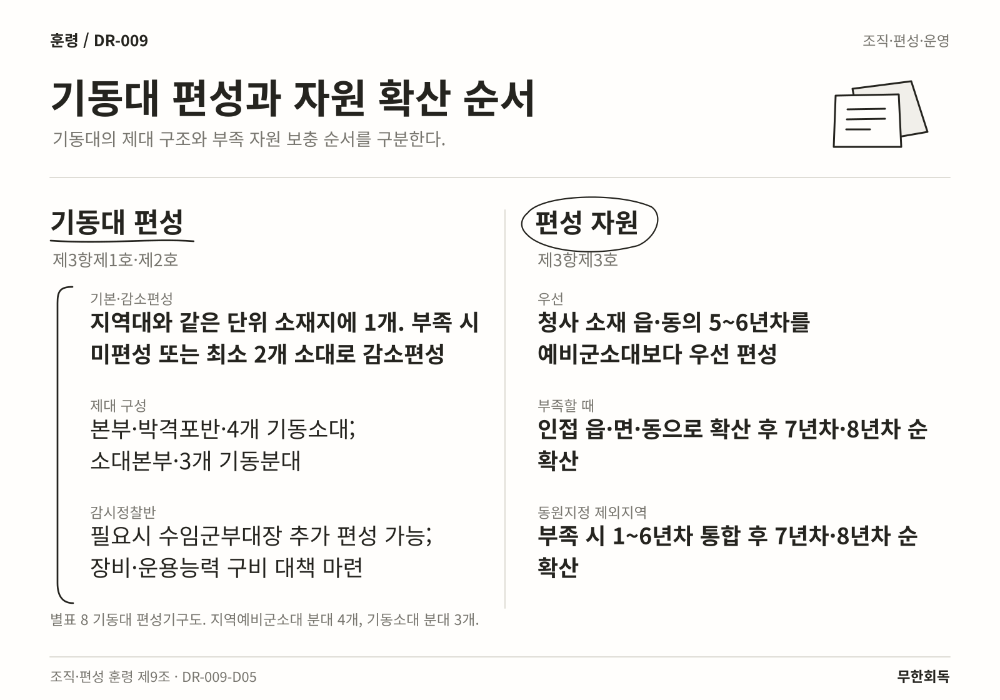

# DR-009 · 예비군 조직·편성과 운영에 관한 훈령 제9조, 편성방법

도식 **5장** · 1600 × 1120 · 흑백 편집형 디자인

[훈령 전체 목록](../../README.md) · [전체 매니페스트](../../diagrams-manifest.json)

## DR-009-D01 · 지역대 본부의 편성 기준

[WebP](DR-009-D01-editorial-v1.webp) · [PNG](DR-009-D01-editorial-v1.png) · [SVG 원본](DR-009-D01-editorial-v1.svg)

근거: [조직·편성 훈령 제9조](https://www.law.go.kr/LSW/admRulLsInfoP.do?admRulSeq=2100000268674#J9-0:0) · 국방부훈령 제3104호

## DR-009-D02 · 중대의 편성 단위와 구성

[WebP](DR-009-D02-editorial-v1.webp) · [PNG](DR-009-D02-editorial-v1.png) · [SVG 원본](DR-009-D02-editorial-v1.svg)

근거: [조직·편성 훈령 제9조](https://www.law.go.kr/LSW/admRulLsInfoP.do?admRulSeq=2100000268674#J9-0:0) · 국방부훈령 제3104호

## DR-009-D03 · 동원예비군소대와 보류자소대

[WebP](DR-009-D03-editorial-v1.webp) · [PNG](DR-009-D03-editorial-v1.png) · [SVG 원본](DR-009-D03-editorial-v1.svg)

근거: [조직·편성 훈령 제9조](https://www.law.go.kr/LSW/admRulLsInfoP.do?admRulSeq=2100000268674#J9-0:0) · 국방부훈령 제3104호

## DR-009-D04 · 지역예비군소대의 연차 구분

[WebP](DR-009-D04-editorial-v1.webp) · [PNG](DR-009-D04-editorial-v1.png) · [SVG 원본](DR-009-D04-editorial-v1.svg)

근거: [조직·편성 훈령 제9조](https://www.law.go.kr/LSW/admRulLsInfoP.do?admRulSeq=2100000268674#J9-0:0) · 국방부훈령 제3104호

## DR-009-D05 · 기동대 편성과 자원 확산 순서

[WebP](DR-009-D05-editorial-v1.webp) · [PNG](DR-009-D05-editorial-v1.png) · [SVG 원본](DR-009-D05-editorial-v1.svg)

근거: [조직·편성 훈령 제9조](https://www.law.go.kr/LSW/admRulLsInfoP.do?admRulSeq=2100000268674#J9-0:0) · 국방부훈령 제3104호
