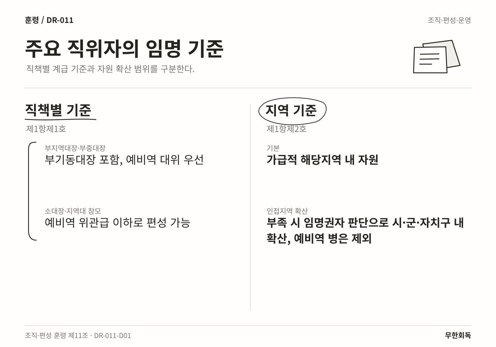
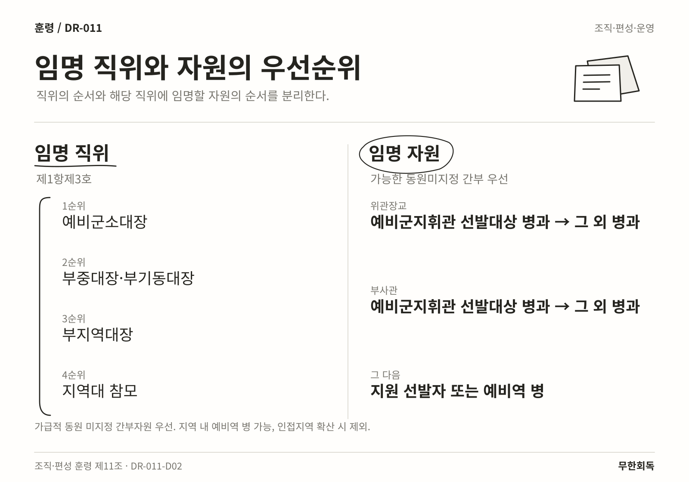
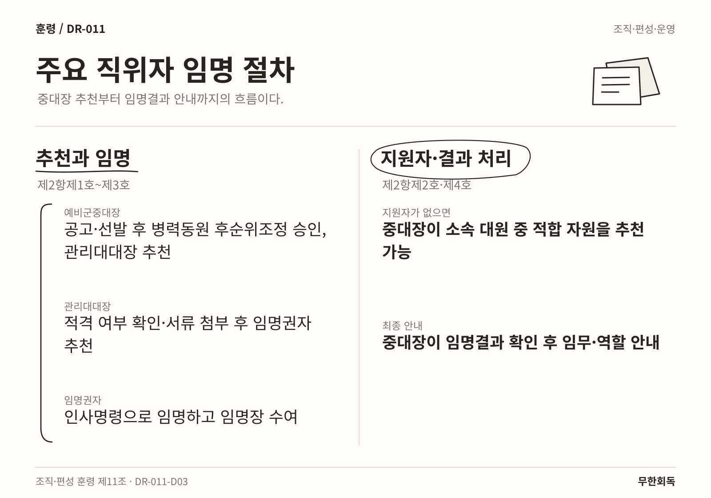
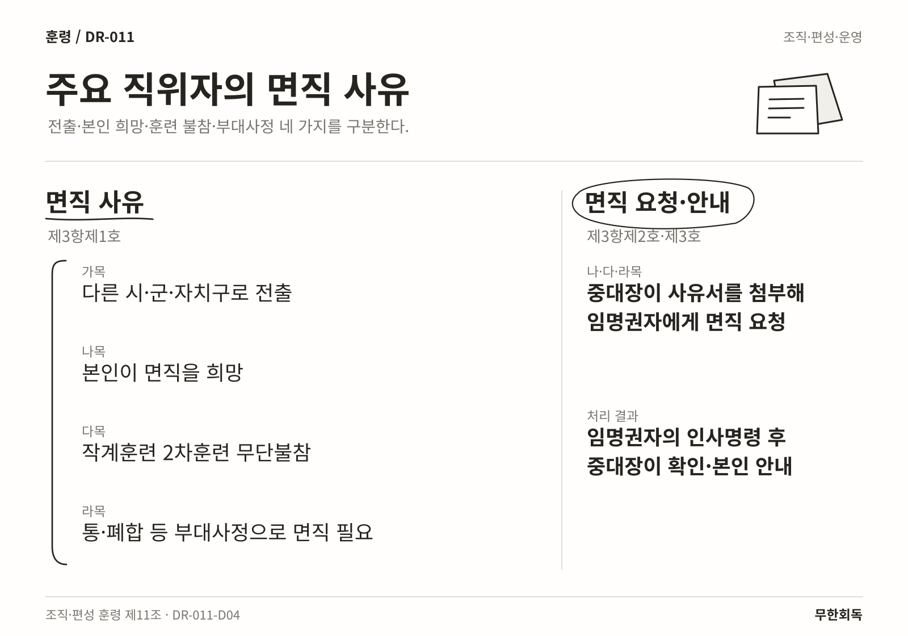
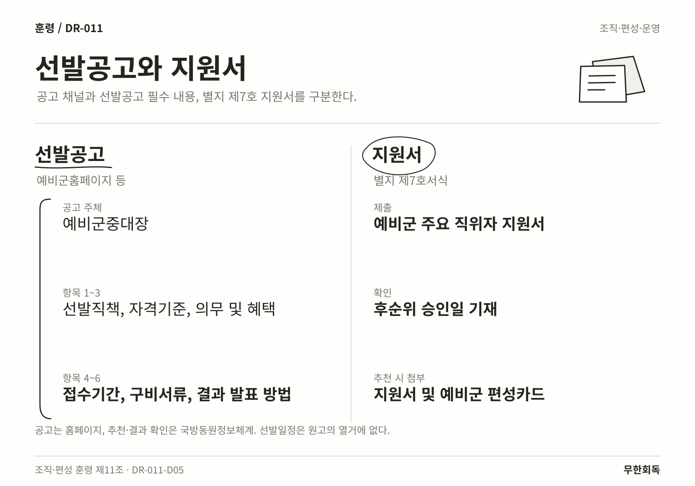

# DR-011 · 예비군 조직·편성과 운영에 관한 훈령 제11조, 예비군 주요 직위자 임명 및 면직

도식 **5장** · 1600 × 1120 · 흑백 편집형 디자인

[훈령 전체 목록](../../README.md) · [전체 매니페스트](../../diagrams-manifest.json)

## DR-011-D01 · 주요 직위자의 임명 기준

[WebP](DR-011-D01-editorial-v1.webp) · [PNG](DR-011-D01-editorial-v1.png) · [SVG 원본](DR-011-D01-editorial-v1.svg)

근거: [조직·편성 훈령 제11조](https://www.law.go.kr/LSW/admRulLsInfoP.do?admRulSeq=2100000268674#J11-0:0) · 국방부훈령 제3104호

## DR-011-D02 · 임명 직위와 자원의 우선순위

[WebP](DR-011-D02-editorial-v1.webp) · [PNG](DR-011-D02-editorial-v1.png) · [SVG 원본](DR-011-D02-editorial-v1.svg)

근거: [조직·편성 훈령 제11조](https://www.law.go.kr/LSW/admRulLsInfoP.do?admRulSeq=2100000268674#J11-0:0) · 국방부훈령 제3104호

## DR-011-D03 · 주요 직위자 임명 절차

[WebP](DR-011-D03-editorial-v1.webp) · [PNG](DR-011-D03-editorial-v1.png) · [SVG 원본](DR-011-D03-editorial-v1.svg)

근거: [조직·편성 훈령 제11조](https://www.law.go.kr/LSW/admRulLsInfoP.do?admRulSeq=2100000268674#J11-0:0) · 국방부훈령 제3104호

## DR-011-D04 · 주요 직위자의 면직 사유

[WebP](DR-011-D04-editorial-v1.webp) · [PNG](DR-011-D04-editorial-v1.png) · [SVG 원본](DR-011-D04-editorial-v1.svg)

근거: [조직·편성 훈령 제11조](https://www.law.go.kr/LSW/admRulLsInfoP.do?admRulSeq=2100000268674#J11-0:0) · 국방부훈령 제3104호

## DR-011-D05 · 선발공고와 지원서

[WebP](DR-011-D05-editorial-v1.webp) · [PNG](DR-011-D05-editorial-v1.png) · [SVG 원본](DR-011-D05-editorial-v1.svg)

근거: [조직·편성 훈령 제11조](https://www.law.go.kr/LSW/admRulLsInfoP.do?admRulSeq=2100000268674#J11-0:0) · 국방부훈령 제3104호

## 제80회 스크립트 대조 기록 (2026-11-28)

- DR-011-D05: 공개 무손실 WebP 직접 검수 통과. PNG/WebP 픽셀 일치, 렌더 해시·레이아웃 검증 확인.
- 강의 전체 대조 상태: 완료.
- [검수 기록](../../diagrams/production-queue.json) · [원고 기준](../../diagrams/SCRIPT-BASIS.md)
