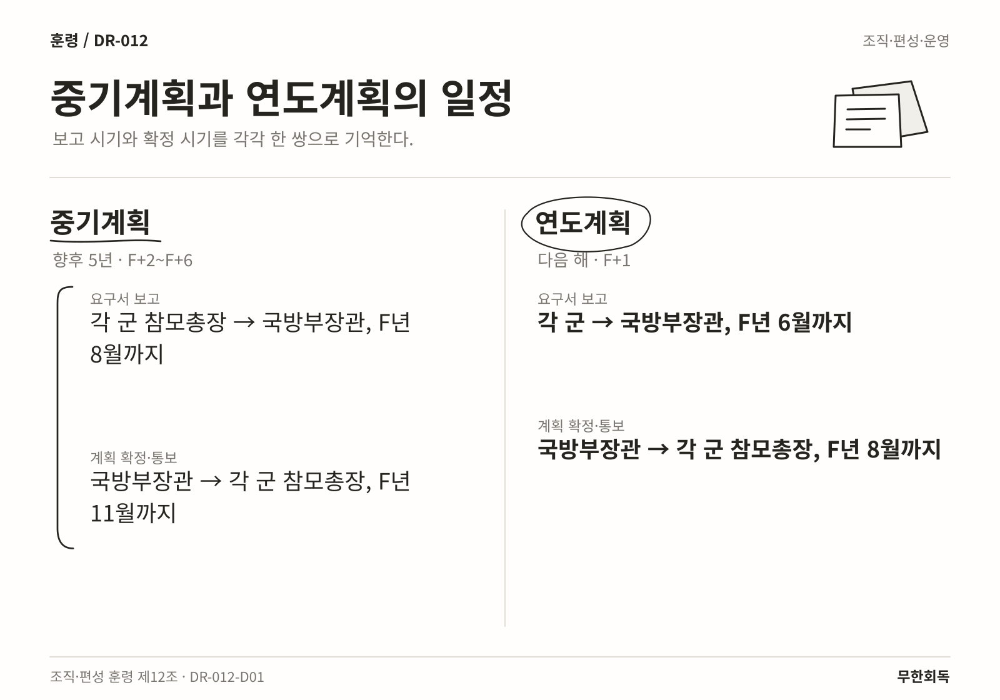
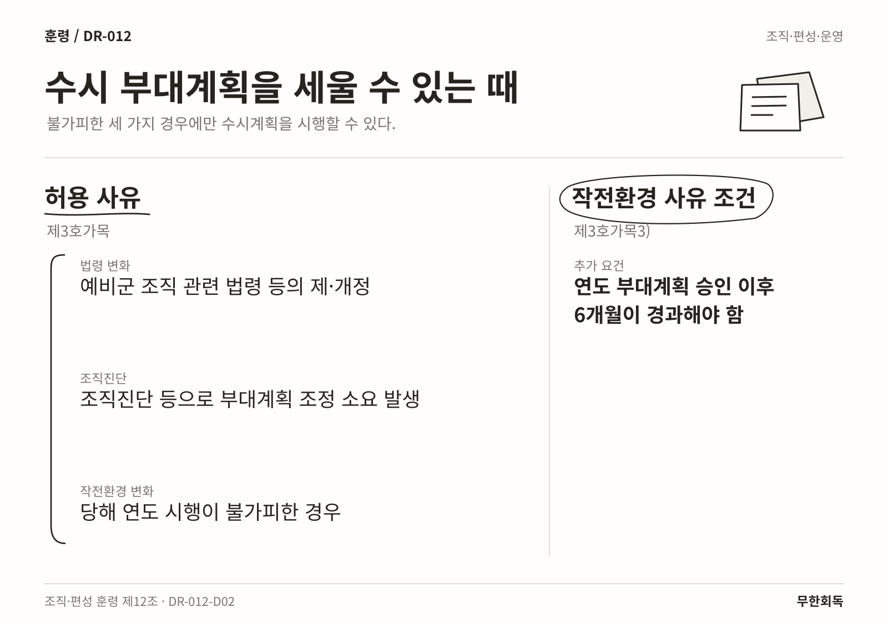
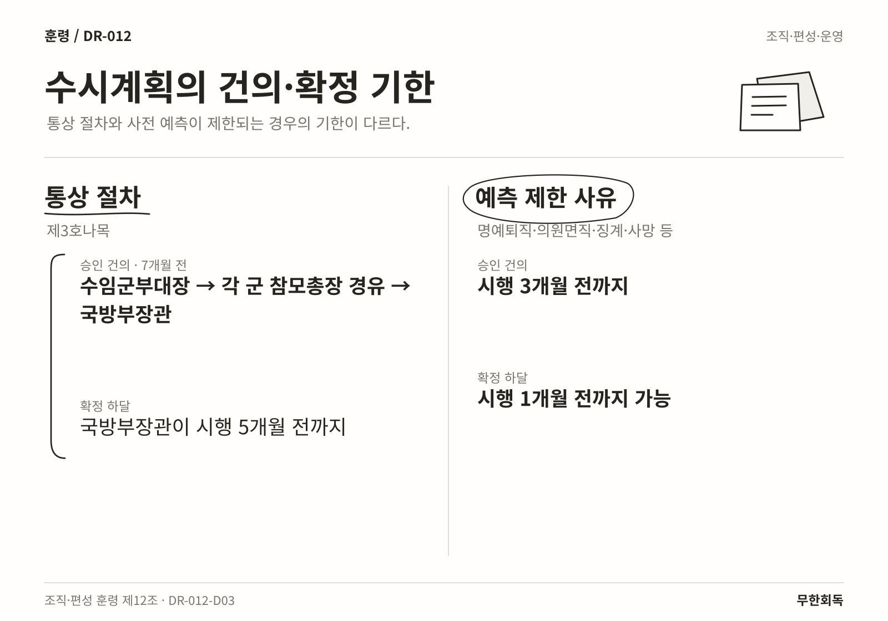
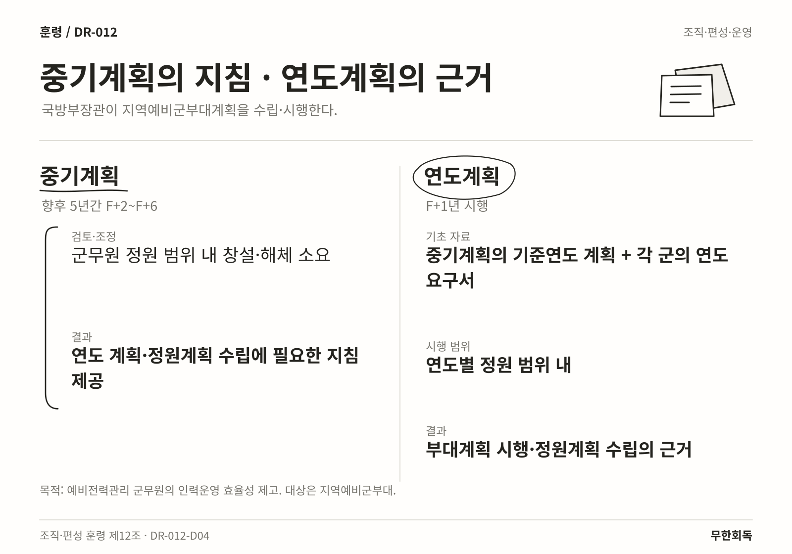
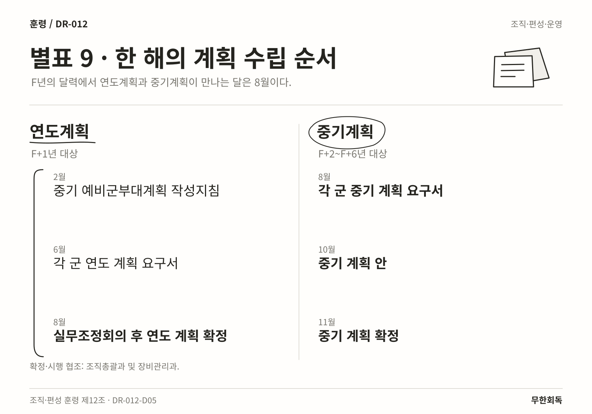

# DR-012 · 예비군 조직·편성과 운영에 관한 훈령 제12조, 지역예비군부대계획

도식 **5장** · 1600 × 1120 · 흑백 편집형 디자인

[훈령 전체 목록](../../README.md) · [전체 매니페스트](../../diagrams-manifest.json)

## DR-012-D01 · 중기계획과 연도계획의 일정

[WebP](DR-012-D01-editorial-v1.webp) · [PNG](DR-012-D01-editorial-v1.png) · [SVG 원본](DR-012-D01-editorial-v1.svg)

근거: [조직·편성 훈령 제12조](https://www.law.go.kr/LSW/admRulLsInfoP.do?admRulSeq=2100000268674#J12-0:0) · 국방부훈령 제3104호

## DR-012-D02 · 수시 부대계획을 세울 수 있는 때

[WebP](DR-012-D02-editorial-v1.webp) · [PNG](DR-012-D02-editorial-v1.png) · [SVG 원본](DR-012-D02-editorial-v1.svg)

근거: [조직·편성 훈령 제12조](https://www.law.go.kr/LSW/admRulLsInfoP.do?admRulSeq=2100000268674#J12-0:0) · 국방부훈령 제3104호

## DR-012-D03 · 수시계획의 건의·확정 기한

[WebP](DR-012-D03-editorial-v1.webp) · [PNG](DR-012-D03-editorial-v1.png) · [SVG 원본](DR-012-D03-editorial-v1.svg)

근거: [조직·편성 훈령 제12조](https://www.law.go.kr/LSW/admRulLsInfoP.do?admRulSeq=2100000268674#J12-0:0) · 국방부훈령 제3104호

## DR-012-D04 · 중기계획의 지침 · 연도계획의 근거

[WebP](DR-012-D04-editorial-v1.webp) · [PNG](DR-012-D04-editorial-v1.png) · [SVG 원본](DR-012-D04-editorial-v1.svg)

근거: [조직·편성 훈령 제12조](https://www.law.go.kr/LSW/admRulLsInfoP.do?admRulSeq=2100000268674#J12-0:0) · 국방부훈령 제3104호

## DR-012-D05 · 별표 9 · 한 해의 계획 수립 순서

[WebP](DR-012-D05-editorial-v1.webp) · [PNG](DR-012-D05-editorial-v1.png) · [SVG 원본](DR-012-D05-editorial-v1.svg)

근거: [조직·편성 훈령 제12조](https://www.law.go.kr/LSW/admRulLsInfoP.do?admRulSeq=2100000268674#J12-0:0) · 국방부훈령 제3104호

