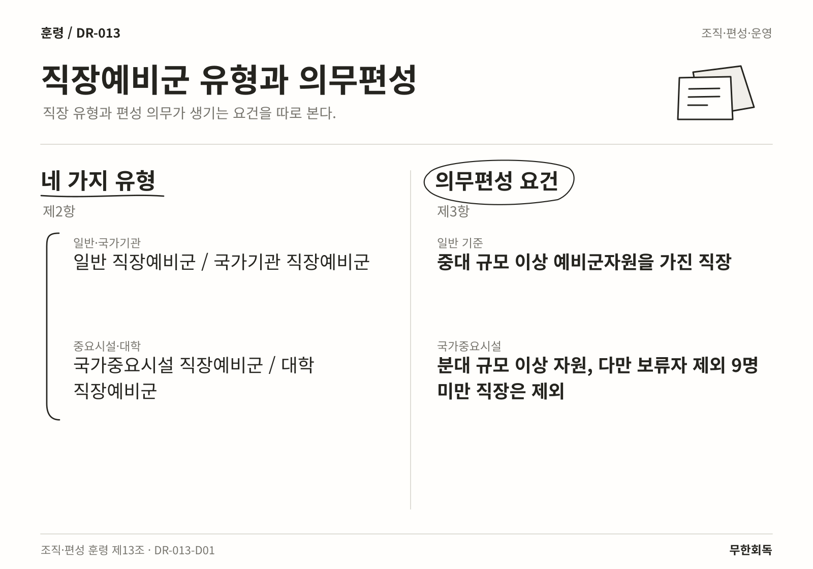
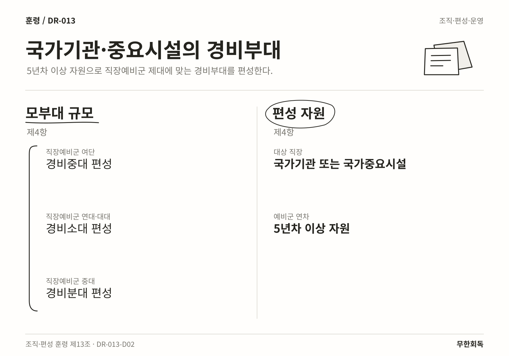
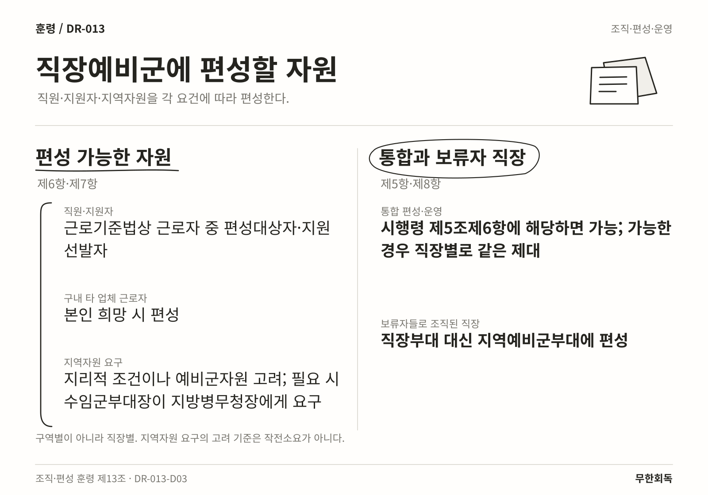
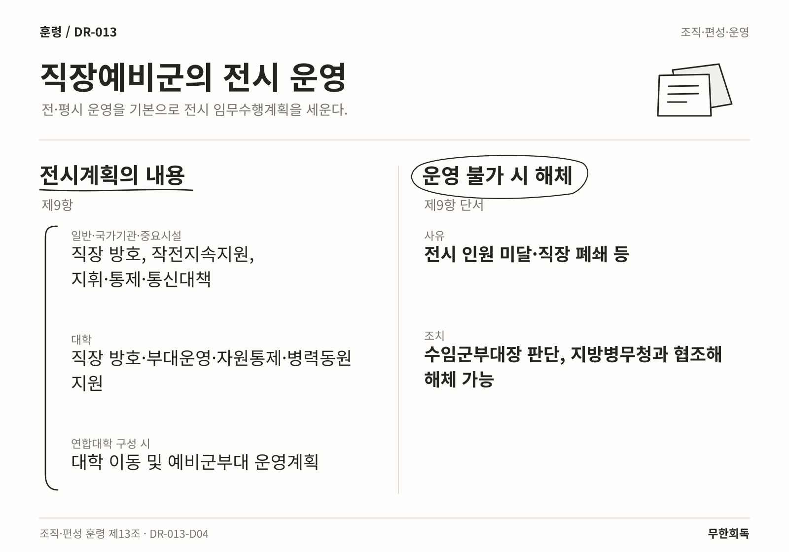
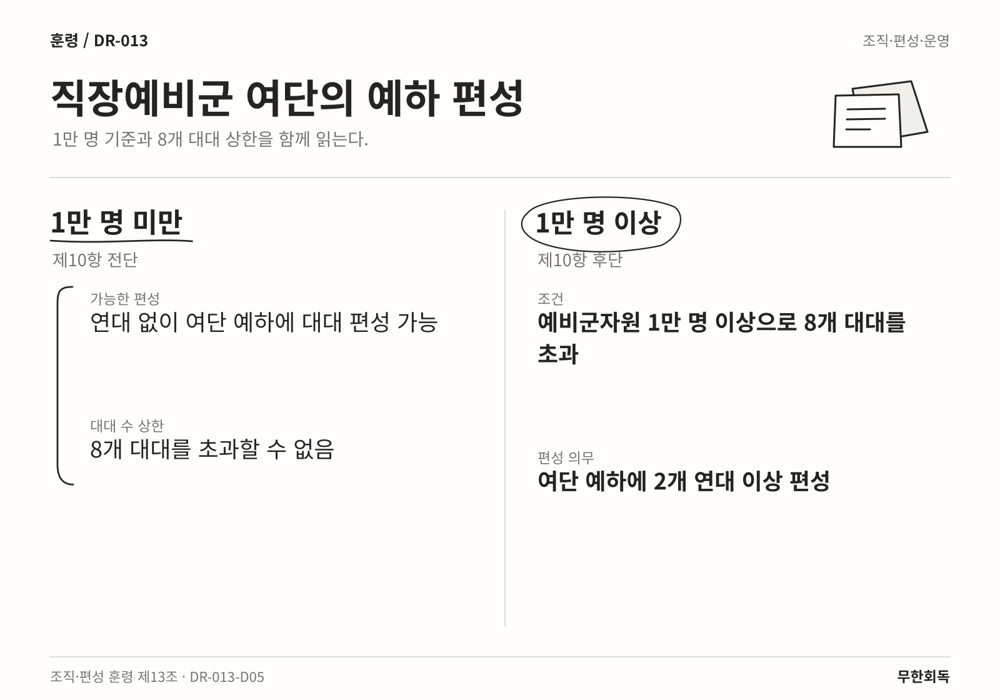
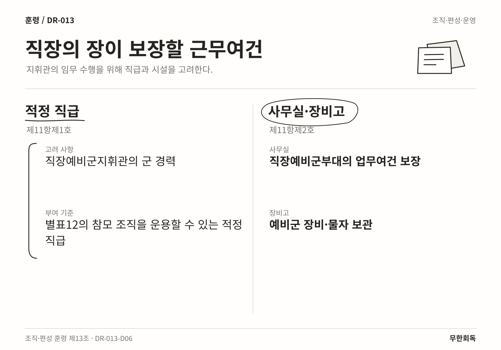

# DR-013 · 예비군 조직·편성과 운영에 관한 훈령 제13조, 편성원칙

도식 **6장** · 1600 × 1120 · 흑백 편집형 디자인

[훈령 전체 목록](../../README.md) · [전체 매니페스트](../../diagrams-manifest.json)

## DR-013-D01 · 직장예비군 유형과 의무편성

[WebP](DR-013-D01-editorial-v1.webp) · [PNG](DR-013-D01-editorial-v1.png) · [SVG 원본](DR-013-D01-editorial-v1.svg)

근거: [조직·편성 훈령 제13조](https://www.law.go.kr/LSW/admRulLsInfoP.do?admRulSeq=2100000268674#J13-0:0) · 국방부훈령 제3104호

## DR-013-D02 · 국가기관·중요시설의 경비부대

[WebP](DR-013-D02-editorial-v1.webp) · [PNG](DR-013-D02-editorial-v1.png) · [SVG 원본](DR-013-D02-editorial-v1.svg)

근거: [조직·편성 훈령 제13조](https://www.law.go.kr/LSW/admRulLsInfoP.do?admRulSeq=2100000268674#J13-0:0) · 국방부훈령 제3104호

## DR-013-D03 · 직장예비군에 편성할 자원

[WebP](DR-013-D03-editorial-v1.webp) · [PNG](DR-013-D03-editorial-v1.png) · [SVG 원본](DR-013-D03-editorial-v1.svg)

근거: [조직·편성 훈령 제13조](https://www.law.go.kr/LSW/admRulLsInfoP.do?admRulSeq=2100000268674#J13-0:0) · 국방부훈령 제3104호

## DR-013-D04 · 직장예비군의 전시 운영

[WebP](DR-013-D04-editorial-v1.webp) · [PNG](DR-013-D04-editorial-v1.png) · [SVG 원본](DR-013-D04-editorial-v1.svg)

근거: [조직·편성 훈령 제13조](https://www.law.go.kr/LSW/admRulLsInfoP.do?admRulSeq=2100000268674#J13-0:0) · 국방부훈령 제3104호

## DR-013-D05 · 직장예비군 여단의 예하 편성

[WebP](DR-013-D05-editorial-v1.webp) · [PNG](DR-013-D05-editorial-v1.png) · [SVG 원본](DR-013-D05-editorial-v1.svg)

근거: [조직·편성 훈령 제13조](https://www.law.go.kr/LSW/admRulLsInfoP.do?admRulSeq=2100000268674#J13-0:0) · 국방부훈령 제3104호

## DR-013-D06 · 직장의 장이 보장할 근무여건

[WebP](DR-013-D06-editorial-v1.webp) · [PNG](DR-013-D06-editorial-v1.png) · [SVG 원본](DR-013-D06-editorial-v1.svg)

근거: [조직·편성 훈령 제13조](https://www.law.go.kr/LSW/admRulLsInfoP.do?admRulSeq=2100000268674#J13-0:0) · 국방부훈령 제3104호
