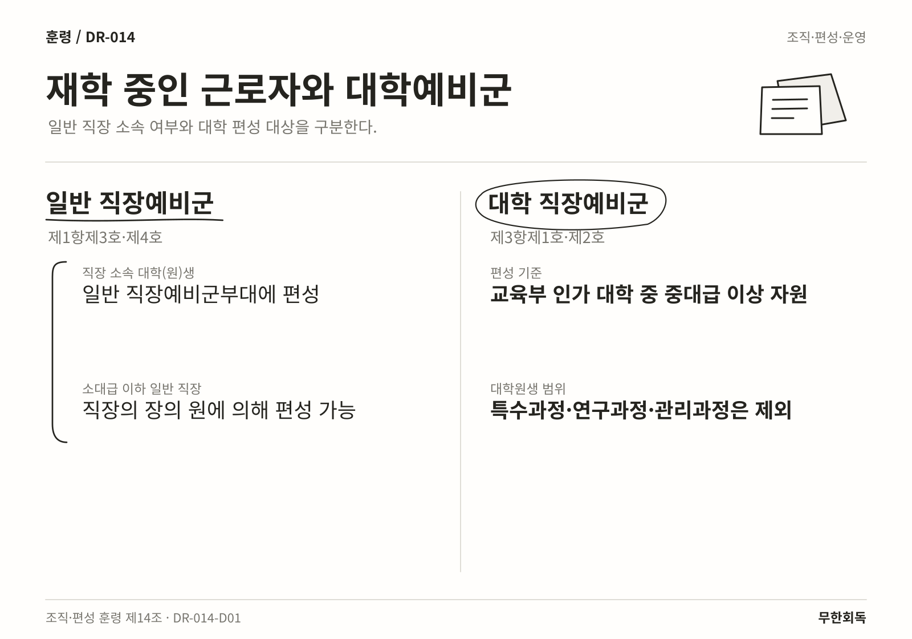
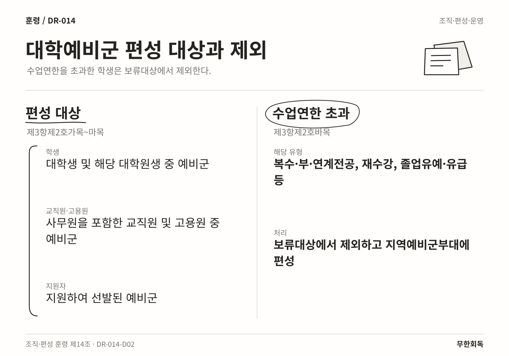
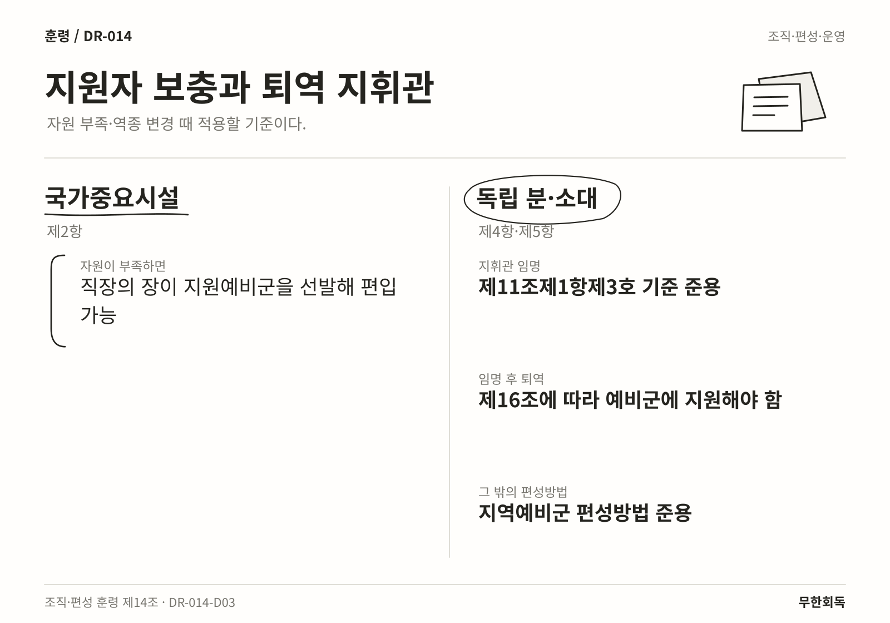

# DR-014 · 예비군 조직·편성과 운영에 관한 훈령 제14조, 편성방법

도식 **3장** · 1600 × 1120 · 흑백 편집형 디자인

[훈령 전체 목록](../../README.md) · [전체 매니페스트](../../diagrams-manifest.json)

## DR-014-D01 · 재학 중인 근로자와 대학예비군

[WebP](DR-014-D01-editorial-v1.webp) · [PNG](DR-014-D01-editorial-v1.png) · [SVG 원본](DR-014-D01-editorial-v1.svg)

근거: [조직·편성 훈령 제14조](https://www.law.go.kr/LSW/admRulLsInfoP.do?admRulSeq=2100000268674#J14-0:0) · 국방부훈령 제3104호

## DR-014-D02 · 대학예비군 편성 대상과 제외

[WebP](DR-014-D02-editorial-v1.webp) · [PNG](DR-014-D02-editorial-v1.png) · [SVG 원본](DR-014-D02-editorial-v1.svg)

근거: [조직·편성 훈령 제14조](https://www.law.go.kr/LSW/admRulLsInfoP.do?admRulSeq=2100000268674#J14-0:0) · 국방부훈령 제3104호

## DR-014-D03 · 지원자 보충과 퇴역 지휘관

[WebP](DR-014-D03-editorial-v1.webp) · [PNG](DR-014-D03-editorial-v1.png) · [SVG 원본](DR-014-D03-editorial-v1.svg)

근거: [조직·편성 훈령 제14조](https://www.law.go.kr/LSW/admRulLsInfoP.do?admRulSeq=2100000268674#J14-0:0) · 국방부훈령 제3104호
