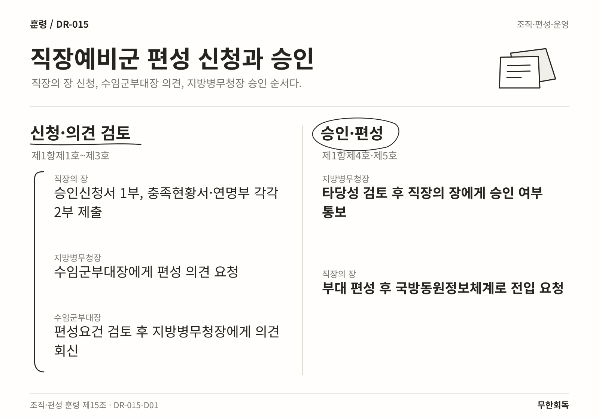
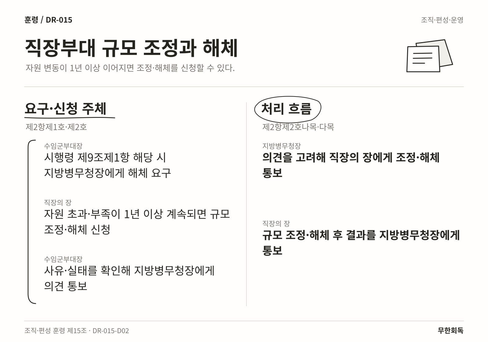
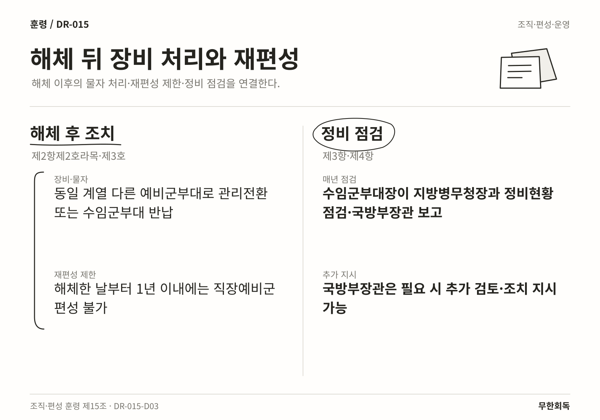

# DR-015 · 예비군 조직·편성과 운영에 관한 훈령 제15조, 편성 및 해체절차

도식 **3장** · 1600 × 1120 · 흑백 편집형 디자인

[훈령 전체 목록](../../README.md) · [전체 매니페스트](../../diagrams-manifest.json)

## DR-015-D01 · 직장예비군 편성 신청과 승인

[WebP](DR-015-D01-editorial-v1.webp) · [PNG](DR-015-D01-editorial-v1.png) · [SVG 원본](DR-015-D01-editorial-v1.svg)

근거: [조직·편성 훈령 제15조](https://www.law.go.kr/LSW/admRulLsInfoP.do?admRulSeq=2100000268674#J15-0:0) · 국방부훈령 제3104호

## DR-015-D02 · 직장부대 규모 조정과 해체

[WebP](DR-015-D02-editorial-v1.webp) · [PNG](DR-015-D02-editorial-v1.png) · [SVG 원본](DR-015-D02-editorial-v1.svg)

근거: [조직·편성 훈령 제15조](https://www.law.go.kr/LSW/admRulLsInfoP.do?admRulSeq=2100000268674#J15-0:0) · 국방부훈령 제3104호

## DR-015-D03 · 해체 뒤 장비 처리와 재편성

[WebP](DR-015-D03-editorial-v1.webp) · [PNG](DR-015-D03-editorial-v1.png) · [SVG 원본](DR-015-D03-editorial-v1.svg)

근거: [조직·편성 훈령 제15조](https://www.law.go.kr/LSW/admRulLsInfoP.do?admRulSeq=2100000268674#J15-0:0) · 국방부훈령 제3104호
