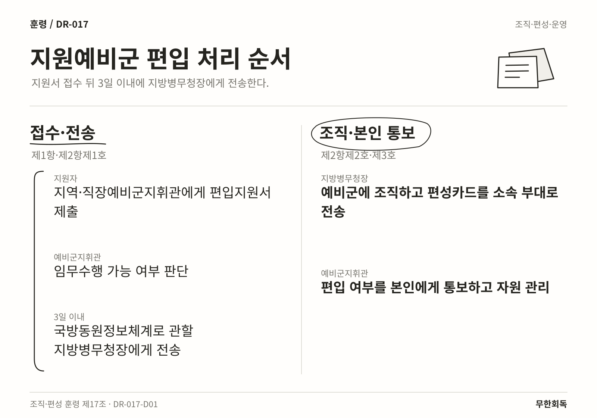
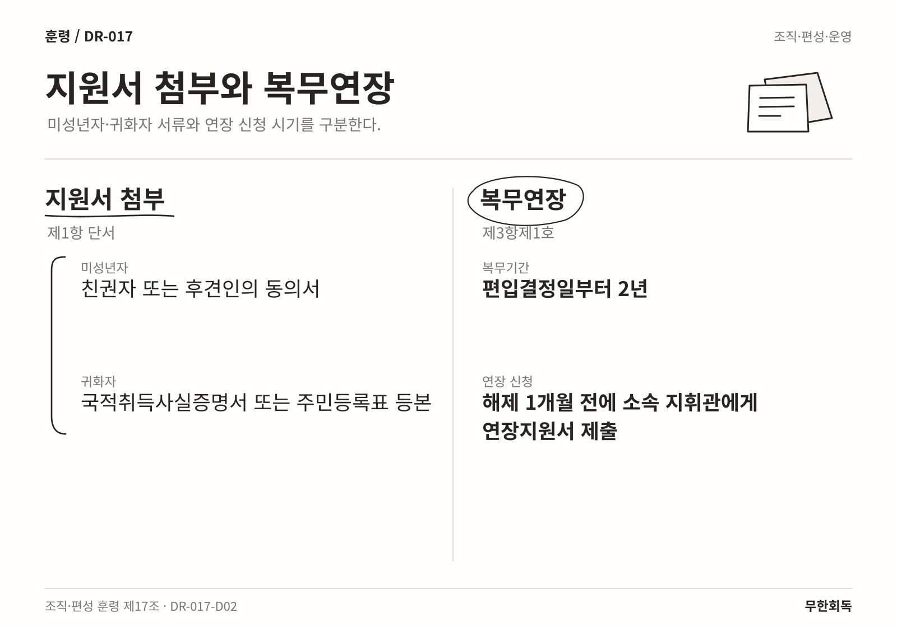
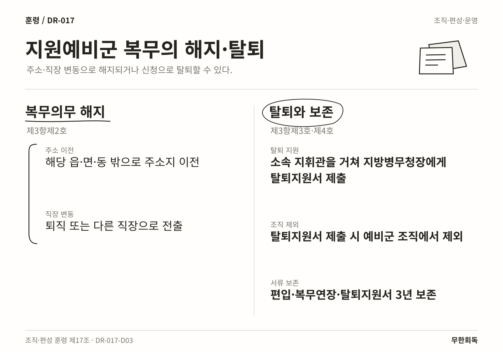

# DR-017 · 예비군 조직·편성과 운영에 관한 훈령 제17조, 지원방법 및 처리절차

도식 **3장** · 1600 × 1120 · 흑백 편집형 디자인

[훈령 전체 목록](../../README.md) · [전체 매니페스트](../../diagrams-manifest.json)

## DR-017-D01 · 지원예비군 편입 처리 순서

[WebP](DR-017-D01-editorial-v1.webp) · [PNG](DR-017-D01-editorial-v1.png) · [SVG 원본](DR-017-D01-editorial-v1.svg)

근거: [조직·편성 훈령 제17조](https://www.law.go.kr/LSW/admRulLsInfoP.do?admRulSeq=2100000268674#J17-0:0) · 국방부훈령 제3104호

## DR-017-D02 · 지원서 첨부와 복무연장

[WebP](DR-017-D02-editorial-v1.webp) · [PNG](DR-017-D02-editorial-v1.png) · [SVG 원본](DR-017-D02-editorial-v1.svg)

근거: [조직·편성 훈령 제17조](https://www.law.go.kr/LSW/admRulLsInfoP.do?admRulSeq=2100000268674#J17-0:0) · 국방부훈령 제3104호

## DR-017-D03 · 지원예비군 복무의 해지·탈퇴

[WebP](DR-017-D03-editorial-v1.webp) · [PNG](DR-017-D03-editorial-v1.png) · [SVG 원본](DR-017-D03-editorial-v1.svg)

근거: [조직·편성 훈령 제17조](https://www.law.go.kr/LSW/admRulLsInfoP.do?admRulSeq=2100000268674#J17-0:0) · 국방부훈령 제3104호
