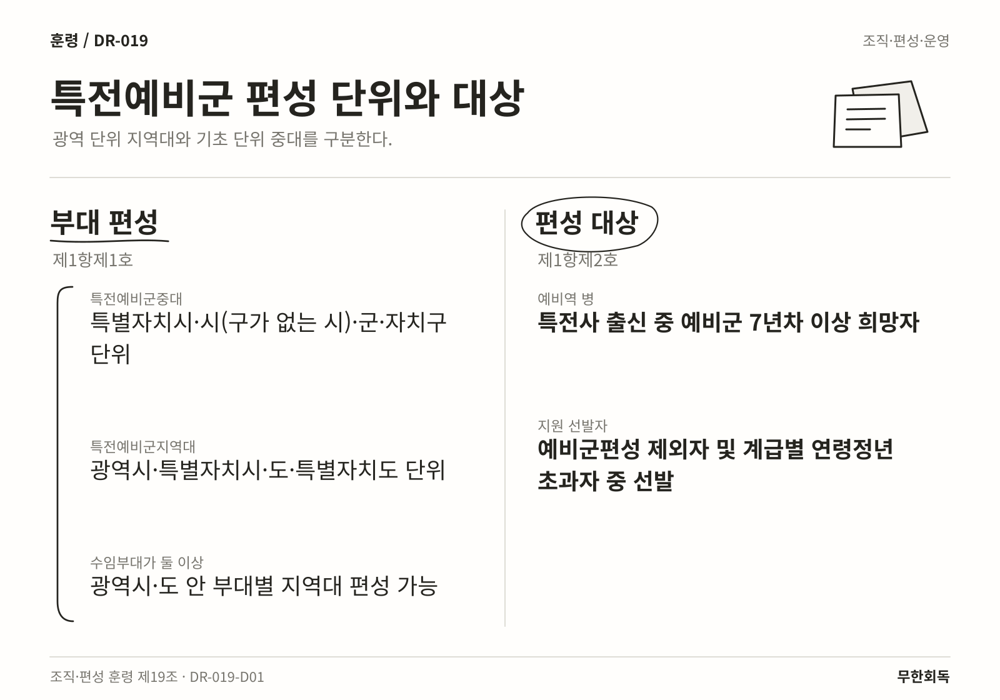
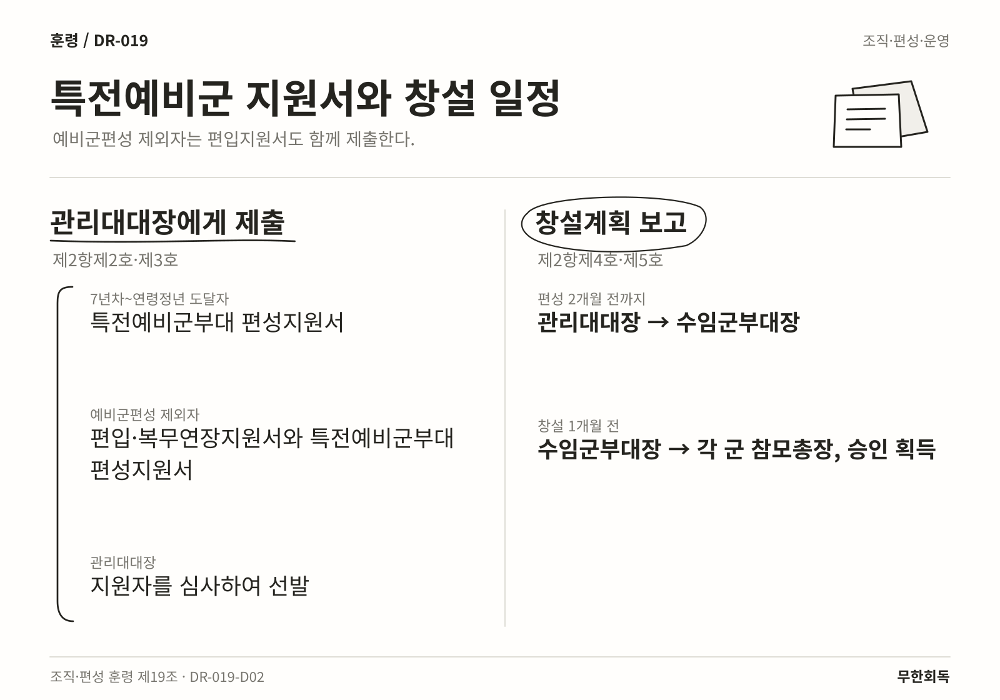
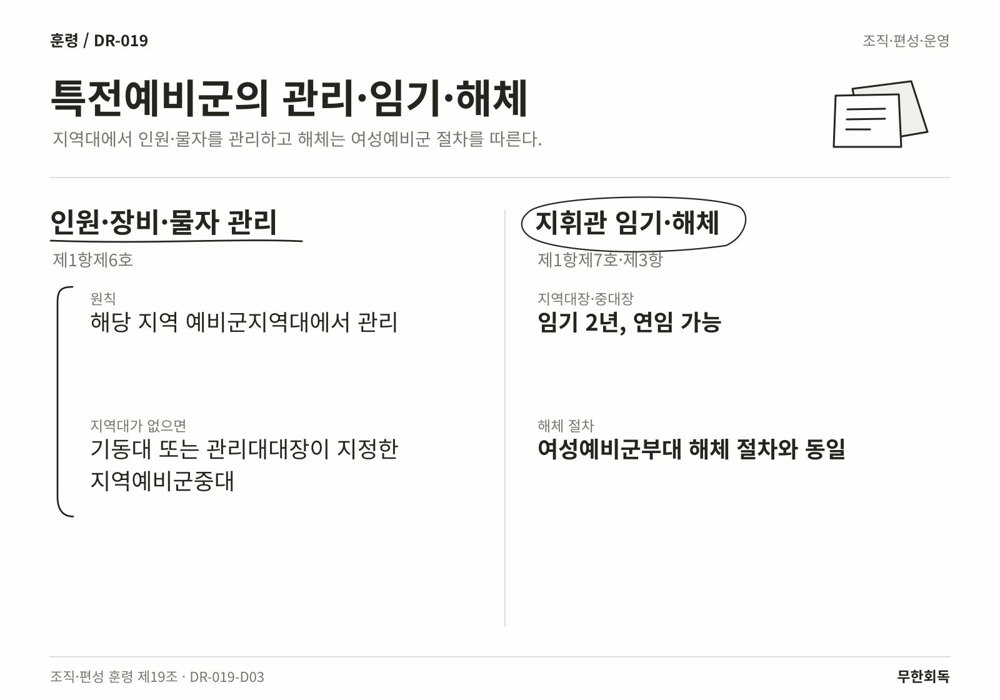

# DR-019 · 예비군 조직·편성과 운영에 관한 훈령 제19조, 특전예비군 편성

도식 **3장** · 1600 × 1120 · 흑백 편집형 디자인

[훈령 전체 목록](../../README.md) · [전체 매니페스트](../../diagrams-manifest.json)

## DR-019-D01 · 특전예비군 편성 단위와 대상

[WebP](DR-019-D01-editorial-v1.webp) · [PNG](DR-019-D01-editorial-v1.png) · [SVG 원본](DR-019-D01-editorial-v1.svg)

근거: [조직·편성 훈령 제19조](https://www.law.go.kr/LSW/admRulLsInfoP.do?admRulSeq=2100000268674#J19-0:0) · 국방부훈령 제3104호

## DR-019-D02 · 특전예비군 지원서와 창설 일정

[WebP](DR-019-D02-editorial-v1.webp) · [PNG](DR-019-D02-editorial-v1.png) · [SVG 원본](DR-019-D02-editorial-v1.svg)

근거: [조직·편성 훈령 제19조](https://www.law.go.kr/LSW/admRulLsInfoP.do?admRulSeq=2100000268674#J19-0:0) · 국방부훈령 제3104호

## DR-019-D03 · 특전예비군의 관리·임기·해체

[WebP](DR-019-D03-editorial-v1.webp) · [PNG](DR-019-D03-editorial-v1.png) · [SVG 원본](DR-019-D03-editorial-v1.svg)

근거: [조직·편성 훈령 제19조](https://www.law.go.kr/LSW/admRulLsInfoP.do?admRulSeq=2100000268674#J19-0:0) · 국방부훈령 제3104호
