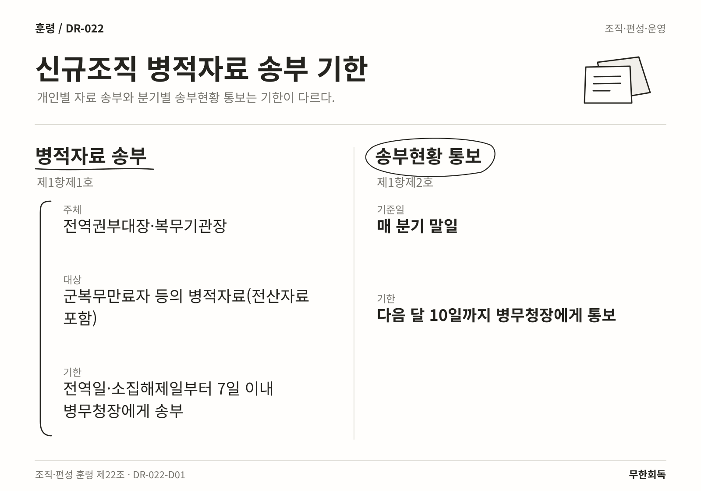
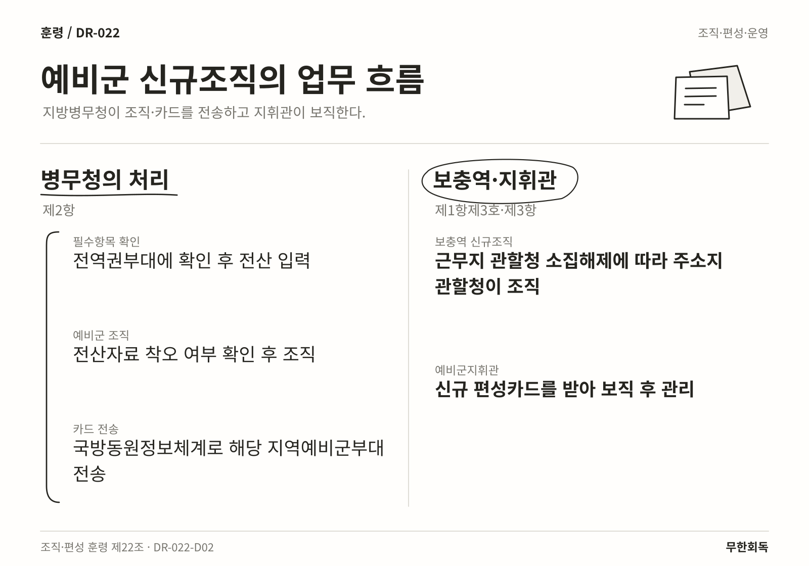

# DR-022 · 예비군 조직·편성과 운영에 관한 훈령 제22조, 예비군 신규조직 절차

도식 **2장** · 1600 × 1120 · 흑백 편집형 디자인

[훈령 전체 목록](../../README.md) · [전체 매니페스트](../../diagrams-manifest.json)

## DR-022-D01 · 신규조직 병적자료 송부 기한

[WebP](DR-022-D01-editorial-v1.webp) · [PNG](DR-022-D01-editorial-v1.png) · [SVG 원본](DR-022-D01-editorial-v1.svg)

근거: [조직·편성 훈령 제22조](https://www.law.go.kr/LSW/admRulLsInfoP.do?admRulSeq=2100000268674#J22-0:0) · 국방부훈령 제3104호

## DR-022-D02 · 예비군 신규조직의 업무 흐름

[WebP](DR-022-D02-editorial-v1.webp) · [PNG](DR-022-D02-editorial-v1.png) · [SVG 원본](DR-022-D02-editorial-v1.svg)

근거: [조직·편성 훈령 제22조](https://www.law.go.kr/LSW/admRulLsInfoP.do?admRulSeq=2100000268674#J22-0:0) · 국방부훈령 제3104호

