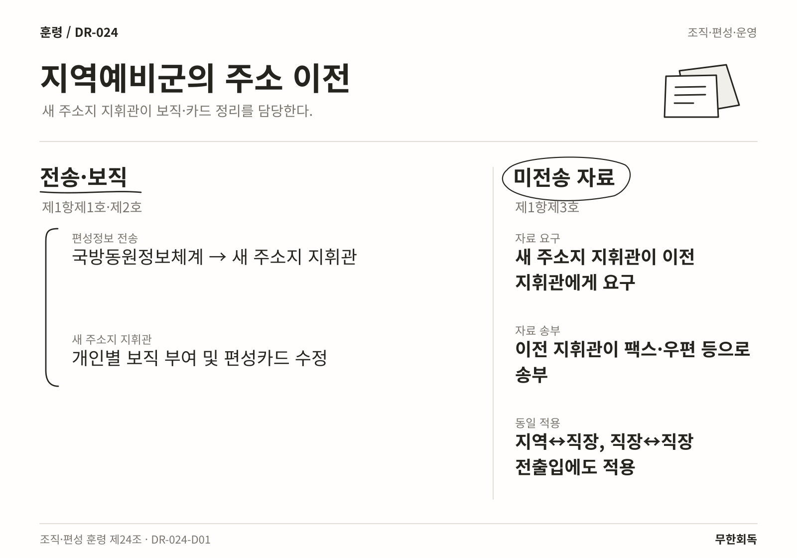
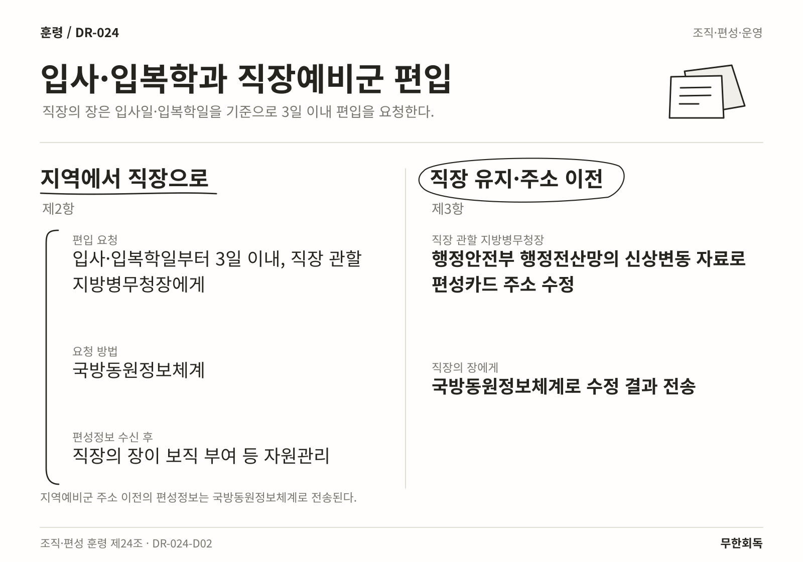
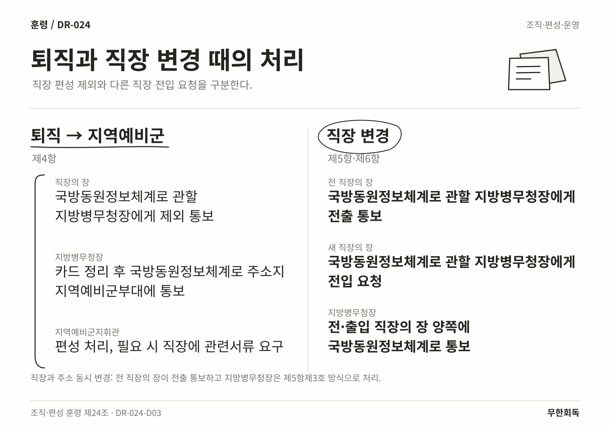
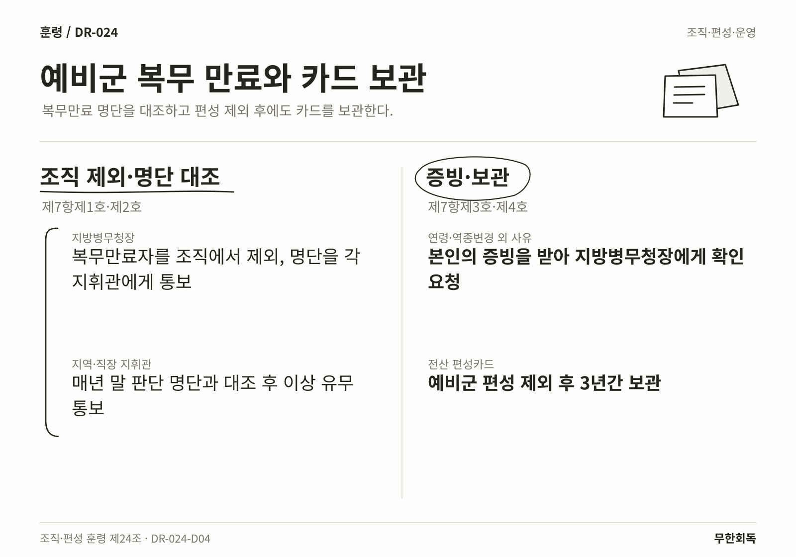
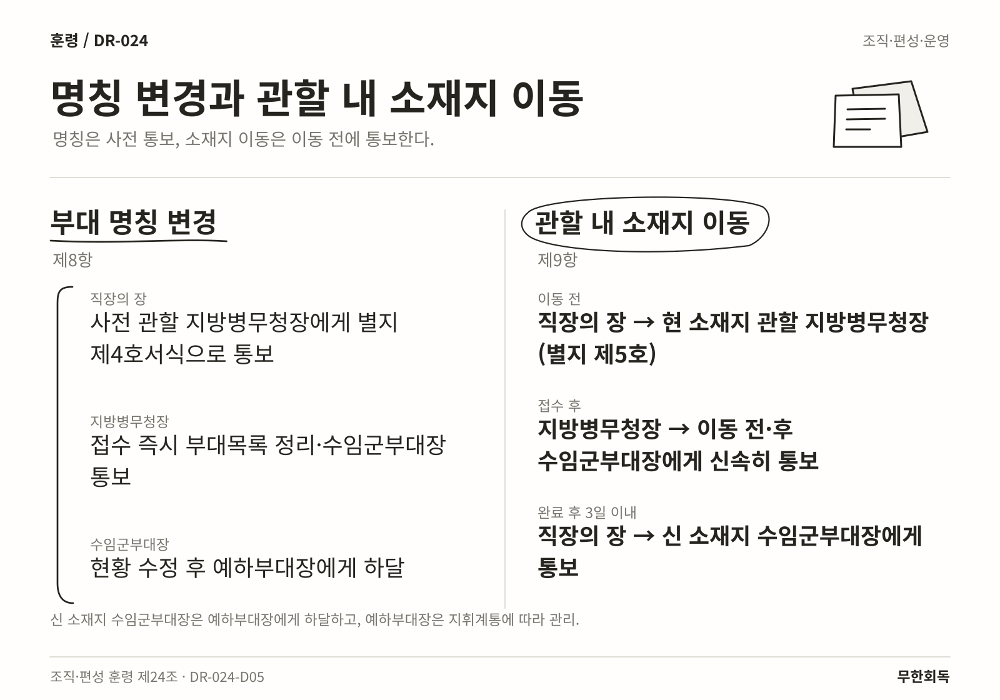
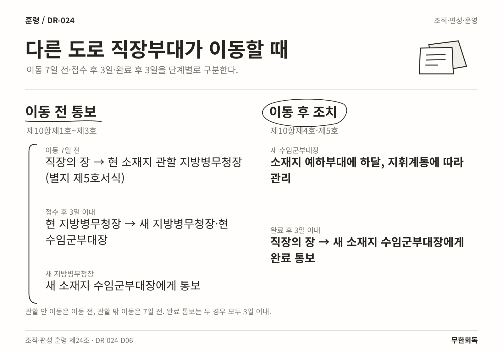

# DR-024 · 예비군 조직·편성과 운영에 관한 훈령 제24조, 전입 및 전출자 발생 시 조치절차

도식 **6장** · 1600 × 1120 · 흑백 편집형 디자인

[훈령 전체 목록](../../README.md) · [전체 매니페스트](../../diagrams-manifest.json)

## DR-024-D01 · 지역예비군의 주소 이전

[WebP](DR-024-D01-editorial-v1.webp) · [PNG](DR-024-D01-editorial-v1.png) · [SVG 원본](DR-024-D01-editorial-v1.svg)

근거: [조직·편성 훈령 제24조](https://www.law.go.kr/LSW/admRulLsInfoP.do?admRulSeq=2100000268674#J24-0:0) · 국방부훈령 제3104호

## DR-024-D02 · 입사·입복학과 직장예비군 편입

[WebP](DR-024-D02-editorial-v1.webp) · [PNG](DR-024-D02-editorial-v1.png) · [SVG 원본](DR-024-D02-editorial-v1.svg)

근거: [조직·편성 훈령 제24조](https://www.law.go.kr/LSW/admRulLsInfoP.do?admRulSeq=2100000268674#J24-0:0) · 국방부훈령 제3104호

## DR-024-D03 · 퇴직과 직장 변경 때의 처리

[WebP](DR-024-D03-editorial-v1.webp) · [PNG](DR-024-D03-editorial-v1.png) · [SVG 원본](DR-024-D03-editorial-v1.svg)

근거: [조직·편성 훈령 제24조](https://www.law.go.kr/LSW/admRulLsInfoP.do?admRulSeq=2100000268674#J24-0:0) · 국방부훈령 제3104호

## DR-024-D04 · 예비군 복무 만료와 카드 보관

[WebP](DR-024-D04-editorial-v1.webp) · [PNG](DR-024-D04-editorial-v1.png) · [SVG 원본](DR-024-D04-editorial-v1.svg)

근거: [조직·편성 훈령 제24조](https://www.law.go.kr/LSW/admRulLsInfoP.do?admRulSeq=2100000268674#J24-0:0) · 국방부훈령 제3104호

## DR-024-D05 · 명칭 변경과 관할 내 소재지 이동

[WebP](DR-024-D05-editorial-v1.webp) · [PNG](DR-024-D05-editorial-v1.png) · [SVG 원본](DR-024-D05-editorial-v1.svg)

근거: [조직·편성 훈령 제24조](https://www.law.go.kr/LSW/admRulLsInfoP.do?admRulSeq=2100000268674#J24-0:0) · 국방부훈령 제3104호

## DR-024-D06 · 다른 도로 직장부대가 이동할 때

[WebP](DR-024-D06-editorial-v1.webp) · [PNG](DR-024-D06-editorial-v1.png) · [SVG 원본](DR-024-D06-editorial-v1.svg)

근거: [조직·편성 훈령 제24조](https://www.law.go.kr/LSW/admRulLsInfoP.do?admRulSeq=2100000268674#J24-0:0) · 국방부훈령 제3104호
