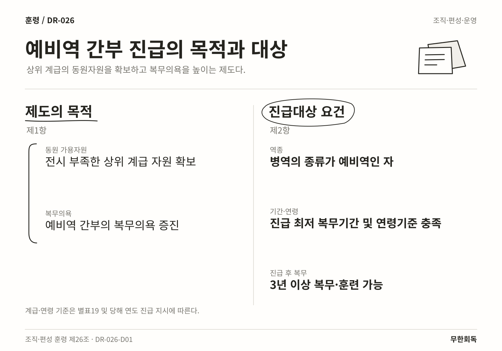
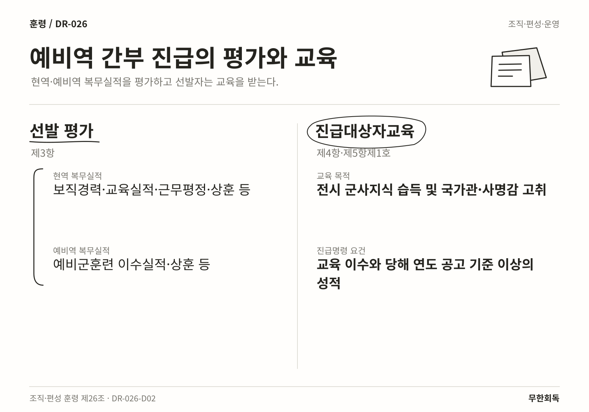
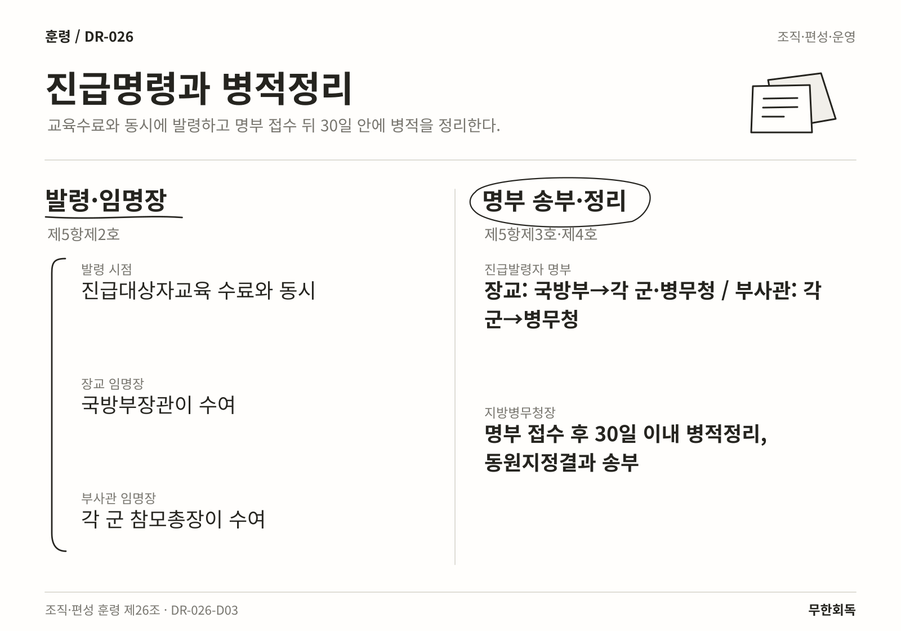
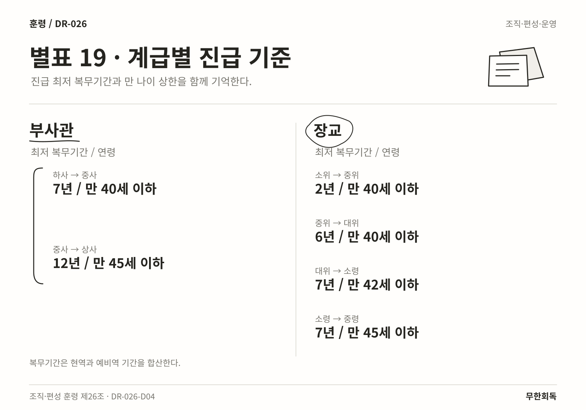
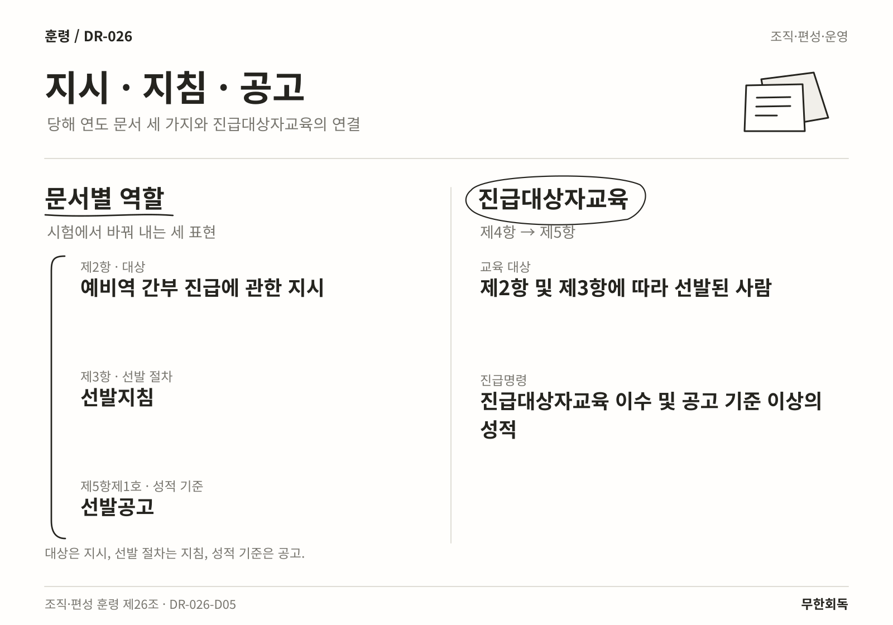

# DR-026 · 예비군 조직·편성과 운영에 관한 훈령 제26조, 예비역 간부 진급

도식 **5장** · 1600 × 1120 · 흑백 편집형 디자인

[훈령 전체 목록](../../README.md) · [전체 매니페스트](../../diagrams-manifest.json)

## DR-026-D01 · 예비역 간부 진급의 목적과 대상

[WebP](DR-026-D01-editorial-v1.webp) · [PNG](DR-026-D01-editorial-v1.png) · [SVG 원본](DR-026-D01-editorial-v1.svg)

근거: [조직·편성 훈령 제26조](https://www.law.go.kr/LSW/admRulLsInfoP.do?admRulSeq=2100000268674#J26-0:0) · 국방부훈령 제3104호

## DR-026-D02 · 예비역 간부 진급의 평가와 교육

[WebP](DR-026-D02-editorial-v1.webp) · [PNG](DR-026-D02-editorial-v1.png) · [SVG 원본](DR-026-D02-editorial-v1.svg)

근거: [조직·편성 훈령 제26조](https://www.law.go.kr/LSW/admRulLsInfoP.do?admRulSeq=2100000268674#J26-0:0) · 국방부훈령 제3104호

## DR-026-D03 · 진급명령과 병적정리

[WebP](DR-026-D03-editorial-v1.webp) · [PNG](DR-026-D03-editorial-v1.png) · [SVG 원본](DR-026-D03-editorial-v1.svg)

근거: [조직·편성 훈령 제26조](https://www.law.go.kr/LSW/admRulLsInfoP.do?admRulSeq=2100000268674#J26-0:0) · 국방부훈령 제3104호

## DR-026-D04 · 별표 19 · 계급별 진급 기준

[WebP](DR-026-D04-editorial-v1.webp) · [PNG](DR-026-D04-editorial-v1.png) · [SVG 원본](DR-026-D04-editorial-v1.svg)

근거: [조직·편성 훈령 제26조](https://www.law.go.kr/LSW/admRulLsInfoP.do?admRulSeq=2100000268674#J26-0:0) · 국방부훈령 제3104호

## DR-026-D05 · 지시 · 지침 · 공고

[WebP](DR-026-D05-editorial-v1.webp) · [PNG](DR-026-D05-editorial-v1.png) · [SVG 원본](DR-026-D05-editorial-v1.svg)

근거: [조직·편성 훈령 제26조](https://www.law.go.kr/LSW/admRulLsInfoP.do?admRulSeq=2100000268674#J26-0:0) · 국방부훈령 제3104호

제80회 원고 대조 완료 (2026-11-28): D03 최종 수정 이미지 검수 통과. [검수 기록](../../diagrams/script-alignment-qa.json).
