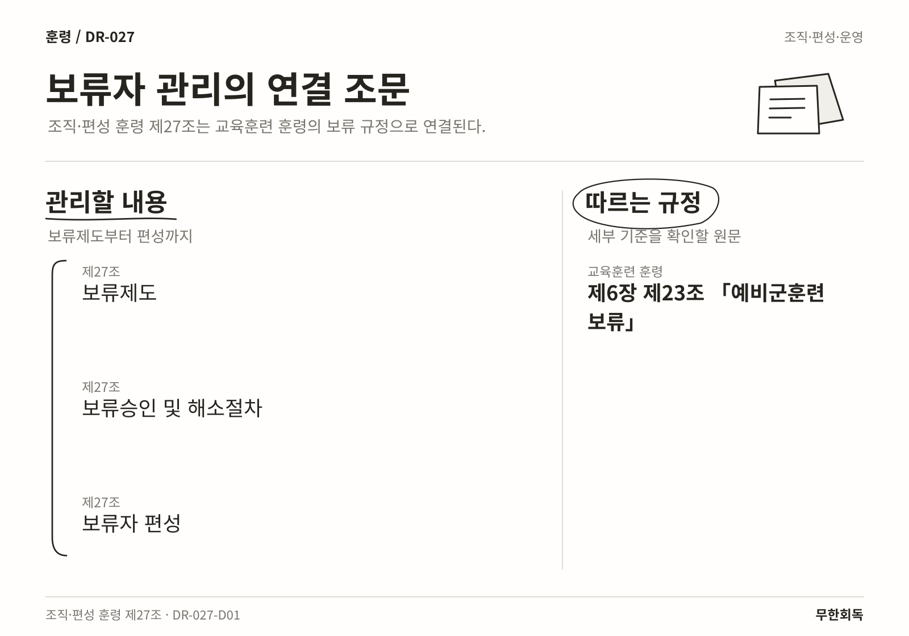

# DR-027 · 예비군 조직·편성과 운영에 관한 훈령 제27조, 예비군 보류자 관리

도식 **1장** · 1600 × 1120 · 흑백 편집형 디자인

[훈령 전체 목록](../../README.md) · [전체 매니페스트](../../diagrams-manifest.json)

## DR-027-D01 · 보류자 관리의 연결 조문

[WebP](DR-027-D01-editorial-v1.webp) · [PNG](DR-027-D01-editorial-v1.png) · [SVG 원본](DR-027-D01-editorial-v1.svg)

근거: [조직·편성 훈령 제27조](https://www.law.go.kr/LSW/admRulLsInfoP.do?admRulSeq=2100000268674#J27-0:0) · 국방부훈령 제3104호
