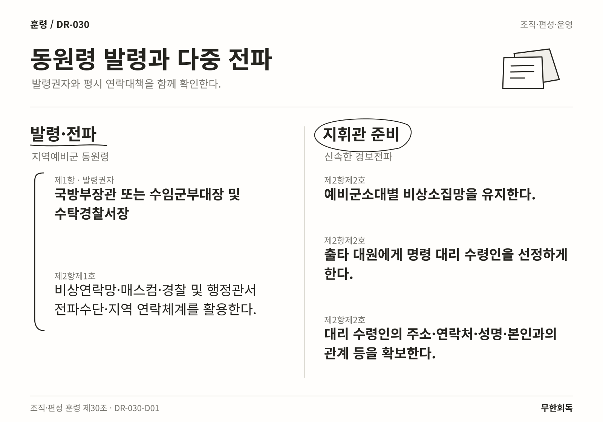
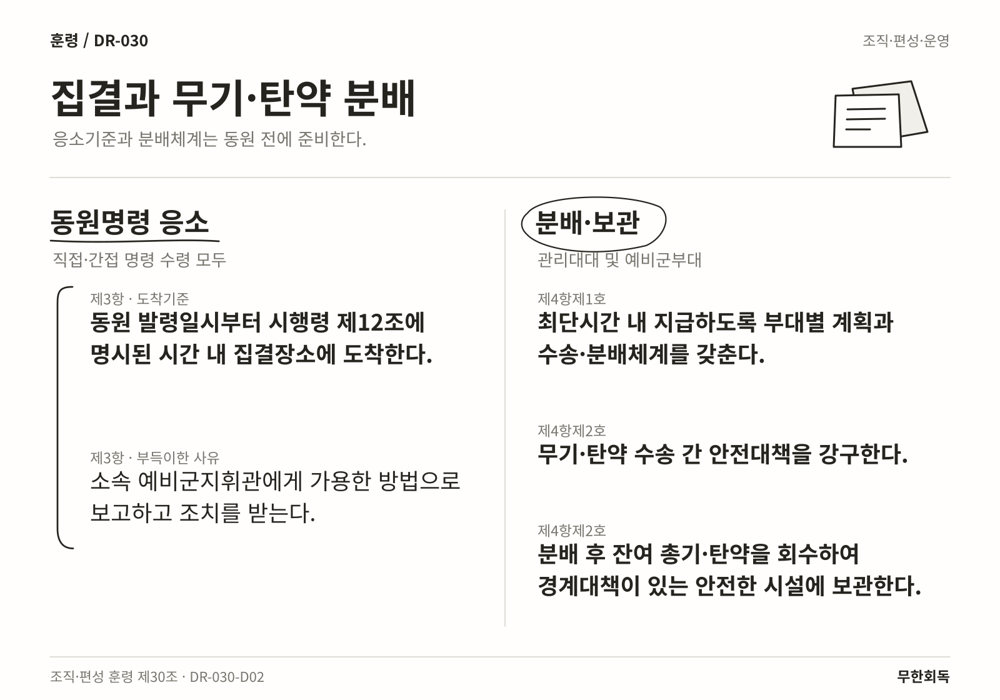
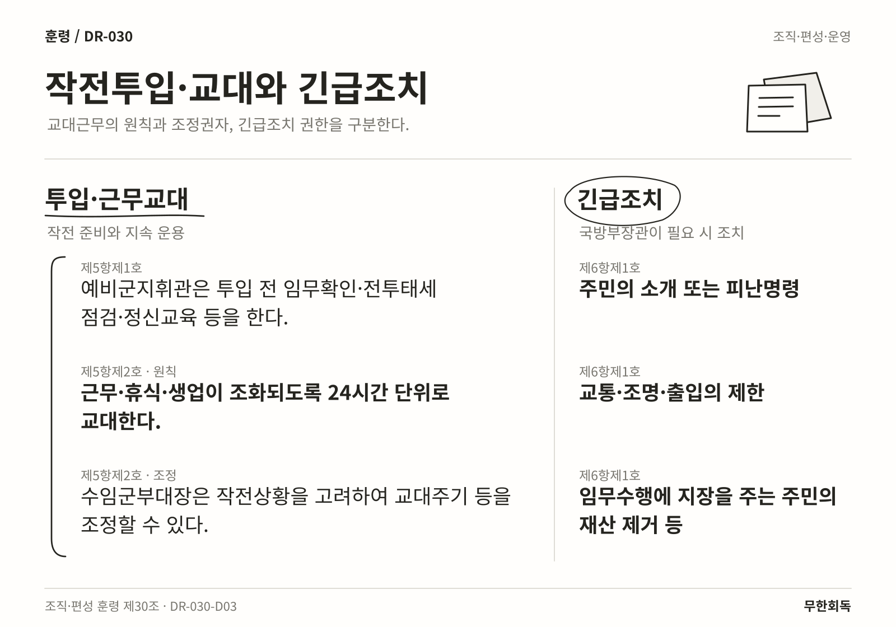
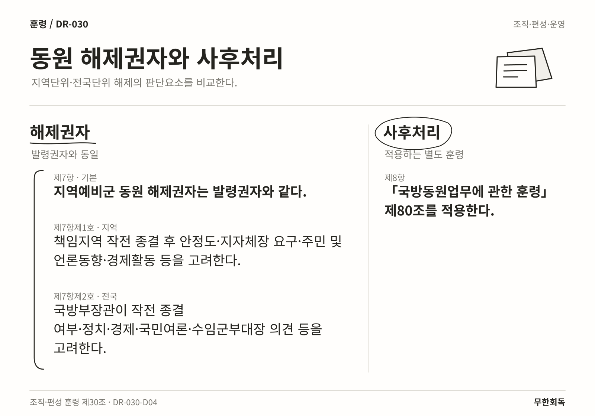

# DR-030 · 예비군 조직·편성과 운영에 관한 훈령 제30조, 동원체계

도식 **4장** · 1600 × 1120 · 흑백 편집형 디자인

[훈령 전체 목록](../../README.md) · [전체 매니페스트](../../diagrams-manifest.json)

## DR-030-D01 · 동원령 발령과 다중 전파

[WebP](DR-030-D01-editorial-v1.webp) · [PNG](DR-030-D01-editorial-v1.png) · [SVG 원본](DR-030-D01-editorial-v1.svg)

근거: [조직·편성 훈령 제30조](https://www.law.go.kr/LSW/admRulLsInfoP.do?admRulSeq=2100000268674#J30-0:0) · 국방부훈령 제3104호

## DR-030-D02 · 집결과 무기·탄약 분배

[WebP](DR-030-D02-editorial-v1.webp) · [PNG](DR-030-D02-editorial-v1.png) · [SVG 원본](DR-030-D02-editorial-v1.svg)

근거: [조직·편성 훈령 제30조](https://www.law.go.kr/LSW/admRulLsInfoP.do?admRulSeq=2100000268674#J30-0:0) · 국방부훈령 제3104호

## DR-030-D03 · 작전투입·교대와 긴급조치

[WebP](DR-030-D03-editorial-v1.webp) · [PNG](DR-030-D03-editorial-v1.png) · [SVG 원본](DR-030-D03-editorial-v1.svg)

근거: [조직·편성 훈령 제30조](https://www.law.go.kr/LSW/admRulLsInfoP.do?admRulSeq=2100000268674#J30-0:0) · 국방부훈령 제3104호

## DR-030-D04 · 동원 해제권자와 사후처리

[WebP](DR-030-D04-editorial-v1.webp) · [PNG](DR-030-D04-editorial-v1.png) · [SVG 원본](DR-030-D04-editorial-v1.svg)

근거: [조직·편성 훈령 제30조](https://www.law.go.kr/LSW/admRulLsInfoP.do?admRulSeq=2100000268674#J30-0:0) · 국방부훈령 제3104호

