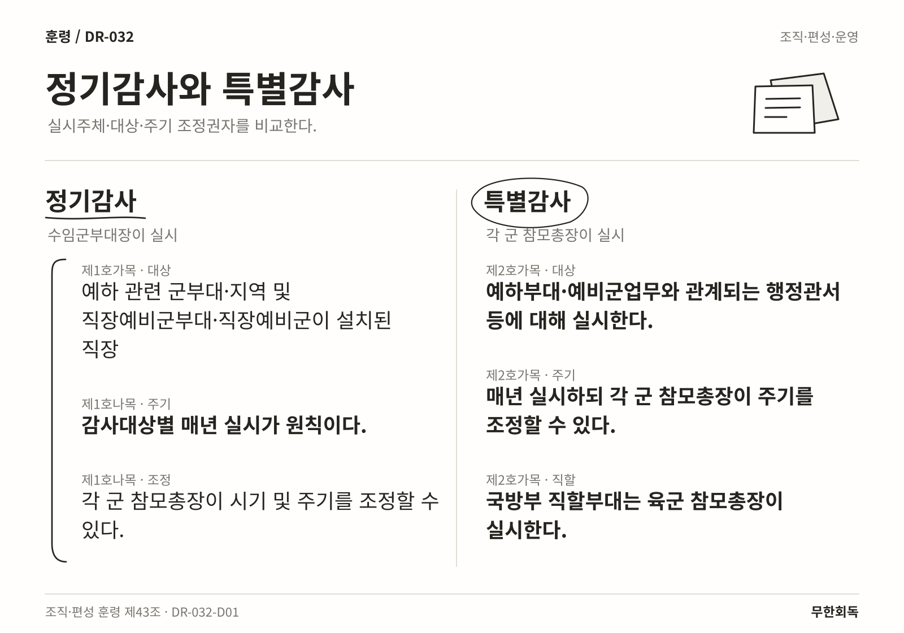
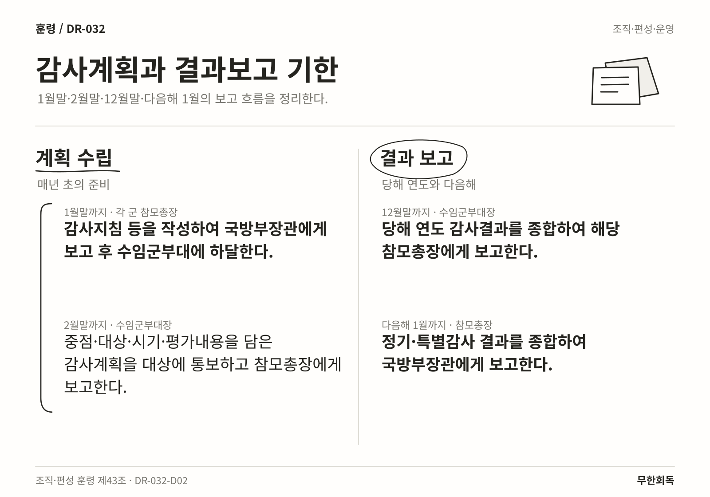
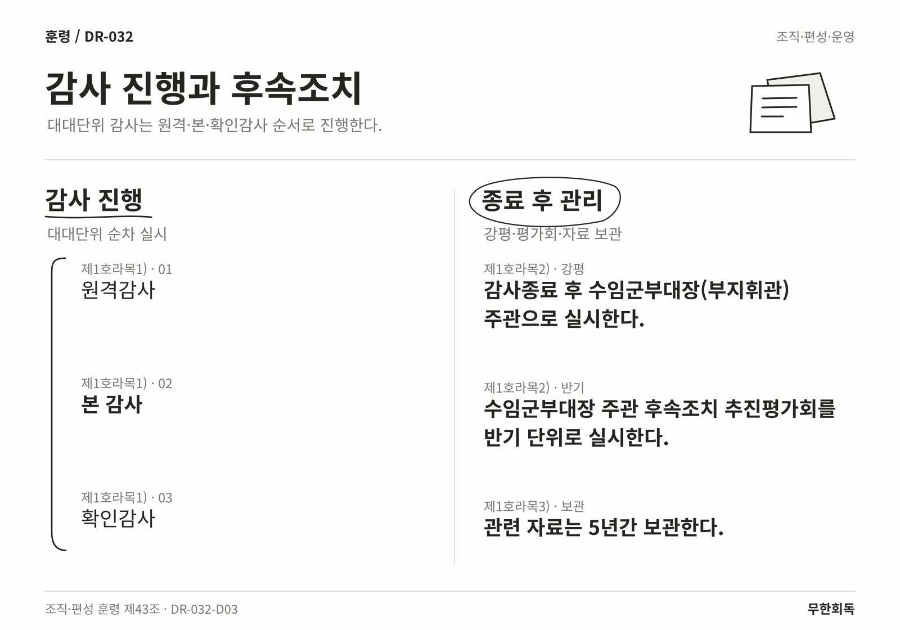

# DR-032 · 예비군 조직·편성과 운영에 관한 훈령 제43조, 예비군 감사

도식 **3장** · 1600 × 1120 · 흑백 편집형 디자인

[훈령 전체 목록](../../README.md) · [전체 매니페스트](../../diagrams-manifest.json)

## DR-032-D01 · 정기감사와 특별감사

[WebP](DR-032-D01-editorial-v1.webp) · [PNG](DR-032-D01-editorial-v1.png) · [SVG 원본](DR-032-D01-editorial-v1.svg)

근거: [조직·편성 훈령 제43조](https://www.law.go.kr/LSW/admRulLsInfoP.do?admRulSeq=2100000268674#J43-0:0) · 국방부훈령 제3104호

## DR-032-D02 · 감사계획과 결과보고 기한

[WebP](DR-032-D02-editorial-v1.webp) · [PNG](DR-032-D02-editorial-v1.png) · [SVG 원본](DR-032-D02-editorial-v1.svg)

근거: [조직·편성 훈령 제43조](https://www.law.go.kr/LSW/admRulLsInfoP.do?admRulSeq=2100000268674#J43-0:0) · 국방부훈령 제3104호

## DR-032-D03 · 감사 진행과 후속조치

[WebP](DR-032-D03-editorial-v1.webp) · [PNG](DR-032-D03-editorial-v1.png) · [SVG 원본](DR-032-D03-editorial-v1.svg)

근거: [조직·편성 훈령 제43조](https://www.law.go.kr/LSW/admRulLsInfoP.do?admRulSeq=2100000268674#J43-0:0) · 국방부훈령 제3104호
