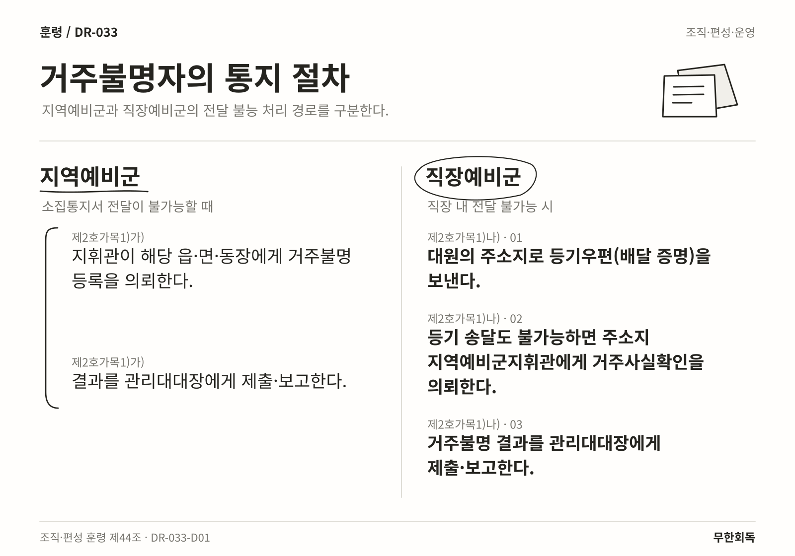
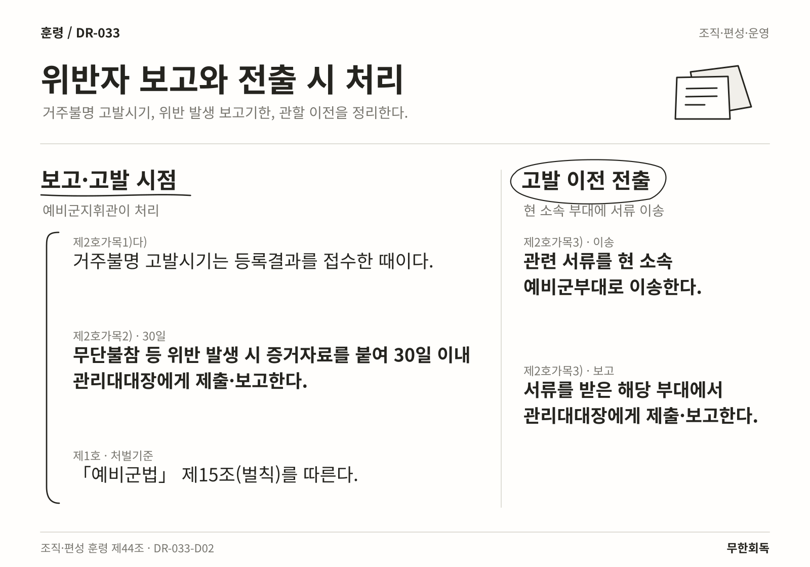
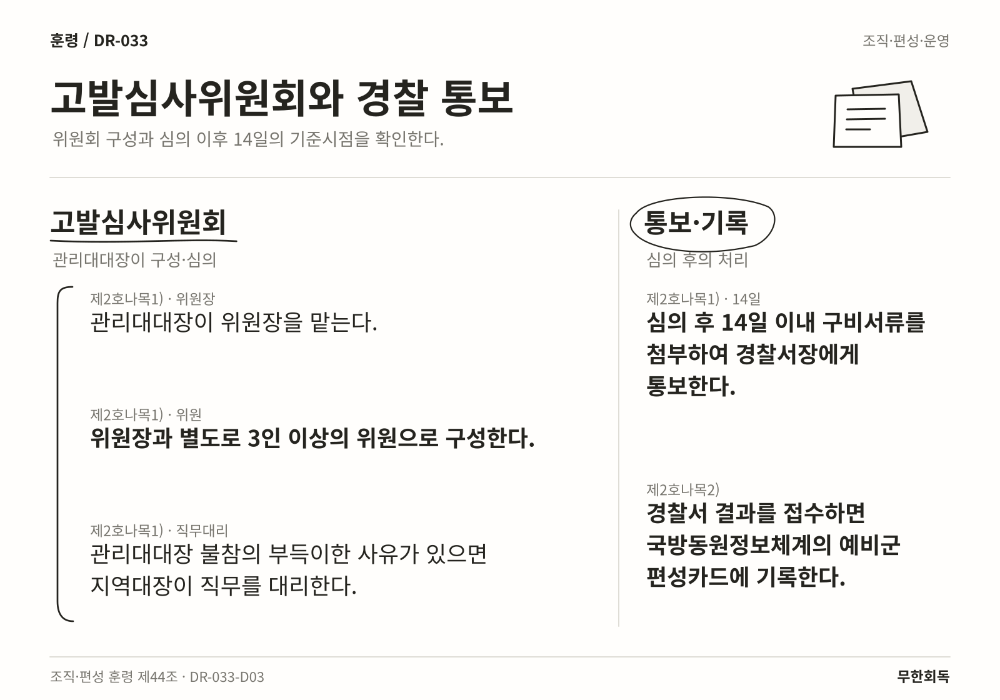

# DR-033 · 예비군 조직·편성과 운영에 관한 훈령 제44조, 예비군법 위반자 처리

도식 **3장** · 1600 × 1120 · 흑백 편집형 디자인

[훈령 전체 목록](../../README.md) · [전체 매니페스트](../../diagrams-manifest.json)

## DR-033-D01 · 거주불명자의 통지 절차

[WebP](DR-033-D01-editorial-v1.webp) · [PNG](DR-033-D01-editorial-v1.png) · [SVG 원본](DR-033-D01-editorial-v1.svg)

근거: [조직·편성 훈령 제44조](https://www.law.go.kr/LSW/admRulLsInfoP.do?admRulSeq=2100000268674#J44-0:0) · 국방부훈령 제3104호

## DR-033-D02 · 위반자 보고와 전출 시 처리

[WebP](DR-033-D02-editorial-v1.webp) · [PNG](DR-033-D02-editorial-v1.png) · [SVG 원본](DR-033-D02-editorial-v1.svg)

근거: [조직·편성 훈령 제44조](https://www.law.go.kr/LSW/admRulLsInfoP.do?admRulSeq=2100000268674#J44-0:0) · 국방부훈령 제3104호

## DR-033-D03 · 고발심사위원회와 경찰 통보

[WebP](DR-033-D03-editorial-v1.webp) · [PNG](DR-033-D03-editorial-v1.png) · [SVG 원본](DR-033-D03-editorial-v1.svg)

근거: [조직·편성 훈령 제44조](https://www.law.go.kr/LSW/admRulLsInfoP.do?admRulSeq=2100000268674#J44-0:0) · 국방부훈령 제3104호
