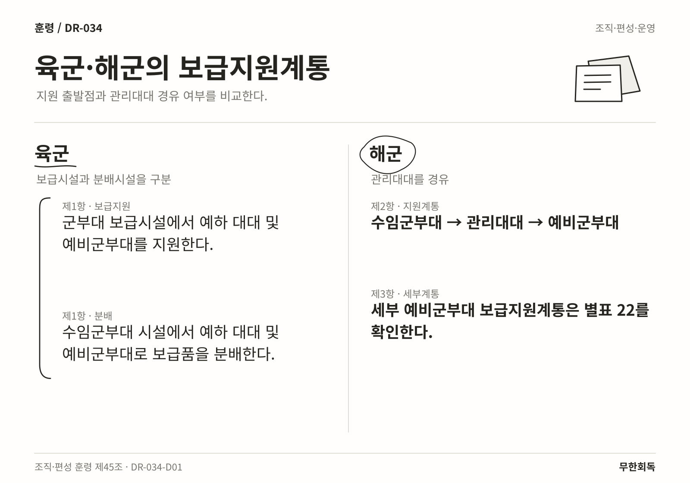

# DR-034 · 예비군 조직·편성과 운영에 관한 훈령 제45조, 보급지원계통

도식 **1장** · 1600 × 1120 · 흑백 편집형 디자인

[훈령 전체 목록](../../README.md) · [전체 매니페스트](../../diagrams-manifest.json)

## DR-034-D01 · 육군·해군의 보급지원계통

[WebP](DR-034-D01-editorial-v1.webp) · [PNG](DR-034-D01-editorial-v1.png) · [SVG 원본](DR-034-D01-editorial-v1.svg)

근거: [조직·편성 훈령 제45조](https://www.law.go.kr/LSW/admRulLsInfoP.do?admRulSeq=2100000268674#J45-0:0) · 국방부훈령 제3104호
