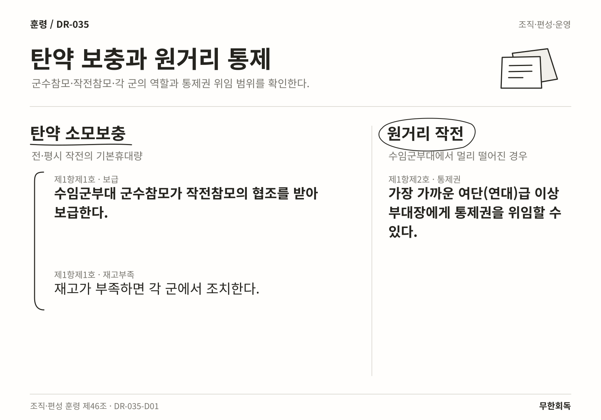
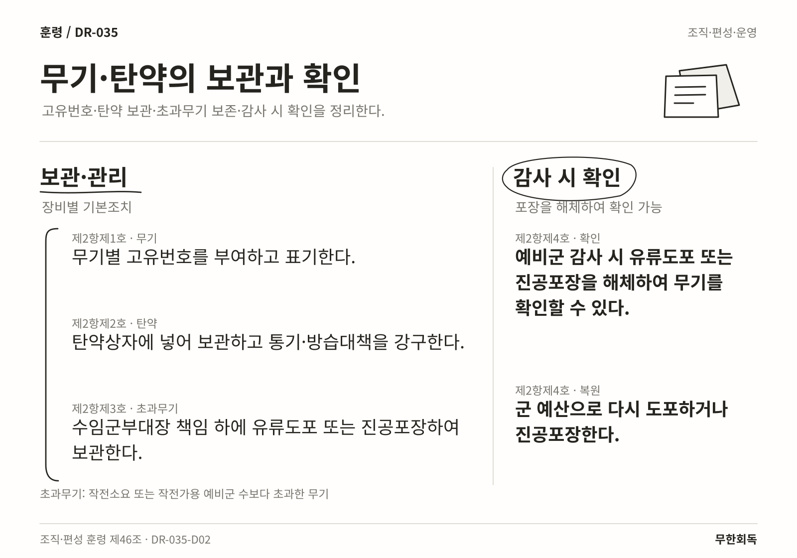
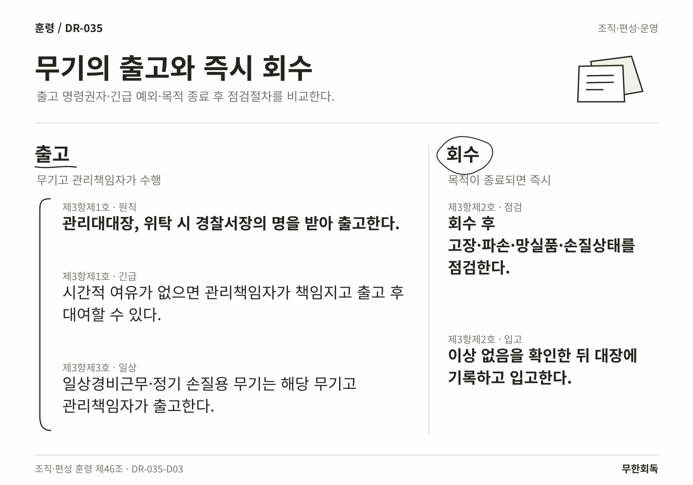
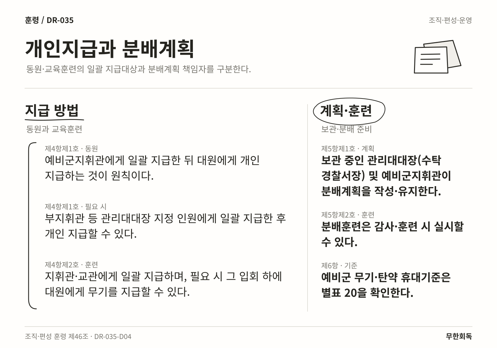

# DR-035 · 예비군 조직·편성과 운영에 관한 훈령 제46조, 무기 및 탄약

도식 **4장** · 1600 × 1120 · 흑백 편집형 디자인

[훈령 전체 목록](../../README.md) · [전체 매니페스트](../../diagrams-manifest.json)

## DR-035-D01 · 탄약 보충과 원거리 통제

[WebP](DR-035-D01-editorial-v1.webp) · [PNG](DR-035-D01-editorial-v1.png) · [SVG 원본](DR-035-D01-editorial-v1.svg)

근거: [조직·편성 훈령 제46조](https://www.law.go.kr/LSW/admRulLsInfoP.do?admRulSeq=2100000268674#J46-0:0) · 국방부훈령 제3104호

## DR-035-D02 · 무기·탄약의 보관과 확인

[WebP](DR-035-D02-editorial-v1.webp) · [PNG](DR-035-D02-editorial-v1.png) · [SVG 원본](DR-035-D02-editorial-v1.svg)

근거: [조직·편성 훈령 제46조](https://www.law.go.kr/LSW/admRulLsInfoP.do?admRulSeq=2100000268674#J46-0:0) · 국방부훈령 제3104호

초과무기: 작전소요 또는 작전가용 예비군 수보다 초과한 무기

## DR-035-D03 · 무기의 출고와 즉시 회수

[WebP](DR-035-D03-editorial-v1.webp) · [PNG](DR-035-D03-editorial-v1.png) · [SVG 원본](DR-035-D03-editorial-v1.svg)

근거: [조직·편성 훈령 제46조](https://www.law.go.kr/LSW/admRulLsInfoP.do?admRulSeq=2100000268674#J46-0:0) · 국방부훈령 제3104호

## DR-035-D04 · 개인지급과 분배계획

[WebP](DR-035-D04-editorial-v1.webp) · [PNG](DR-035-D04-editorial-v1.png) · [SVG 원본](DR-035-D04-editorial-v1.svg)

근거: [조직·편성 훈령 제46조](https://www.law.go.kr/LSW/admRulLsInfoP.do?admRulSeq=2100000268674#J46-0:0) · 국방부훈령 제3104호
