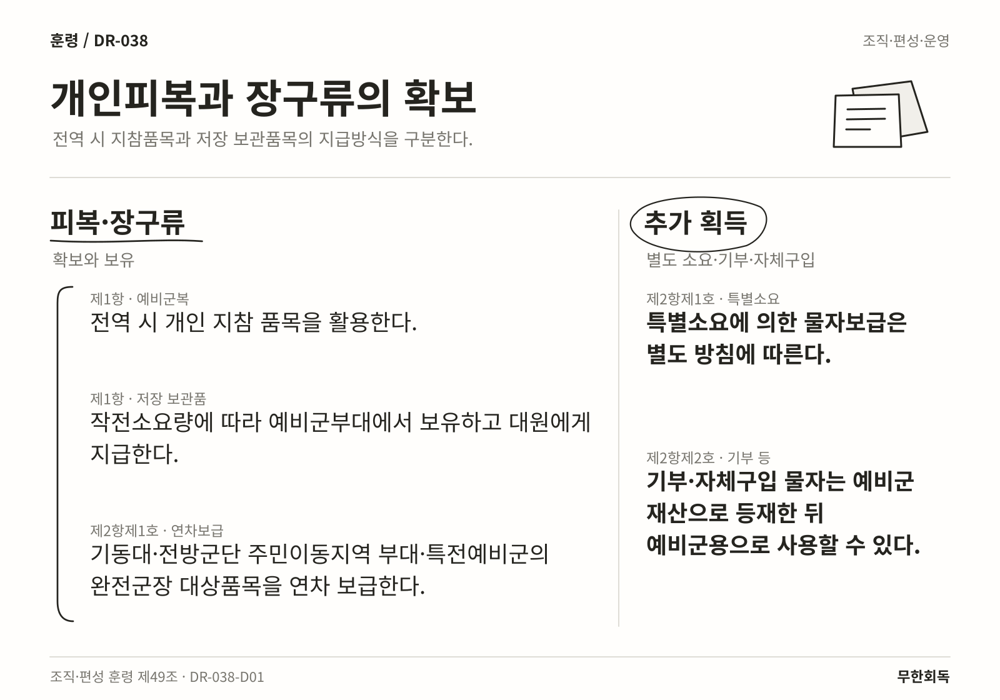
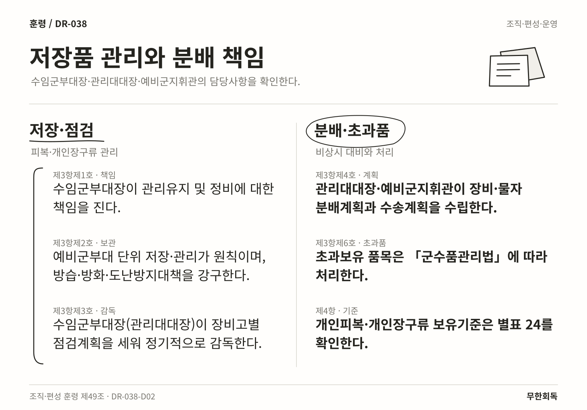
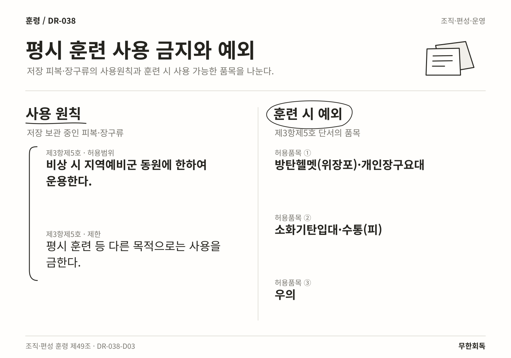

# DR-038 · 예비군 조직·편성과 운영에 관한 훈령 제49조, 개인피복 및 개인장구류

도식 **3장** · 1600 × 1120 · 흑백 편집형 디자인

[훈령 전체 목록](../../README.md) · [전체 매니페스트](../../diagrams-manifest.json)

## DR-038-D01 · 개인피복과 장구류의 확보

[WebP](DR-038-D01-editorial-v1.webp) · [PNG](DR-038-D01-editorial-v1.png) · [SVG 원본](DR-038-D01-editorial-v1.svg)

근거: [조직·편성 훈령 제49조](https://www.law.go.kr/LSW/admRulLsInfoP.do?admRulSeq=2100000268674#J49-0:0) · 국방부훈령 제3104호

## DR-038-D02 · 저장품 관리와 분배 책임

[WebP](DR-038-D02-editorial-v1.webp) · [PNG](DR-038-D02-editorial-v1.png) · [SVG 원본](DR-038-D02-editorial-v1.svg)

근거: [조직·편성 훈령 제49조](https://www.law.go.kr/LSW/admRulLsInfoP.do?admRulSeq=2100000268674#J49-0:0) · 국방부훈령 제3104호

## DR-038-D03 · 평시 훈련 사용 금지와 예외

[WebP](DR-038-D03-editorial-v1.webp) · [PNG](DR-038-D03-editorial-v1.png) · [SVG 원본](DR-038-D03-editorial-v1.svg)

근거: [조직·편성 훈령 제49조](https://www.law.go.kr/LSW/admRulLsInfoP.do?admRulSeq=2100000268674#J49-0:0) · 국방부훈령 제3104호
