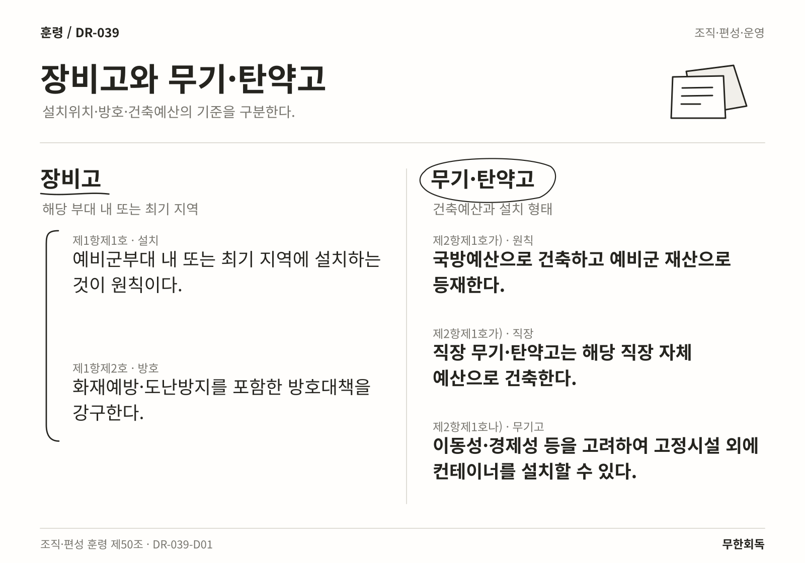
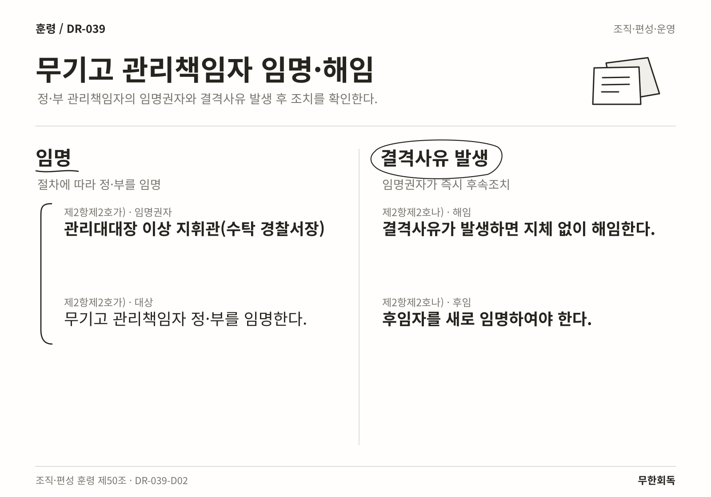

# DR-039 · 예비군 조직·편성과 운영에 관한 훈령 제50조, 시설

도식 **2장** · 1600 × 1120 · 흑백 편집형 디자인

[훈령 전체 목록](../../README.md) · [전체 매니페스트](../../diagrams-manifest.json)

## DR-039-D01 · 장비고와 무기·탄약고

[WebP](DR-039-D01-editorial-v1.webp) · [PNG](DR-039-D01-editorial-v1.png) · [SVG 원본](DR-039-D01-editorial-v1.svg)

근거: [조직·편성 훈령 제50조](https://www.law.go.kr/LSW/admRulLsInfoP.do?admRulSeq=2100000268674#J50-0:0) · 국방부훈령 제3104호

## DR-039-D02 · 무기고 관리책임자 임명·해임

[WebP](DR-039-D02-editorial-v1.webp) · [PNG](DR-039-D02-editorial-v1.png) · [SVG 원본](DR-039-D02-editorial-v1.svg)

근거: [조직·편성 훈령 제50조](https://www.law.go.kr/LSW/admRulLsInfoP.do?admRulSeq=2100000268674#J50-0:0) · 국방부훈령 제3104호
