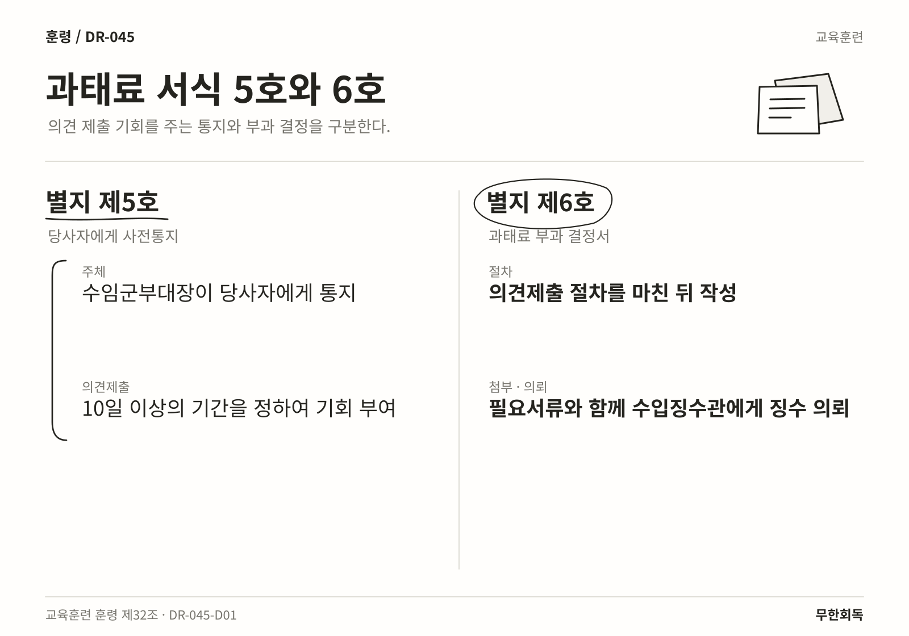

# DR-045 · 예비군 교육훈련 훈령 제32조, 과태료 부과 서식 해설

도식 **1장** · 1600 × 1120 · 흑백 편집형 디자인

[훈령 전체 목록](../../README.md) · [전체 매니페스트](../../diagrams-manifest.json)

## DR-045-D01 · 과태료 서식 5호와 6호

[WebP](DR-045-D01-editorial-v1.webp) · [PNG](DR-045-D01-editorial-v1.png) · [SVG 원본](DR-045-D01-editorial-v1.svg)

근거: [교육훈련 훈령 제32조](https://www.law.go.kr/LSW/admRulLsInfoP.do?admRulSeq=2100000286712#J32-0:0) · 국방부훈령 제3216호
