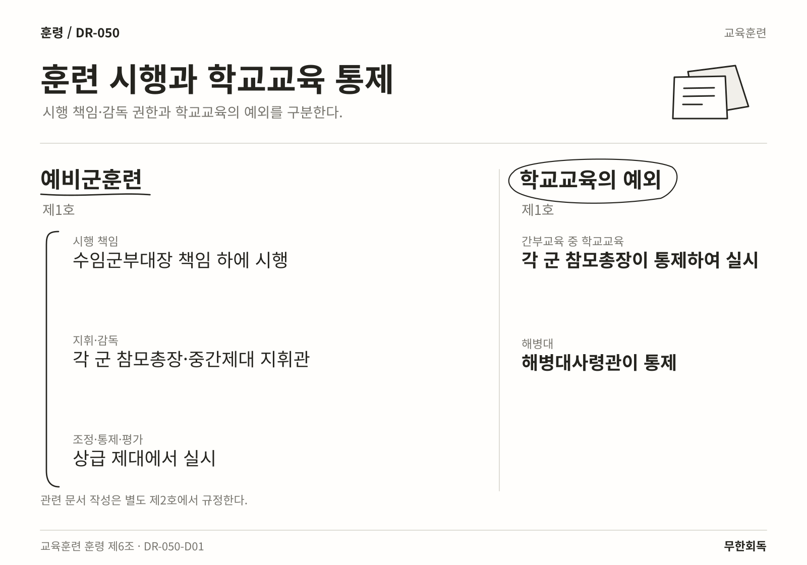

# DR-050 · 예비군 교육훈련 훈령 제6조, 예비군훈련 체계

도식 **1장** · 1600 × 1120 · 흑백 편집형 디자인

[훈령 전체 목록](../../README.md) · [전체 매니페스트](../../diagrams-manifest.json)

## DR-050-D01 · 훈련 시행과 학교교육 통제

[WebP](DR-050-D01-editorial-v1.webp) · [PNG](DR-050-D01-editorial-v1.png) · [SVG 원본](DR-050-D01-editorial-v1.svg)

근거: [교육훈련 훈령 제6조](https://www.law.go.kr/LSW/admRulLsInfoP.do?admRulSeq=2100000286712#J6-0:0) · 국방부훈령 제3216호

각 군 참모총장은 해병대의 경우 해병대사령관을 말한다.
