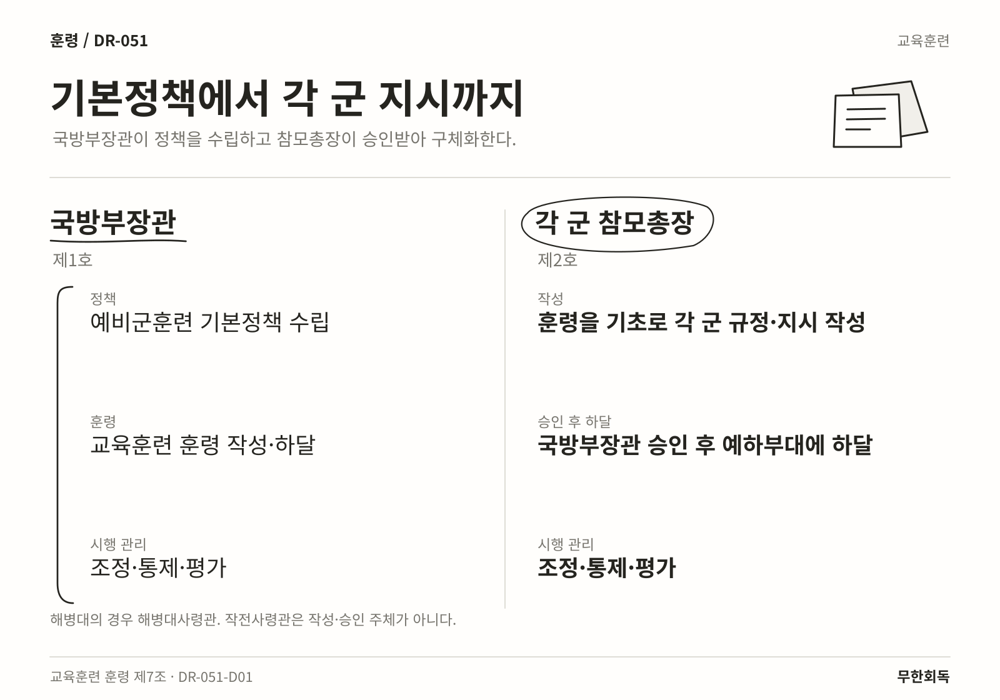
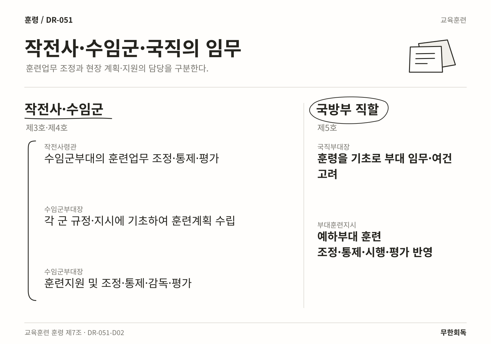

# DR-051 · 예비군 교육훈련 훈령 제7조, 각 관의 임무

도식 **2장** · 1600 × 1120 · 흑백 편집형 디자인

[훈령 전체 목록](../../README.md) · [전체 매니페스트](../../diagrams-manifest.json)

## DR-051-D01 · 기본정책에서 각 군 지시까지

[WebP](DR-051-D01-editorial-v1.webp) · [PNG](DR-051-D01-editorial-v1.png) · [SVG 원본](DR-051-D01-editorial-v1.svg)

근거: [교육훈련 훈령 제7조](https://www.law.go.kr/LSW/admRulLsInfoP.do?admRulSeq=2100000286712#J7-0:0) · 국방부훈령 제3216호

각 군 지휘부: 각 군 참모총장·해병대사령관.

## DR-051-D02 · 작전사·수임군·국직의 임무

[WebP](DR-051-D02-editorial-v1.webp) · [PNG](DR-051-D02-editorial-v1.png) · [SVG 원본](DR-051-D02-editorial-v1.svg)

근거: [교육훈련 훈령 제7조](https://www.law.go.kr/LSW/admRulLsInfoP.do?admRulSeq=2100000286712#J7-0:0) · 국방부훈령 제3216호
