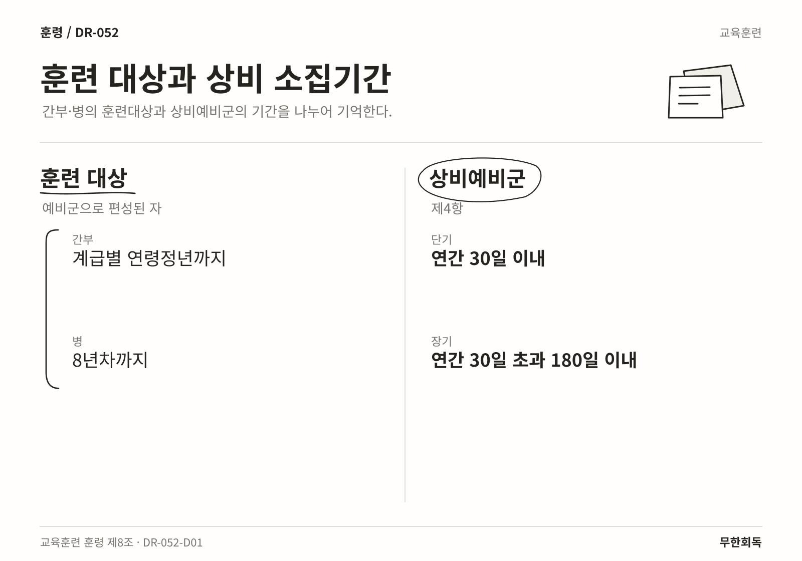
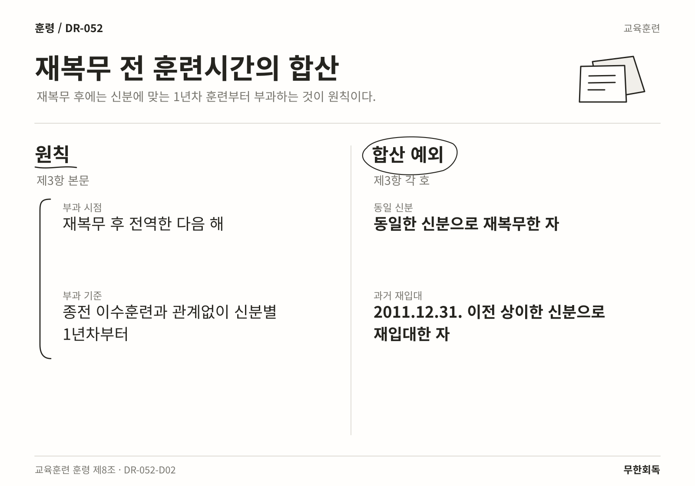

# DR-052 · 예비군 교육훈련 훈령 제8조, 훈련대상 및 시간

도식 **2장** · 1600 × 1120 · 흑백 편집형 디자인

[훈령 전체 목록](../../README.md) · [전체 매니페스트](../../diagrams-manifest.json)

## DR-052-D01 · 훈련 대상과 상비 소집기간

[WebP](DR-052-D01-editorial-v1.webp) · [PNG](DR-052-D01-editorial-v1.png) · [SVG 원본](DR-052-D01-editorial-v1.svg)

근거: [교육훈련 훈령 제8조](https://www.law.go.kr/LSW/admRulLsInfoP.do?admRulSeq=2100000286712#J8-0:0) · 국방부훈령 제3216호

## DR-052-D02 · 재복무 전 훈련시간의 합산

[WebP](DR-052-D02-editorial-v1.webp) · [PNG](DR-052-D02-editorial-v1.png) · [SVG 원본](DR-052-D02-editorial-v1.svg)

근거: [교육훈련 훈령 제8조](https://www.law.go.kr/LSW/admRulLsInfoP.do?admRulSeq=2100000286712#J8-0:0) · 국방부훈령 제3216호
