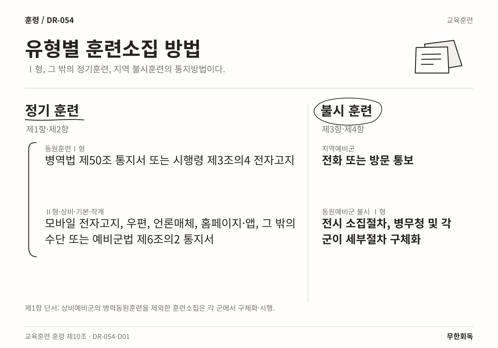
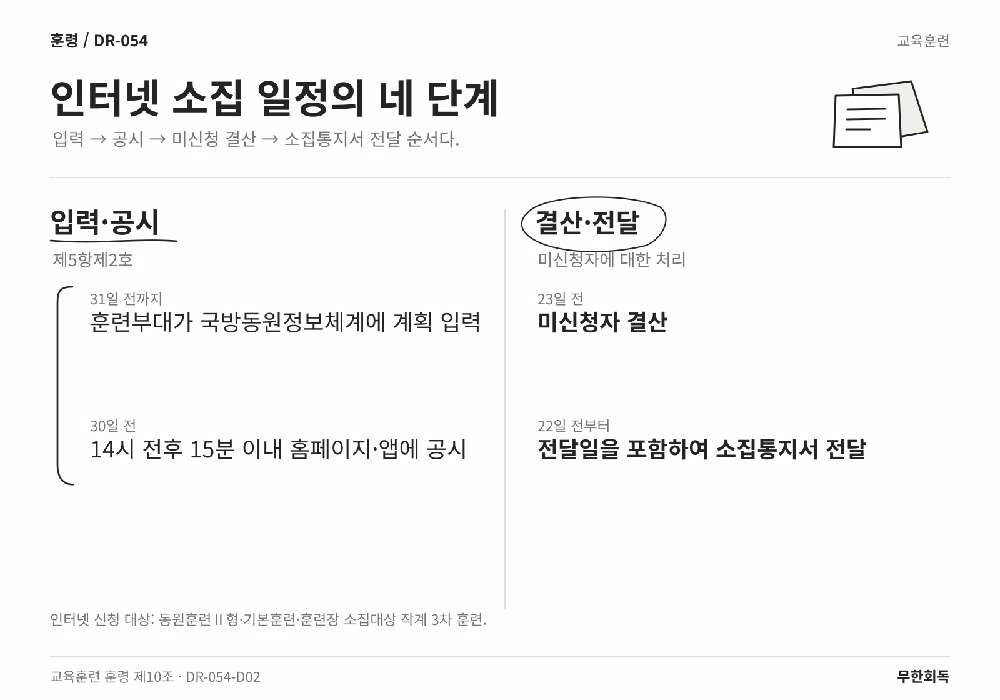
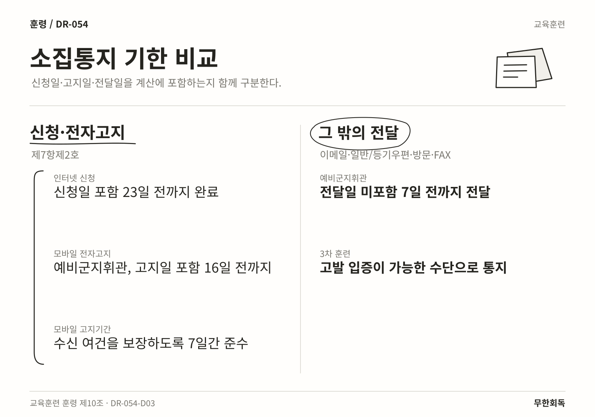
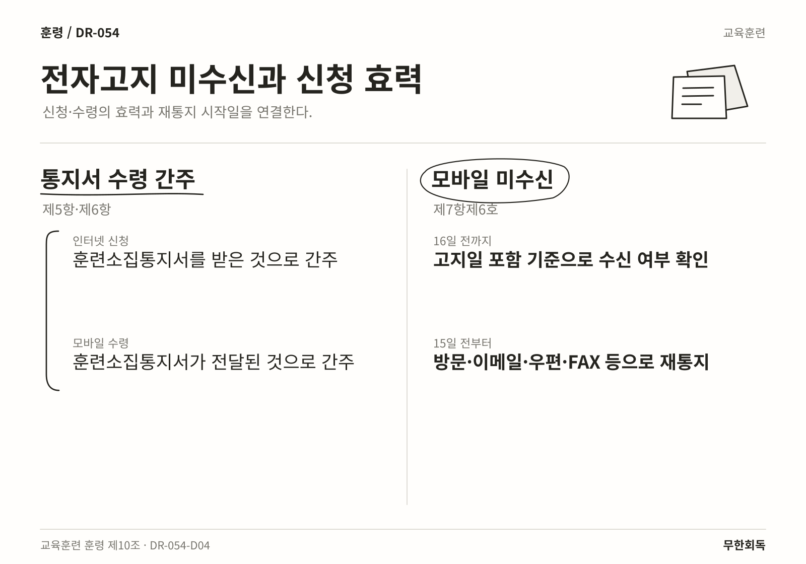
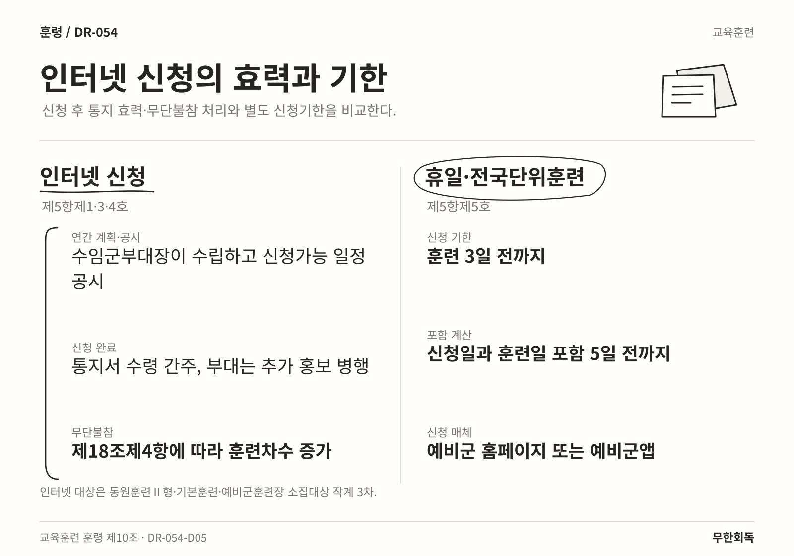
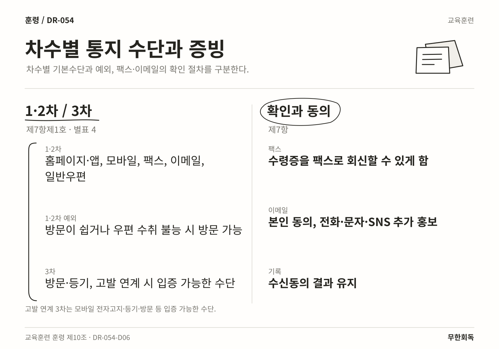

# DR-054 · 예비군 교육훈련 훈령 제10조, 소집방법

도식 **6장** · 1600 × 1120 · 흑백 편집형 디자인

[훈령 전체 목록](../../README.md) · [전체 매니페스트](../../diagrams-manifest.json)

## DR-054-D01 · 유형별 훈련소집 방법

[WebP](DR-054-D01-editorial-v1.webp) · [PNG](DR-054-D01-editorial-v1.png) · [SVG 원본](DR-054-D01-editorial-v1.svg)

근거: [교육훈련 훈령 제10조](https://www.law.go.kr/LSW/admRulLsInfoP.do?admRulSeq=2100000286712#J10-0:0) · 국방부훈령 제3216호

## DR-054-D02 · 인터넷 소집 일정의 네 단계

[WebP](DR-054-D02-editorial-v1.webp) · [PNG](DR-054-D02-editorial-v1.png) · [SVG 원본](DR-054-D02-editorial-v1.svg)

근거: [교육훈련 훈령 제10조](https://www.law.go.kr/LSW/admRulLsInfoP.do?admRulSeq=2100000286712#J10-0:0) · 국방부훈령 제3216호

## DR-054-D03 · 소집통지 기한 비교

[WebP](DR-054-D03-editorial-v1.webp) · [PNG](DR-054-D03-editorial-v1.png) · [SVG 원본](DR-054-D03-editorial-v1.svg)

근거: [교육훈련 훈령 제10조](https://www.law.go.kr/LSW/admRulLsInfoP.do?admRulSeq=2100000286712#J10-0:0) · 국방부훈령 제3216호

## DR-054-D04 · 전자고지 미수신과 신청 효력

[WebP](DR-054-D04-editorial-v1.webp) · [PNG](DR-054-D04-editorial-v1.png) · [SVG 원본](DR-054-D04-editorial-v1.svg)

근거: [교육훈련 훈령 제10조](https://www.law.go.kr/LSW/admRulLsInfoP.do?admRulSeq=2100000286712#J10-0:0) · 국방부훈령 제3216호

## DR-054-D05 · 인터넷 신청의 효력과 기한

[WebP](DR-054-D05-editorial-v1.webp) · [PNG](DR-054-D05-editorial-v1.png) · [SVG 원본](DR-054-D05-editorial-v1.svg)

근거: [교육훈련 훈령 제10조](https://www.law.go.kr/LSW/admRulLsInfoP.do?admRulSeq=2100000286712#J10-0:0) · 국방부훈령 제3216호

## DR-054-D06 · 차수별 통지 수단과 증빙

[WebP](DR-054-D06-editorial-v1.webp) · [PNG](DR-054-D06-editorial-v1.png) · [SVG 원본](DR-054-D06-editorial-v1.svg)

근거: [교육훈련 훈령 제10조](https://www.law.go.kr/LSW/admRulLsInfoP.do?admRulSeq=2100000286712#J10-0:0) · 국방부훈령 제3216호

