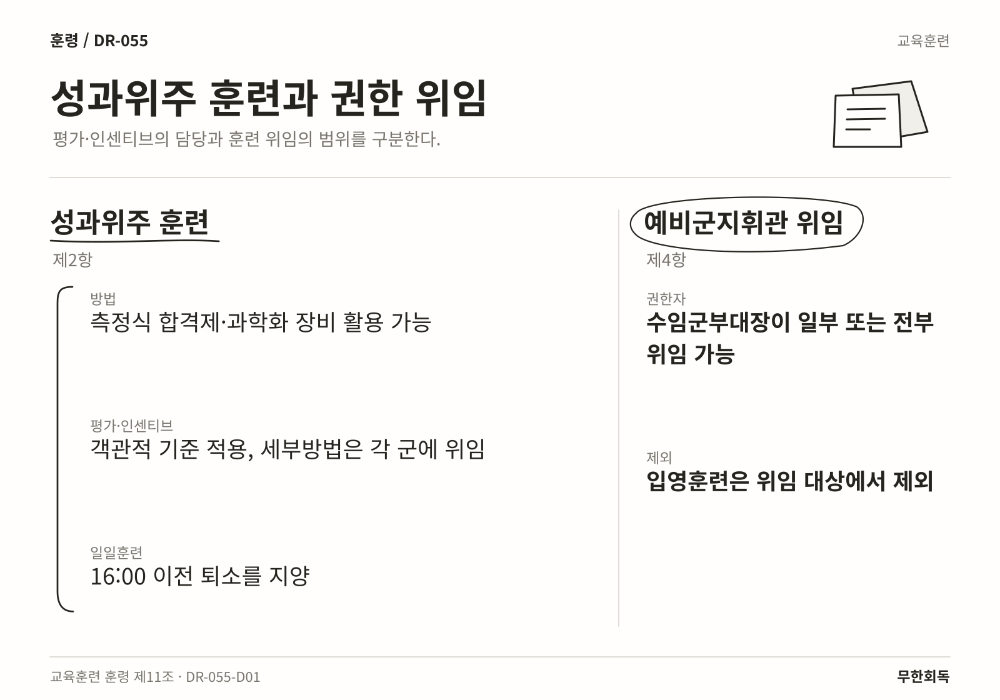
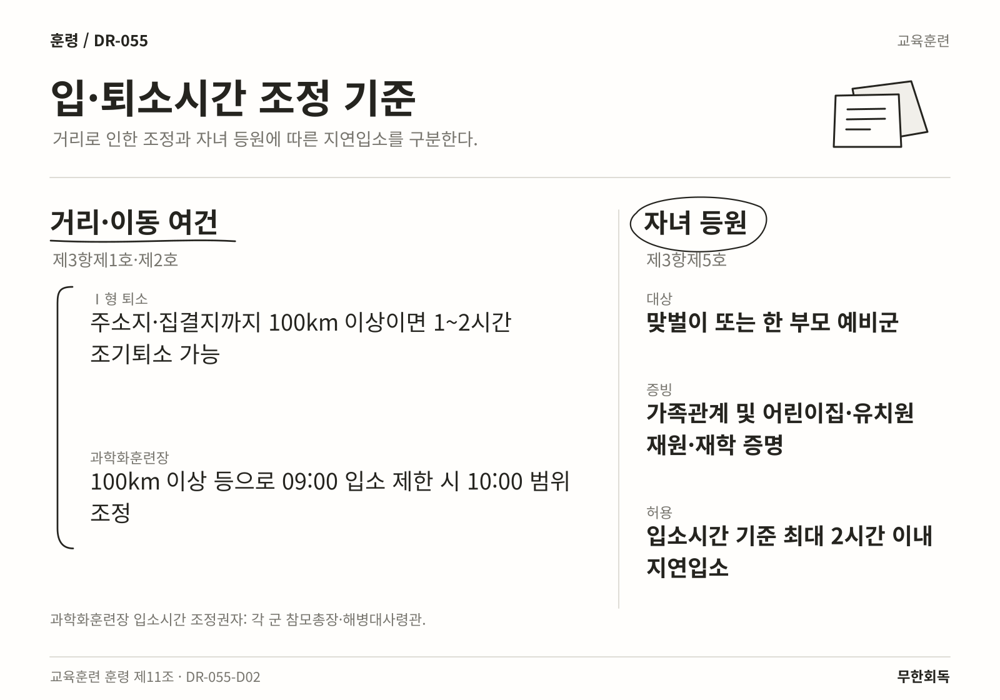
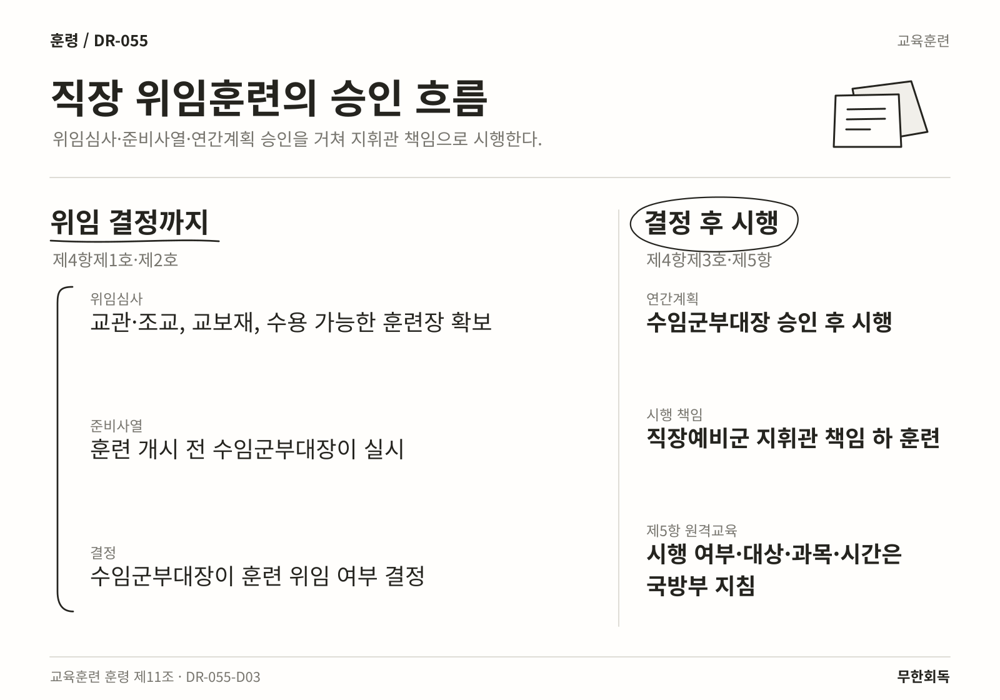

# DR-055 · 예비군 교육훈련 훈령 제11조, 훈련방법

도식 **3장** · 1600 × 1120 · 흑백 편집형 디자인

[훈령 전체 목록](../../README.md) · [전체 매니페스트](../../diagrams-manifest.json)

## DR-055-D01 · 성과위주 훈련과 권한 위임

[WebP](DR-055-D01-editorial-v1.webp) · [PNG](DR-055-D01-editorial-v1.png) · [SVG 원본](DR-055-D01-editorial-v1.svg)

근거: [교육훈련 훈령 제11조](https://www.law.go.kr/LSW/admRulLsInfoP.do?admRulSeq=2100000286712#J11-0:0) · 국방부훈령 제3216호

## DR-055-D02 · 입·퇴소시간 조정 기준

[WebP](DR-055-D02-editorial-v1.webp) · [PNG](DR-055-D02-editorial-v1.png) · [SVG 원본](DR-055-D02-editorial-v1.svg)

근거: [교육훈련 훈령 제11조](https://www.law.go.kr/LSW/admRulLsInfoP.do?admRulSeq=2100000286712#J11-0:0) · 국방부훈령 제3216호

과학화훈련장 입소시간 조정권자: 각 군 참모총장·해병대사령관.

## DR-055-D03 · 직장 위임훈련의 승인 흐름

[WebP](DR-055-D03-editorial-v1.webp) · [PNG](DR-055-D03-editorial-v1.png) · [SVG 원본](DR-055-D03-editorial-v1.svg)

근거: [교육훈련 훈령 제11조](https://www.law.go.kr/LSW/admRulLsInfoP.do?admRulSeq=2100000286712#J11-0:0) · 국방부훈령 제3216호
