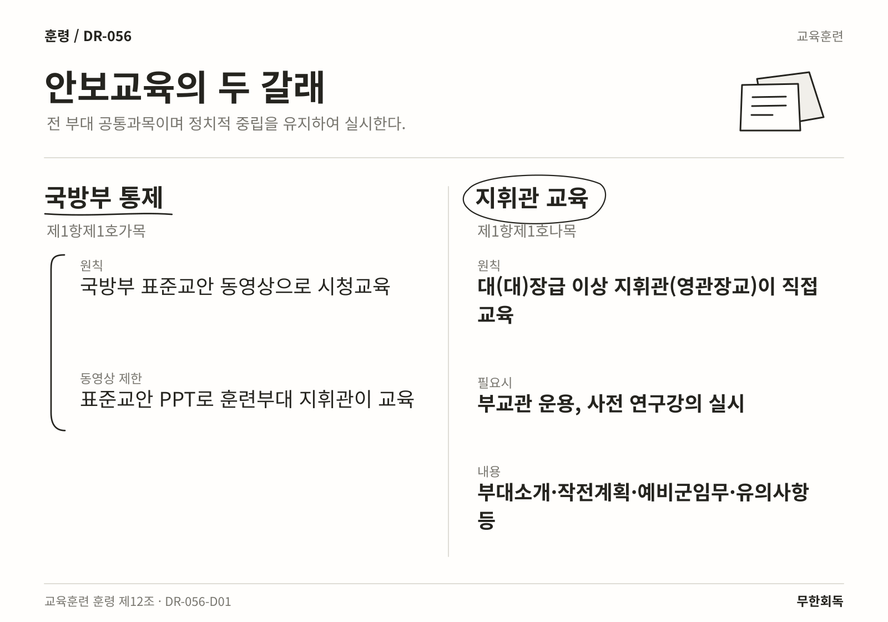
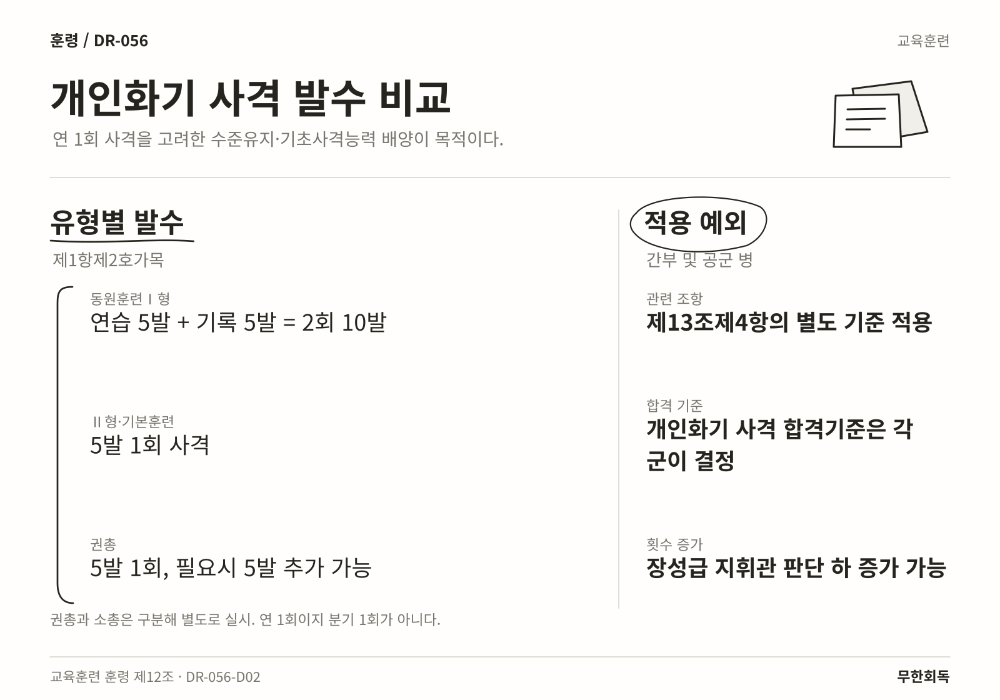
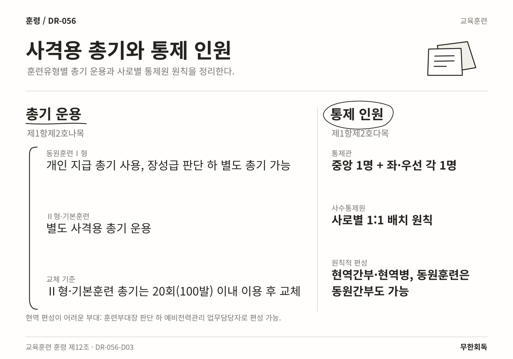
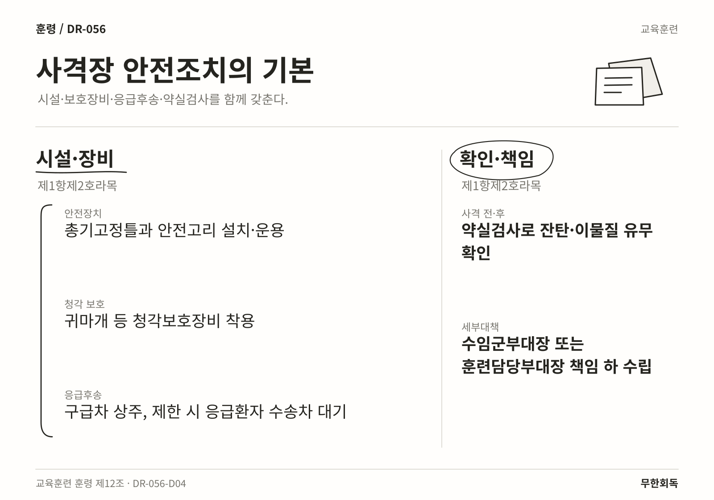

# DR-056 · 예비군 교육훈련 훈령 제12조, 공통과목

도식 **4장** · 1600 × 1120 · 흑백 편집형 디자인

[훈령 전체 목록](../../README.md) · [전체 매니페스트](../../diagrams-manifest.json)

## DR-056-D01 · 안보교육의 두 갈래

[WebP](DR-056-D01-editorial-v1.webp) · [PNG](DR-056-D01-editorial-v1.png) · [SVG 원본](DR-056-D01-editorial-v1.svg)

근거: [교육훈련 훈령 제12조](https://www.law.go.kr/LSW/admRulLsInfoP.do?admRulSeq=2100000286712#J12-0:0) · 국방부훈령 제3216호

## DR-056-D02 · 개인화기 사격 발수 비교

[WebP](DR-056-D02-editorial-v1.webp) · [PNG](DR-056-D02-editorial-v1.png) · [SVG 원본](DR-056-D02-editorial-v1.svg)

근거: [교육훈련 훈령 제12조](https://www.law.go.kr/LSW/admRulLsInfoP.do?admRulSeq=2100000286712#J12-0:0) · 국방부훈령 제3216호

## DR-056-D03 · 사격용 총기와 통제 인원

[WebP](DR-056-D03-editorial-v1.webp) · [PNG](DR-056-D03-editorial-v1.png) · [SVG 원본](DR-056-D03-editorial-v1.svg)

근거: [교육훈련 훈령 제12조](https://www.law.go.kr/LSW/admRulLsInfoP.do?admRulSeq=2100000286712#J12-0:0) · 국방부훈령 제3216호

간부·공군 병은 제13조제4항 적용. 통제원 편성 제한 시 별도 예외 규정 적용.

## DR-056-D04 · 사격장 안전조치의 기본

[WebP](DR-056-D04-editorial-v1.webp) · [PNG](DR-056-D04-editorial-v1.png) · [SVG 원본](DR-056-D04-editorial-v1.svg)

근거: [교육훈련 훈령 제12조](https://www.law.go.kr/LSW/admRulLsInfoP.do?admRulSeq=2100000286712#J12-0:0) · 국방부훈령 제3216호
