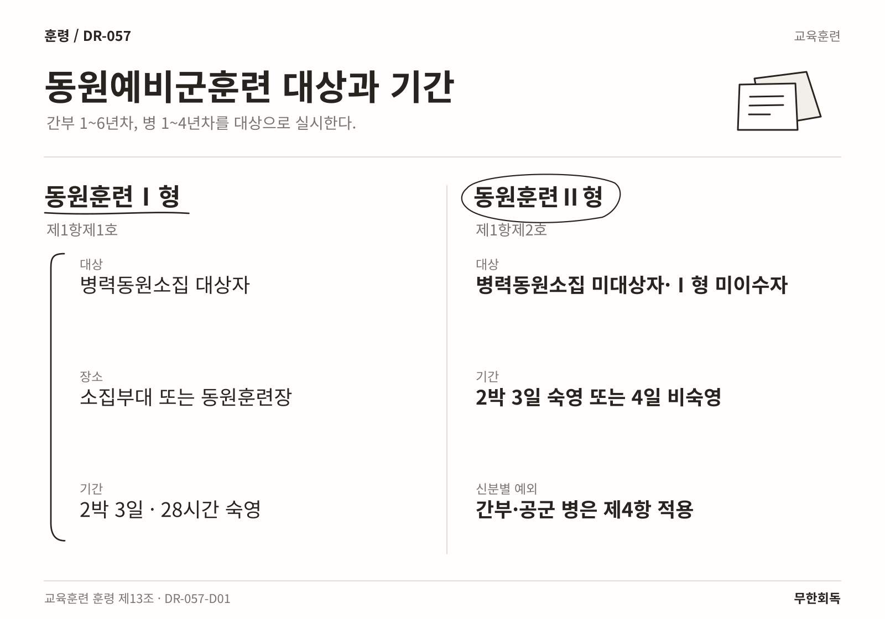
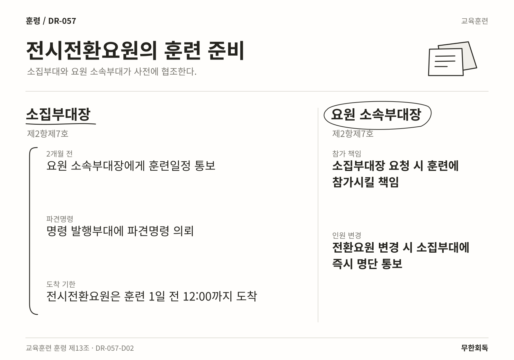
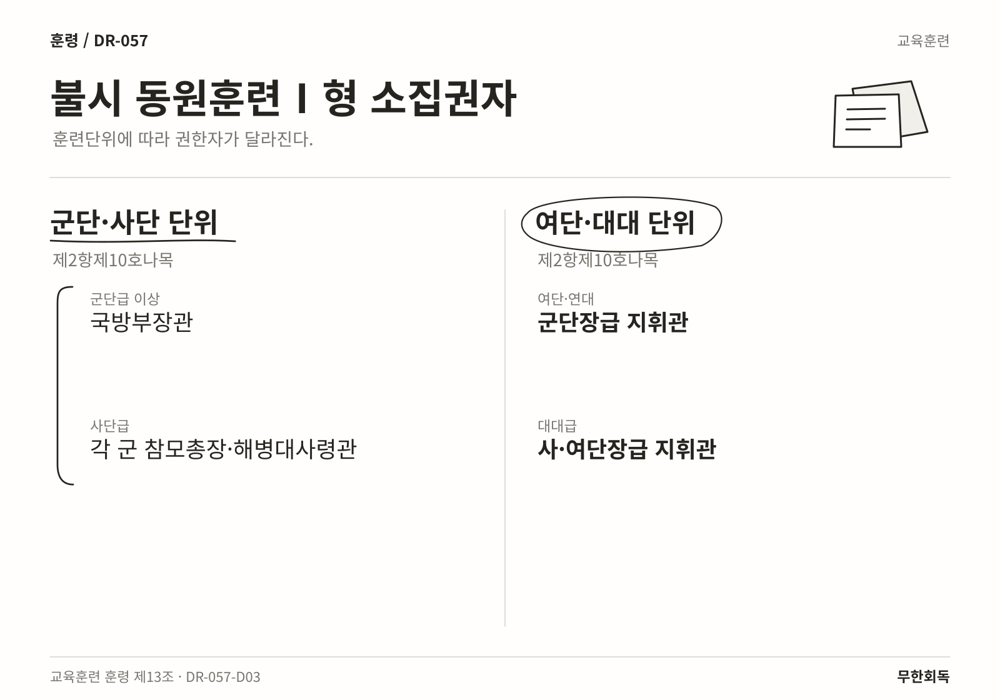
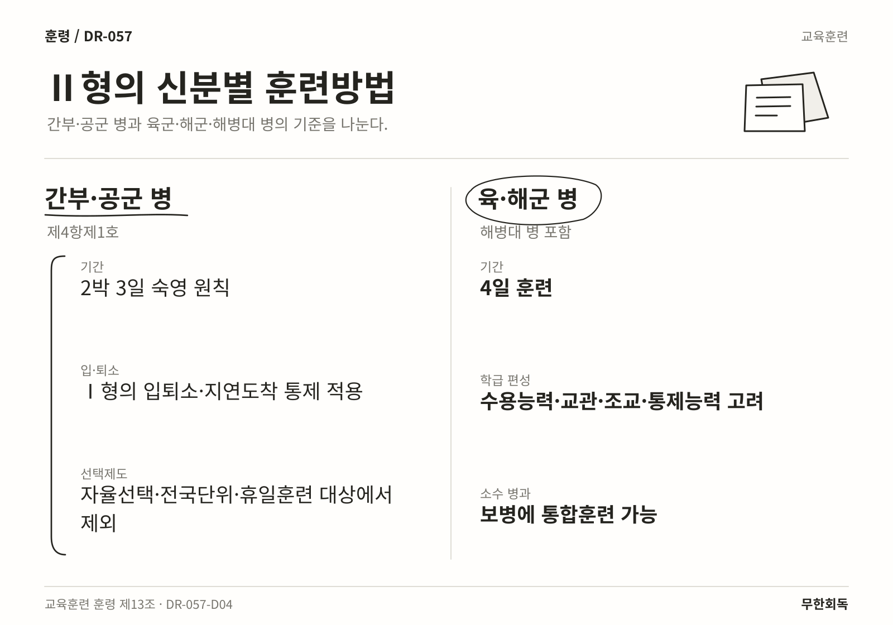

# DR-057 · 예비군 교육훈련 훈령 제13조, 동원예비군훈련

도식 **4장** · 1600 × 1120 · 흑백 편집형 디자인

[훈령 전체 목록](../../README.md) · [전체 매니페스트](../../diagrams-manifest.json)

## DR-057-D01 · 동원예비군훈련 대상과 기간

[WebP](DR-057-D01-editorial-v1.webp) · [PNG](DR-057-D01-editorial-v1.png) · [SVG 원본](DR-057-D01-editorial-v1.svg)

근거: [교육훈련 훈령 제13조](https://www.law.go.kr/LSW/admRulLsInfoP.do?admRulSeq=2100000286712#J13-0:0) · 국방부훈령 제3216호

## DR-057-D02 · 전시전환요원의 훈련 준비

[WebP](DR-057-D02-editorial-v1.webp) · [PNG](DR-057-D02-editorial-v1.png) · [SVG 원본](DR-057-D02-editorial-v1.svg)

근거: [교육훈련 훈령 제13조](https://www.law.go.kr/LSW/admRulLsInfoP.do?admRulSeq=2100000286712#J13-0:0) · 국방부훈령 제3216호

## DR-057-D03 · 불시 동원훈련Ⅰ형 소집권자

[WebP](DR-057-D03-editorial-v1.webp) · [PNG](DR-057-D03-editorial-v1.png) · [SVG 원본](DR-057-D03-editorial-v1.svg)

근거: [교육훈련 훈령 제13조](https://www.law.go.kr/LSW/admRulLsInfoP.do?admRulSeq=2100000286712#J13-0:0) · 국방부훈령 제3216호

## DR-057-D04 · Ⅱ형의 신분별 훈련방법

[WebP](DR-057-D04-editorial-v1.webp) · [PNG](DR-057-D04-editorial-v1.png) · [SVG 원본](DR-057-D04-editorial-v1.svg)

근거: [교육훈련 훈령 제13조](https://www.law.go.kr/LSW/admRulLsInfoP.do?admRulSeq=2100000286712#J13-0:0) · 국방부훈령 제3216호
