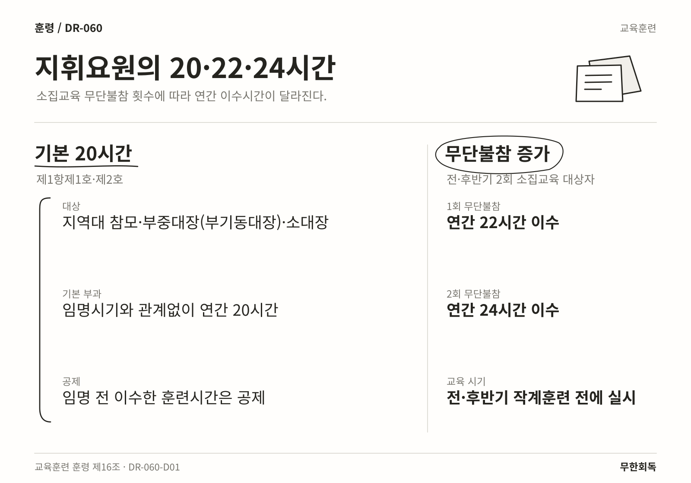
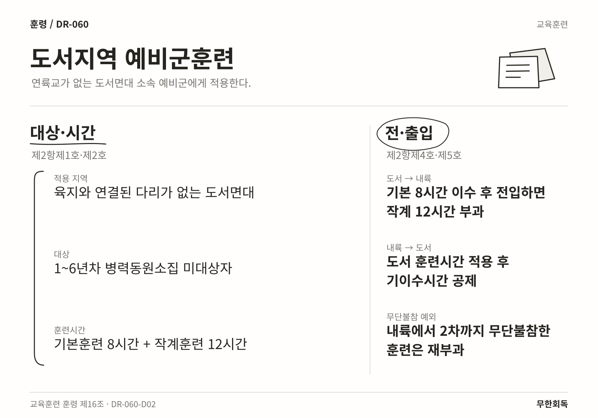
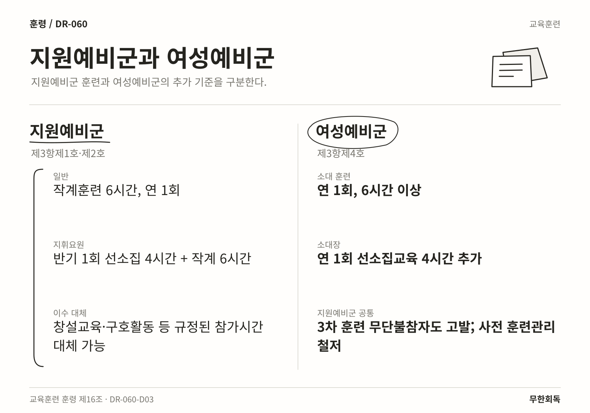
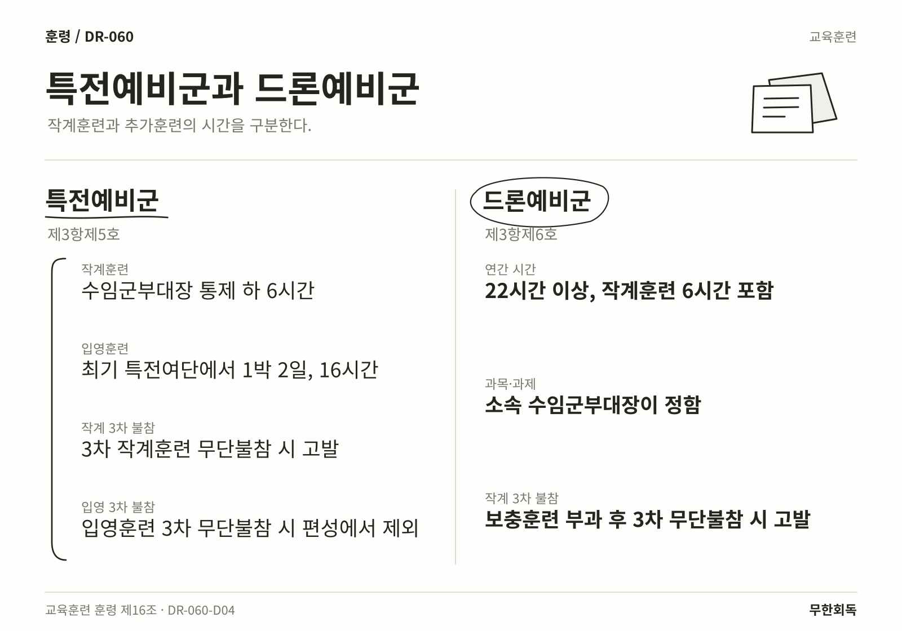
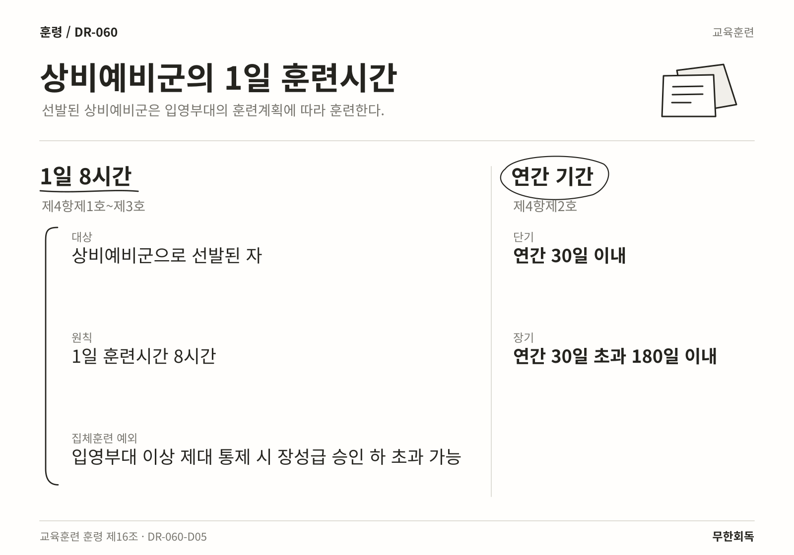
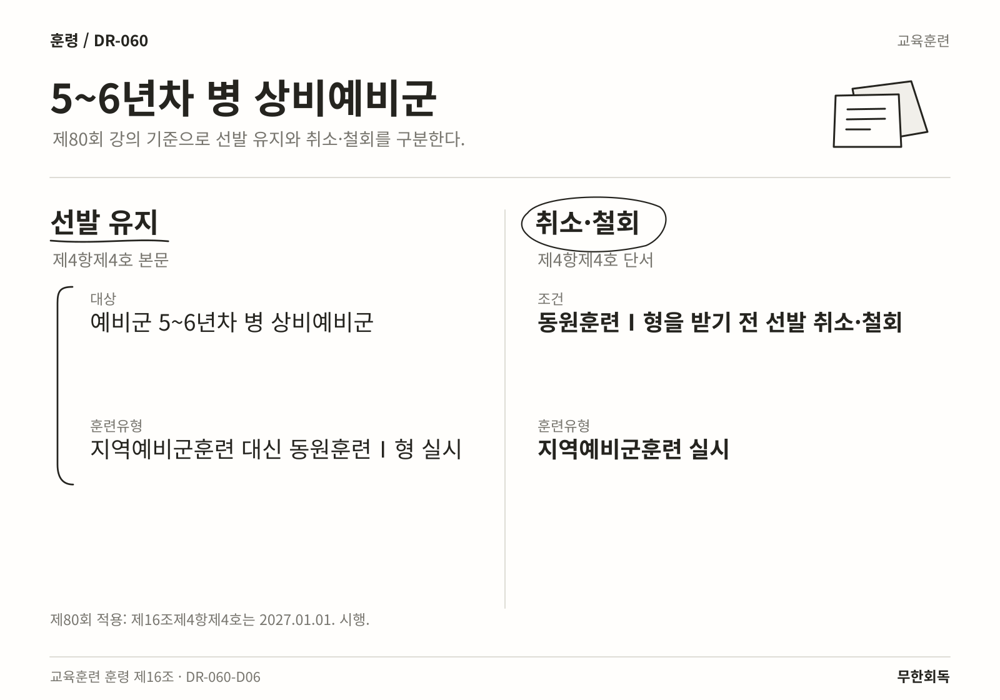
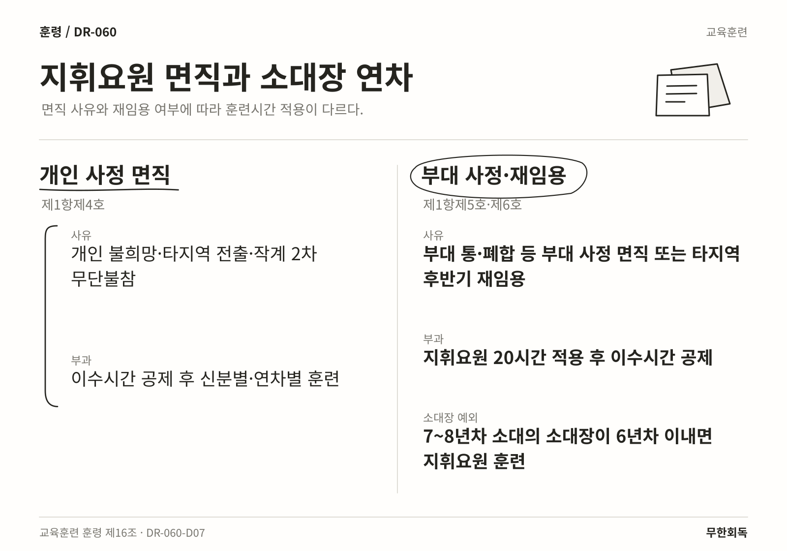

# DR-060 · 예비군 교육훈련 훈령 제16조, 기타훈련

도식 **7장** · 1600 × 1120 · 흑백 편집형 디자인

[훈령 전체 목록](../../README.md) · [전체 매니페스트](../../diagrams-manifest.json)

## DR-060-D01 · 지휘요원의 20·22·24시간

[WebP](DR-060-D01-editorial-v1.webp) · [PNG](DR-060-D01-editorial-v1.png) · [SVG 원본](DR-060-D01-editorial-v1.svg)

근거: [교육훈련 훈령 제16조](https://www.law.go.kr/LSW/admRulLsInfoP.do?admRulSeq=2100000286712#J16-0:0) · 국방부훈령 제3216호

## DR-060-D02 · 도서지역 예비군훈련

[WebP](DR-060-D02-editorial-v1.webp) · [PNG](DR-060-D02-editorial-v1.png) · [SVG 원본](DR-060-D02-editorial-v1.svg)

근거: [교육훈련 훈령 제16조](https://www.law.go.kr/LSW/admRulLsInfoP.do?admRulSeq=2100000286712#J16-0:0) · 국방부훈령 제3216호

## DR-060-D03 · 지원예비군과 여성예비군

[WebP](DR-060-D03-editorial-v1.webp) · [PNG](DR-060-D03-editorial-v1.png) · [SVG 원본](DR-060-D03-editorial-v1.svg)

근거: [교육훈련 훈령 제16조](https://www.law.go.kr/LSW/admRulLsInfoP.do?admRulSeq=2100000286712#J16-0:0) · 국방부훈령 제3216호

## DR-060-D04 · 특전예비군과 드론예비군

[WebP](DR-060-D04-editorial-v1.webp) · [PNG](DR-060-D04-editorial-v1.png) · [SVG 원본](DR-060-D04-editorial-v1.svg)

근거: [교육훈련 훈령 제16조](https://www.law.go.kr/LSW/admRulLsInfoP.do?admRulSeq=2100000286712#J16-0:0) · 국방부훈령 제3216호

## DR-060-D05 · 상비예비군의 1일 훈련시간

[WebP](DR-060-D05-editorial-v1.webp) · [PNG](DR-060-D05-editorial-v1.png) · [SVG 원본](DR-060-D05-editorial-v1.svg)

근거: [교육훈련 훈령 제16조](https://www.law.go.kr/LSW/admRulLsInfoP.do?admRulSeq=2100000286712#J16-0:0) · 국방부훈령 제3216호

## DR-060-D06 · 5~6년차 병 상비예비군

[WebP](DR-060-D06-editorial-v1.webp) · [PNG](DR-060-D06-editorial-v1.png) · [SVG 원본](DR-060-D06-editorial-v1.svg)

근거: [교육훈련 훈령 제16조](https://www.law.go.kr/LSW/admRulLsInfoP.do?admRulSeq=2100000286712#J16-0:0) · 국방부훈령 제3216호

## DR-060-D07 · 지휘요원 면직과 소대장 연차

[WebP](DR-060-D07-editorial-v1.webp) · [PNG](DR-060-D07-editorial-v1.png) · [SVG 원본](DR-060-D07-editorial-v1.svg)

근거: [교육훈련 훈령 제16조](https://www.law.go.kr/LSW/admRulLsInfoP.do?admRulSeq=2100000286712#J16-0:0) · 국방부훈령 제3216호

