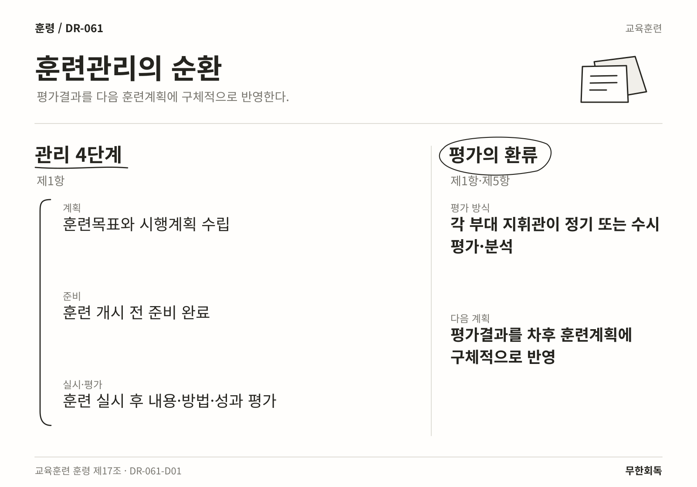
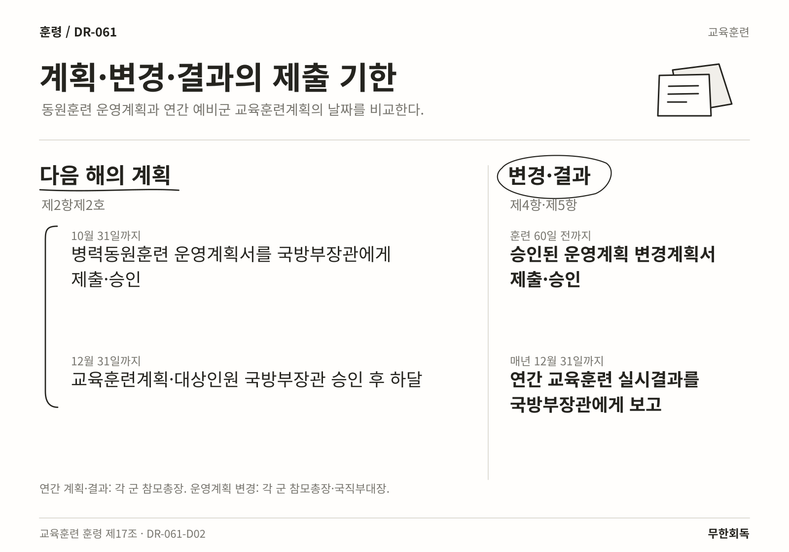

# DR-061 · 예비군 교육훈련 훈령 제17조, 훈련관리

도식 **2장** · 1600 × 1120 · 흑백 편집형 디자인

[훈령 전체 목록](../../README.md) · [전체 매니페스트](../../diagrams-manifest.json)

## DR-061-D01 · 훈련관리의 순환

[WebP](DR-061-D01-editorial-v1.webp) · [PNG](DR-061-D01-editorial-v1.png) · [SVG 원본](DR-061-D01-editorial-v1.svg)

근거: [교육훈련 훈령 제17조](https://www.law.go.kr/LSW/admRulLsInfoP.do?admRulSeq=2100000286712#J17-0:0) · 국방부훈령 제3216호

## DR-061-D02 · 계획·변경·결과의 제출 기한

[WebP](DR-061-D02-editorial-v1.webp) · [PNG](DR-061-D02-editorial-v1.png) · [SVG 원본](DR-061-D02-editorial-v1.svg)

근거: [교육훈련 훈령 제17조](https://www.law.go.kr/LSW/admRulLsInfoP.do?admRulSeq=2100000286712#J17-0:0) · 국방부훈령 제3216호

연간 계획·결과: 각 군 참모총장. 운영계획 변경: 각 군 참모총장·국직부대장.
