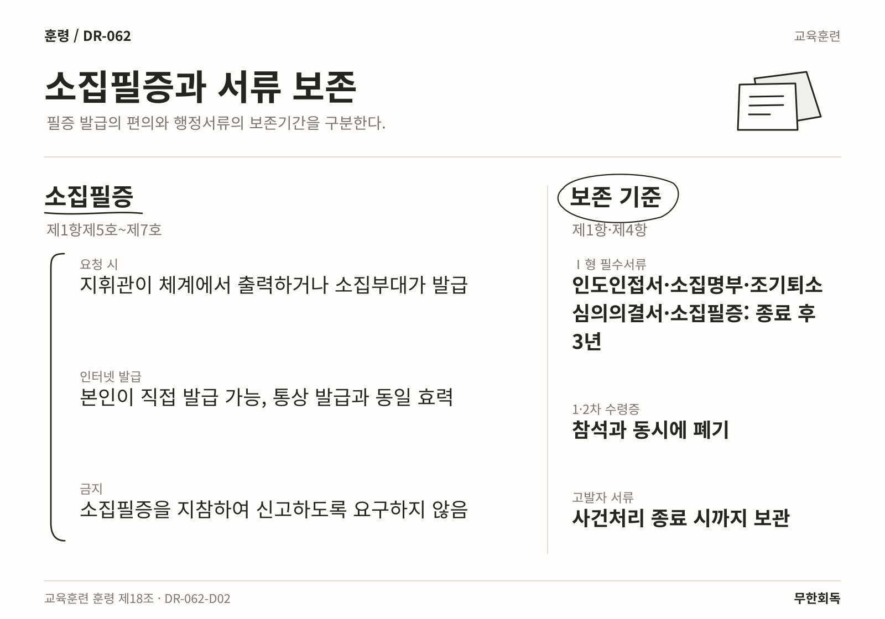
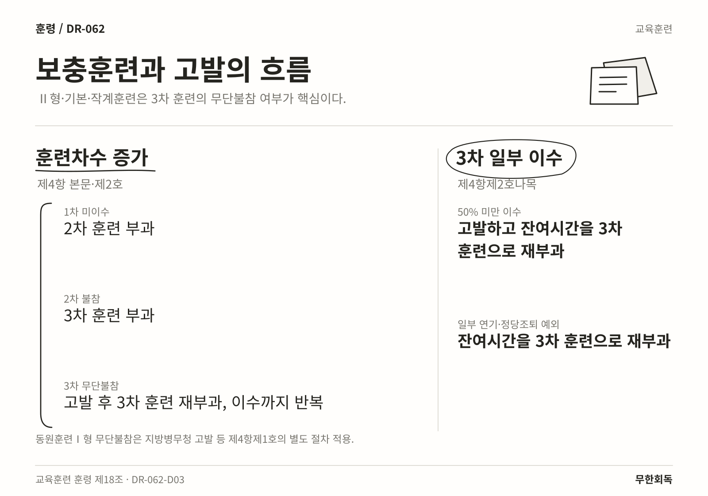
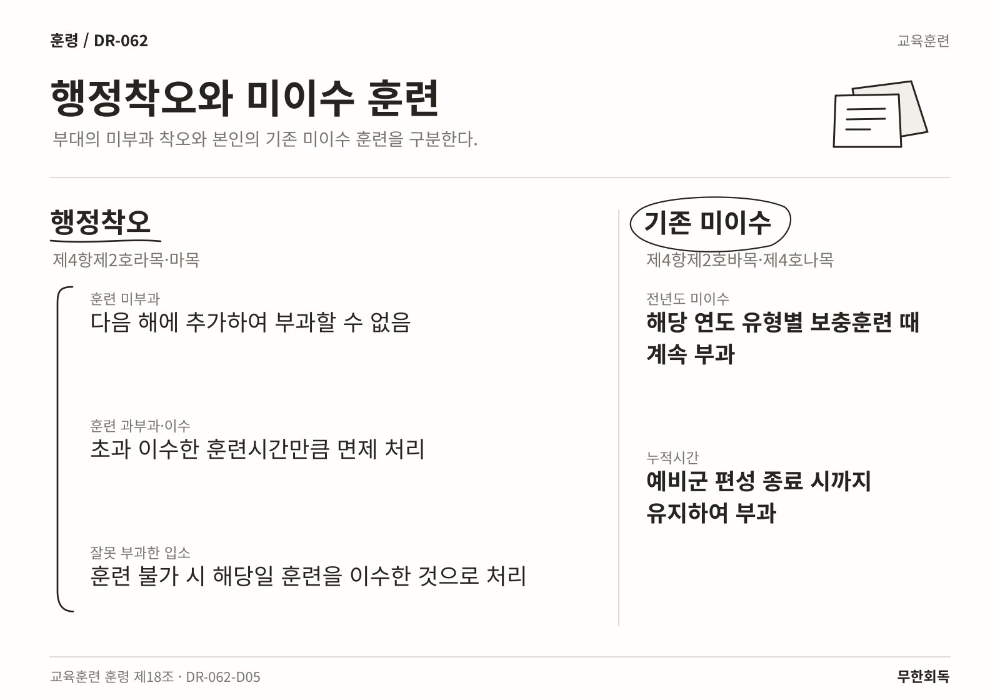
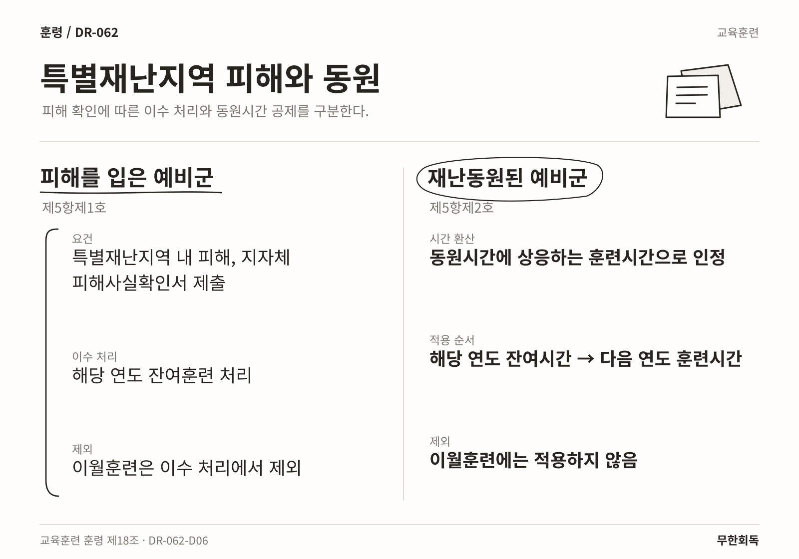

# DR-062 · 예비군 교육훈련 훈령 제18조, 훈련 후 행정처리

도식 **6장** · 1600 × 1120 · 흑백 편집형 디자인

[훈령 전체 목록](../../README.md) · [전체 매니페스트](../../diagrams-manifest.json)

## DR-062-D01 · 훈련결과 입력과 확인

[WebP](DR-062-D01-editorial-v1.webp) · [PNG](DR-062-D01-editorial-v1.png) · [SVG 원본](DR-062-D01-editorial-v1.svg)

근거: [교육훈련 훈령 제18조](https://www.law.go.kr/LSW/admRulLsInfoP.do?admRulSeq=2100000286712#J18-0:0) · 국방부훈령 제3216호

## DR-062-D02 · 소집필증과 서류 보존

[WebP](DR-062-D02-editorial-v1.webp) · [PNG](DR-062-D02-editorial-v1.png) · [SVG 원본](DR-062-D02-editorial-v1.svg)

근거: [교육훈련 훈령 제18조](https://www.law.go.kr/LSW/admRulLsInfoP.do?admRulSeq=2100000286712#J18-0:0) · 국방부훈령 제3216호

## DR-062-D03 · 보충훈련과 고발의 흐름

[WebP](DR-062-D03-editorial-v1.webp) · [PNG](DR-062-D03-editorial-v1.png) · [SVG 원본](DR-062-D03-editorial-v1.svg)

근거: [교육훈련 훈령 제18조](https://www.law.go.kr/LSW/admRulLsInfoP.do?admRulSeq=2100000286712#J18-0:0) · 국방부훈령 제3216호

동원훈련Ⅰ형 무단불참은 지방병무청 고발 등 제4항제1호의 별도 절차 적용.

## DR-062-D04 · Ⅰ형 귀가와 조기퇴소 처리

[WebP](DR-062-D04-editorial-v1.webp) · [PNG](DR-062-D04-editorial-v1.png) · [SVG 원본](DR-062-D04-editorial-v1.svg)

근거: [교육훈련 훈령 제18조](https://www.law.go.kr/LSW/admRulLsInfoP.do?admRulSeq=2100000286712#J18-0:0) · 국방부훈령 제3216호

## DR-062-D05 · 행정착오와 미이수 훈련

[WebP](DR-062-D05-editorial-v1.webp) · [PNG](DR-062-D05-editorial-v1.png) · [SVG 원본](DR-062-D05-editorial-v1.svg)

근거: [교육훈련 훈령 제18조](https://www.law.go.kr/LSW/admRulLsInfoP.do?admRulSeq=2100000286712#J18-0:0) · 국방부훈령 제3216호

병역법상 훈련 대상자에게 추가훈련 기회가 없는 경우는 미부과자로 보지 않는다.

## DR-062-D06 · 특별재난지역 피해와 동원

[WebP](DR-062-D06-editorial-v1.webp) · [PNG](DR-062-D06-editorial-v1.png) · [SVG 원본](DR-062-D06-editorial-v1.svg)

근거: [교육훈련 훈령 제18조](https://www.law.go.kr/LSW/admRulLsInfoP.do?admRulSeq=2100000286712#J18-0:0) · 국방부훈령 제3216호
