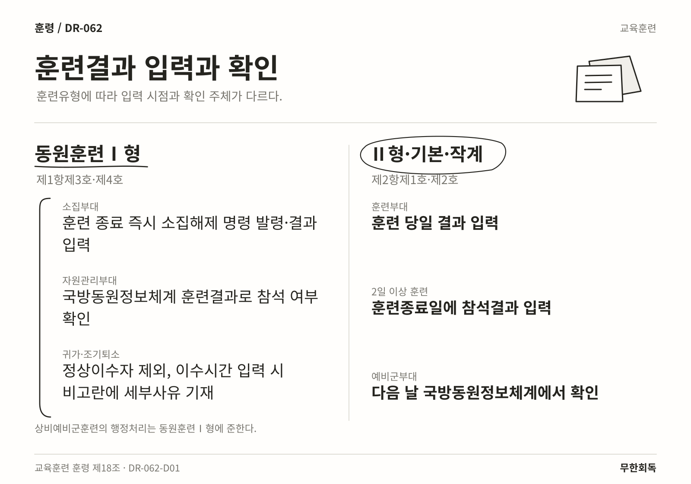
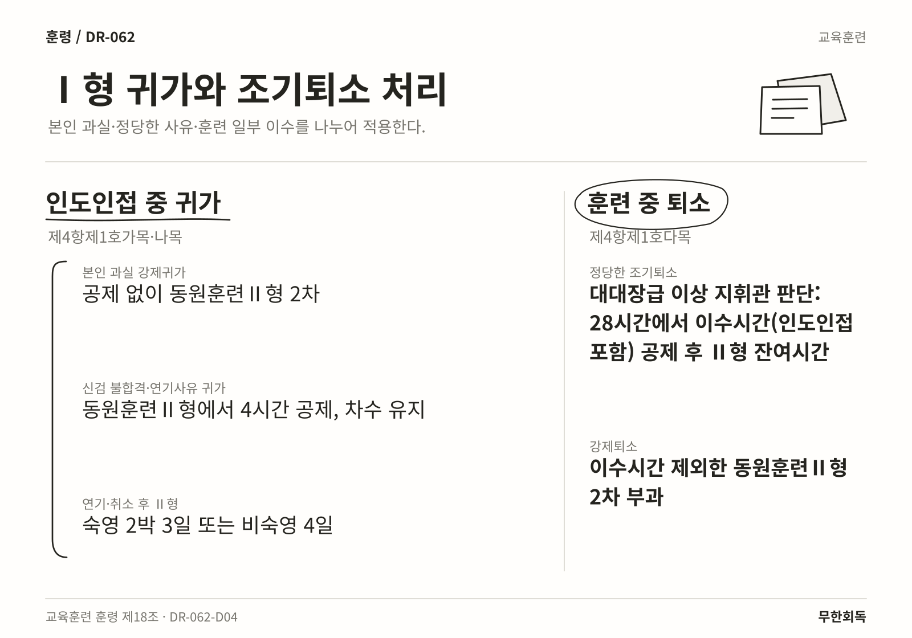
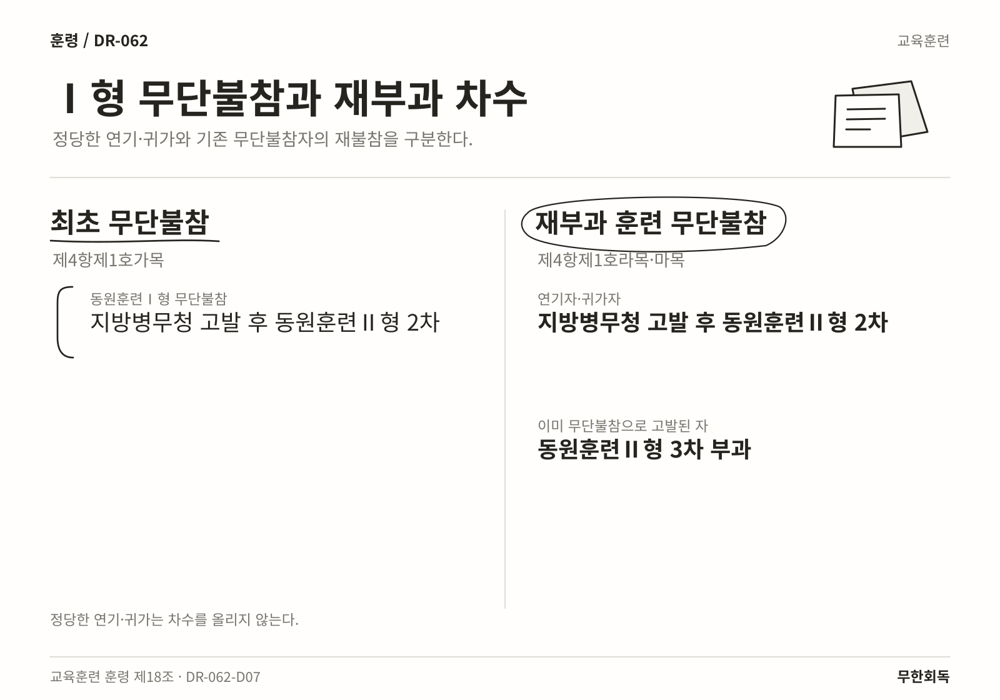
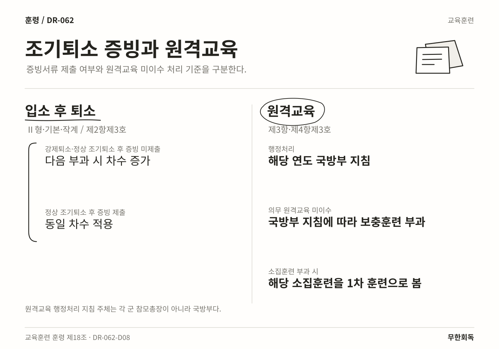
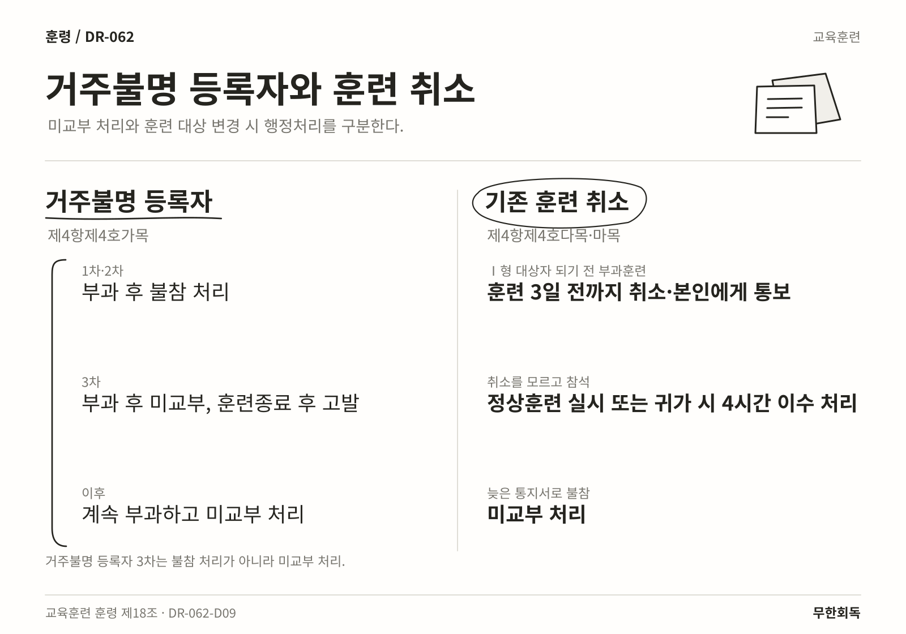
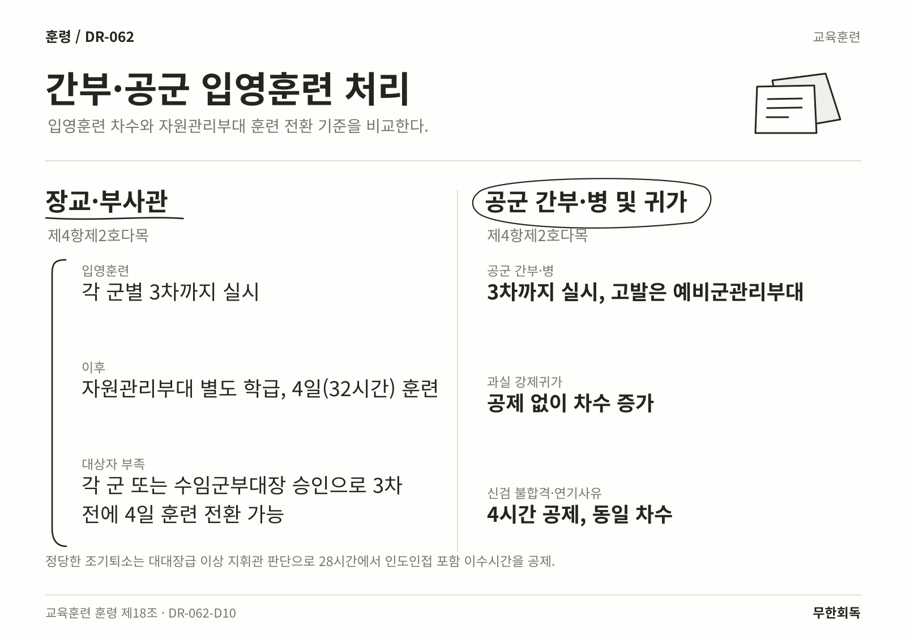
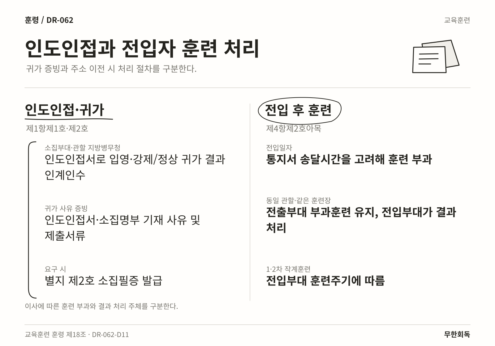

# DR-062 · 예비군 교육훈련 훈령 제18조, 훈련 후 행정처리

도식 **11장** · 1600 × 1120 · 흑백 편집형 디자인

[훈령 전체 목록](../../README.md) · [전체 매니페스트](../../diagrams-manifest.json)

## DR-062-D01 · 훈련결과 입력과 확인

[WebP](DR-062-D01-editorial-v1.webp) · [PNG](DR-062-D01-editorial-v1.png) · [SVG 원본](DR-062-D01-editorial-v1.svg)

근거: [교육훈련 훈령 제18조](https://www.law.go.kr/LSW/admRulLsInfoP.do?admRulSeq=2100000286712#J18-0:0) · 국방부훈령 제3216호

## DR-062-D02 · 소집필증과 서류 보존

[WebP](DR-062-D02-editorial-v1.webp) · [PNG](DR-062-D02-editorial-v1.png) · [SVG 원본](DR-062-D02-editorial-v1.svg)

근거: [교육훈련 훈령 제18조](https://www.law.go.kr/LSW/admRulLsInfoP.do?admRulSeq=2100000286712#J18-0:0) · 국방부훈령 제3216호

## DR-062-D03 · 보충훈련과 고발의 흐름

[WebP](DR-062-D03-editorial-v1.webp) · [PNG](DR-062-D03-editorial-v1.png) · [SVG 원본](DR-062-D03-editorial-v1.svg)

근거: [교육훈련 훈령 제18조](https://www.law.go.kr/LSW/admRulLsInfoP.do?admRulSeq=2100000286712#J18-0:0) · 국방부훈령 제3216호

## DR-062-D04 · Ⅰ형 귀가와 조기퇴소 처리

[WebP](DR-062-D04-editorial-v1.webp) · [PNG](DR-062-D04-editorial-v1.png) · [SVG 원본](DR-062-D04-editorial-v1.svg)

근거: [교육훈련 훈령 제18조](https://www.law.go.kr/LSW/admRulLsInfoP.do?admRulSeq=2100000286712#J18-0:0) · 국방부훈령 제3216호

## DR-062-D05 · 행정착오와 미이수 훈련

[WebP](DR-062-D05-editorial-v1.webp) · [PNG](DR-062-D05-editorial-v1.png) · [SVG 원본](DR-062-D05-editorial-v1.svg)

근거: [교육훈련 훈령 제18조](https://www.law.go.kr/LSW/admRulLsInfoP.do?admRulSeq=2100000286712#J18-0:0) · 국방부훈령 제3216호

## DR-062-D06 · 특별재난지역 피해와 동원

[WebP](DR-062-D06-editorial-v1.webp) · [PNG](DR-062-D06-editorial-v1.png) · [SVG 원본](DR-062-D06-editorial-v1.svg)

근거: [교육훈련 훈령 제18조](https://www.law.go.kr/LSW/admRulLsInfoP.do?admRulSeq=2100000286712#J18-0:0) · 국방부훈령 제3216호

## DR-062-D07 · Ⅰ형 무단불참과 재부과 차수

[WebP](DR-062-D07-editorial-v1.webp) · [PNG](DR-062-D07-editorial-v1.png) · [SVG 원본](DR-062-D07-editorial-v1.svg)

근거: [교육훈련 훈령 제18조](https://www.law.go.kr/LSW/admRulLsInfoP.do?admRulSeq=2100000286712#J18-0:0) · 국방부훈령 제3216호

## DR-062-D08 · 조기퇴소 증빙과 원격교육

[WebP](DR-062-D08-editorial-v1.webp) · [PNG](DR-062-D08-editorial-v1.png) · [SVG 원본](DR-062-D08-editorial-v1.svg)

근거: [교육훈련 훈령 제18조](https://www.law.go.kr/LSW/admRulLsInfoP.do?admRulSeq=2100000286712#J18-0:0) · 국방부훈령 제3216호

## DR-062-D09 · 거주불명 등록자와 훈련 취소

[WebP](DR-062-D09-editorial-v1.webp) · [PNG](DR-062-D09-editorial-v1.png) · [SVG 원본](DR-062-D09-editorial-v1.svg)

근거: [교육훈련 훈령 제18조](https://www.law.go.kr/LSW/admRulLsInfoP.do?admRulSeq=2100000286712#J18-0:0) · 국방부훈령 제3216호

## DR-062-D10 · 간부·공군 입영훈련 처리

[WebP](DR-062-D10-editorial-v1.webp) · [PNG](DR-062-D10-editorial-v1.png) · [SVG 원본](DR-062-D10-editorial-v1.svg)

근거: [교육훈련 훈령 제18조](https://www.law.go.kr/LSW/admRulLsInfoP.do?admRulSeq=2100000286712#J18-0:0) · 국방부훈령 제3216호

## DR-062-D11 · 인도인접과 전입자 훈련 처리

[WebP](DR-062-D11-editorial-v1.webp) · [PNG](DR-062-D11-editorial-v1.png) · [SVG 원본](DR-062-D11-editorial-v1.svg)

근거: [교육훈련 훈령 제18조](https://www.law.go.kr/LSW/admRulLsInfoP.do?admRulSeq=2100000286712#J18-0:0) · 국방부훈령 제3216호

