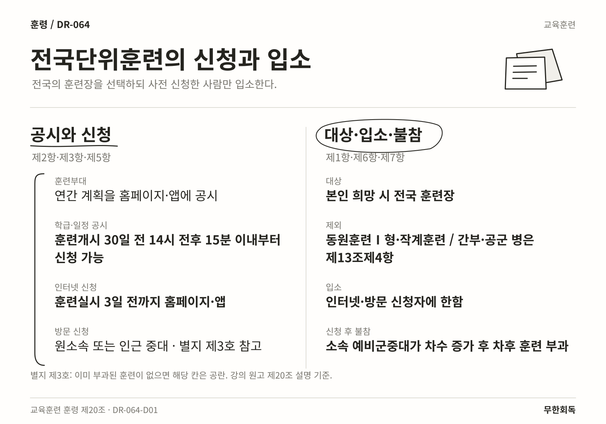
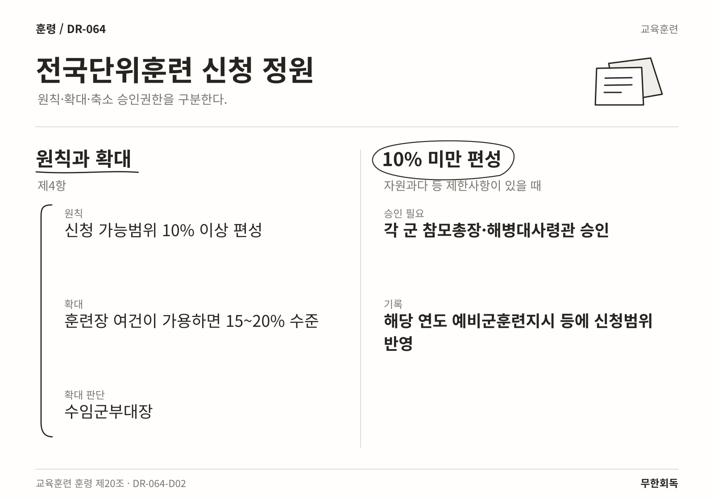

# DR-064 · 예비군 교육훈련 훈령 제20조, 전국단위훈련

도식 **2장** · 1600 × 1120 · 흑백 편집형 디자인

[훈령 전체 목록](../../README.md) · [전체 매니페스트](../../diagrams-manifest.json)

## DR-064-D01 · 전국단위훈련의 신청과 입소

[WebP](DR-064-D01-editorial-v1.webp) · [PNG](DR-064-D01-editorial-v1.png) · [SVG 원본](DR-064-D01-editorial-v1.svg)

근거: [교육훈련 훈령 제20조](https://www.law.go.kr/LSW/admRulLsInfoP.do?admRulSeq=2100000286712#J20-0:0) · 국방부훈령 제3216호

훈련장에서 실시하는 작계 3차의 전환 예외는 제14조제2호마목 적용.

## DR-064-D02 · 전국단위훈련 신청 정원

[WebP](DR-064-D02-editorial-v1.webp) · [PNG](DR-064-D02-editorial-v1.png) · [SVG 원본](DR-064-D02-editorial-v1.svg)

근거: [교육훈련 훈령 제20조](https://www.law.go.kr/LSW/admRulLsInfoP.do?admRulSeq=2100000286712#J20-0:0) · 국방부훈령 제3216호
