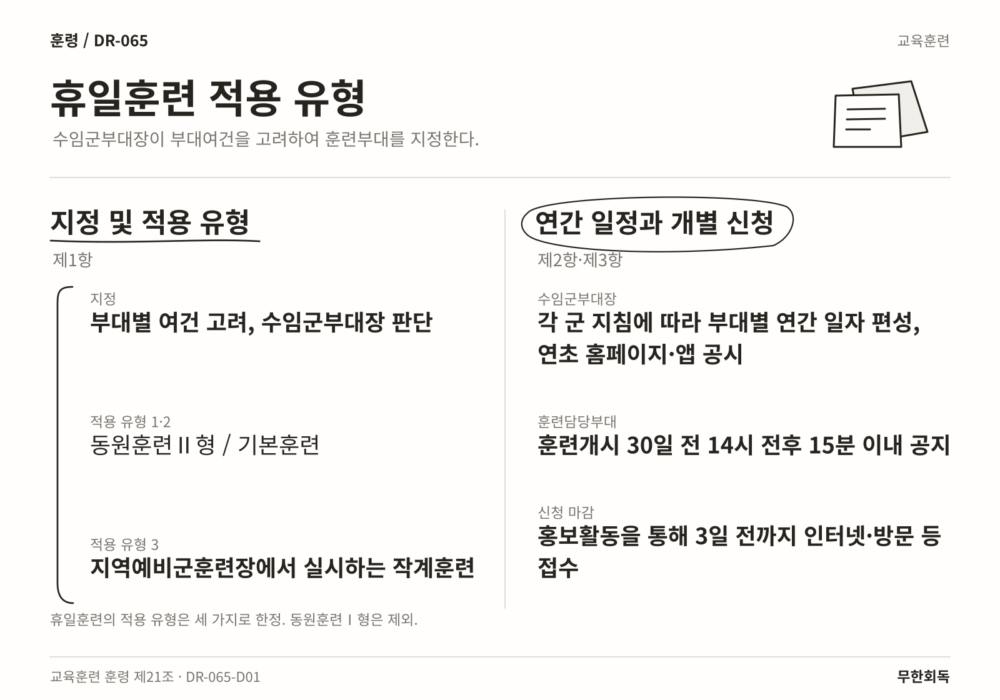
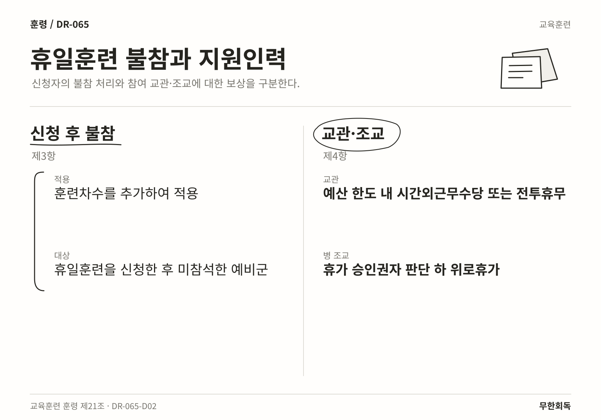

# DR-065 · 예비군 교육훈련 훈령 제21조, 휴일예비군훈련

도식 **2장** · 1600 × 1120 · 흑백 편집형 디자인

[훈령 전체 목록](../../README.md) · [전체 매니페스트](../../diagrams-manifest.json)

## DR-065-D01 · 휴일훈련 적용 유형

[WebP](DR-065-D01-editorial-v1.webp) · [PNG](DR-065-D01-editorial-v1.png) · [SVG 원본](DR-065-D01-editorial-v1.svg)

근거: [교육훈련 훈령 제21조](https://www.law.go.kr/LSW/admRulLsInfoP.do?admRulSeq=2100000286712#J21-0:0) · 국방부훈령 제3216호

## DR-065-D02 · 휴일훈련 불참과 지원인력

[WebP](DR-065-D02-editorial-v1.webp) · [PNG](DR-065-D02-editorial-v1.png) · [SVG 원본](DR-065-D02-editorial-v1.svg)

근거: [교육훈련 훈령 제21조](https://www.law.go.kr/LSW/admRulLsInfoP.do?admRulSeq=2100000286712#J21-0:0) · 국방부훈령 제3216호

