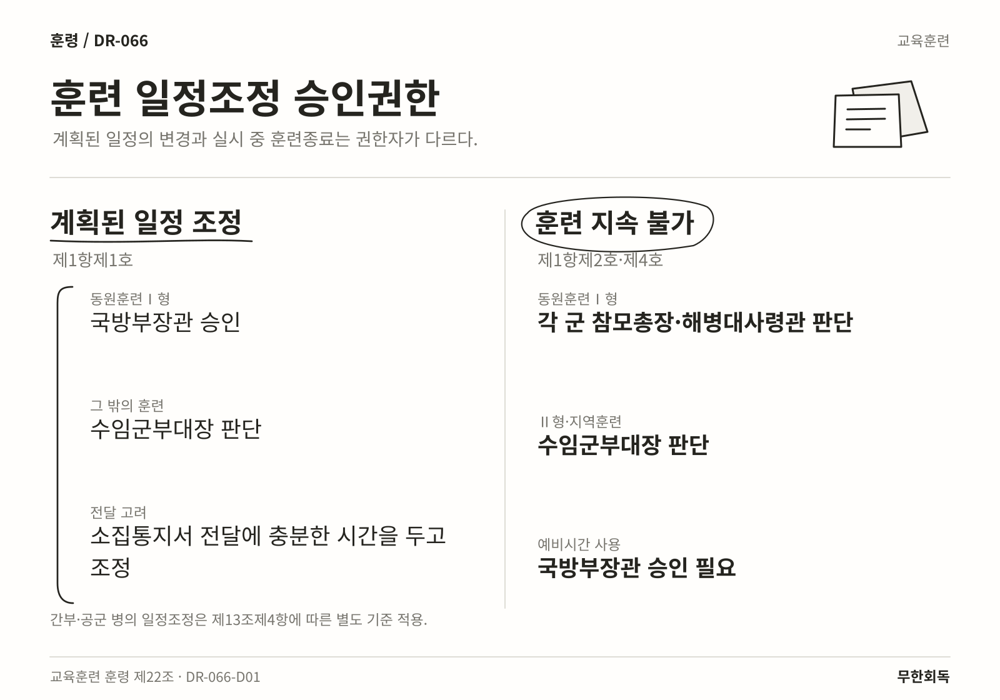
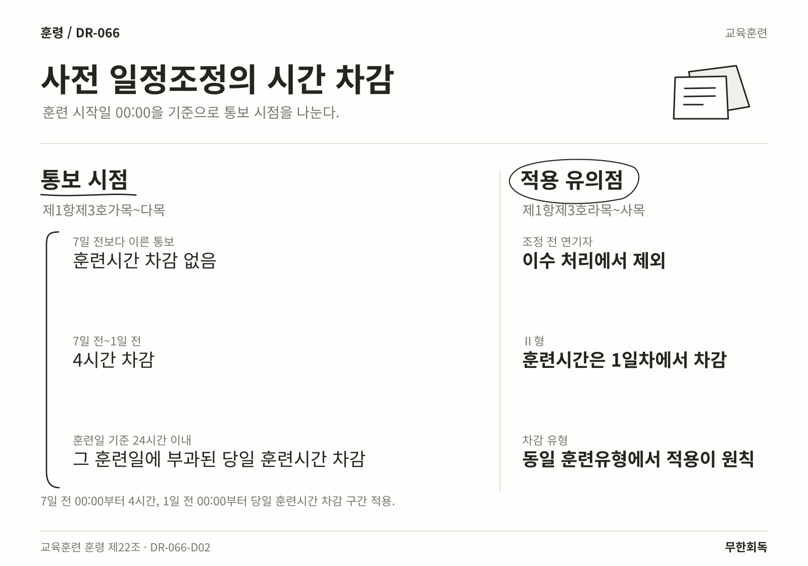
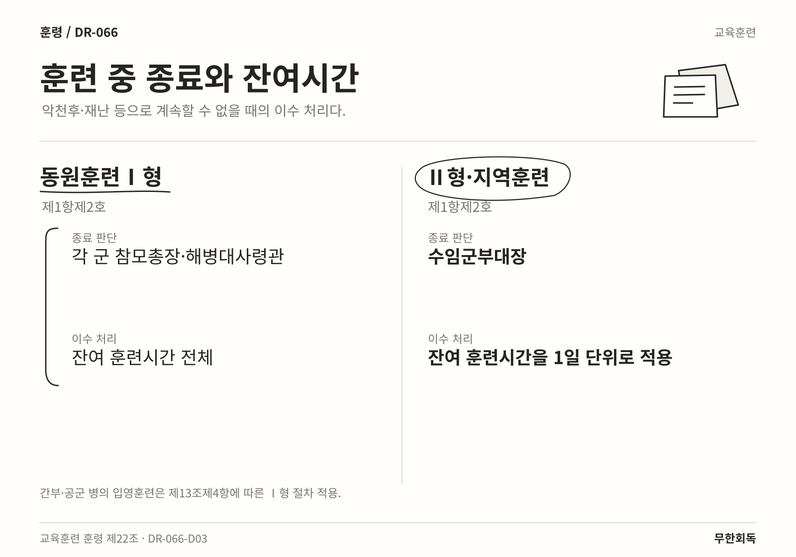

# DR-066 · 예비군 교육훈련 훈령 제22조, 훈련일정조정 등의 승인권한

도식 **3장** · 1600 × 1120 · 흑백 편집형 디자인

[훈령 전체 목록](../../README.md) · [전체 매니페스트](../../diagrams-manifest.json)

## DR-066-D01 · 훈련 일정조정 승인권한

[WebP](DR-066-D01-editorial-v1.webp) · [PNG](DR-066-D01-editorial-v1.png) · [SVG 원본](DR-066-D01-editorial-v1.svg)

근거: [교육훈련 훈령 제22조](https://www.law.go.kr/LSW/admRulLsInfoP.do?admRulSeq=2100000286712#J22-0:0) · 국방부훈령 제3216호

간부·공군 병의 일정조정은 제13조제4항에 따른 별도 기준 적용.

## DR-066-D02 · 사전 일정조정의 시간 차감

[WebP](DR-066-D02-editorial-v1.webp) · [PNG](DR-066-D02-editorial-v1.png) · [SVG 원본](DR-066-D02-editorial-v1.svg)

근거: [교육훈련 훈령 제22조](https://www.law.go.kr/LSW/admRulLsInfoP.do?admRulSeq=2100000286712#J22-0:0) · 국방부훈령 제3216호

7일 전 00:00부터 4시간, 1일 전 00:00부터 당일 훈련시간 차감 구간 적용.

## DR-066-D03 · 훈련 중 종료와 잔여시간

[WebP](DR-066-D03-editorial-v1.webp) · [PNG](DR-066-D03-editorial-v1.png) · [SVG 원본](DR-066-D03-editorial-v1.svg)

근거: [교육훈련 훈령 제22조](https://www.law.go.kr/LSW/admRulLsInfoP.do?admRulSeq=2100000286712#J22-0:0) · 국방부훈령 제3216호

간부·공군 병의 입영훈련은 제13조제4항에 따른 Ⅰ형 절차 적용.
