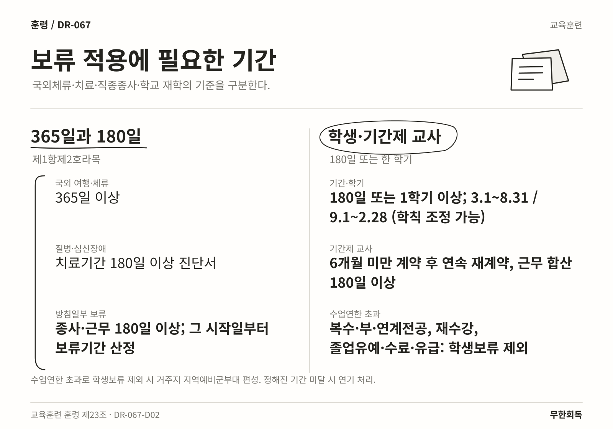
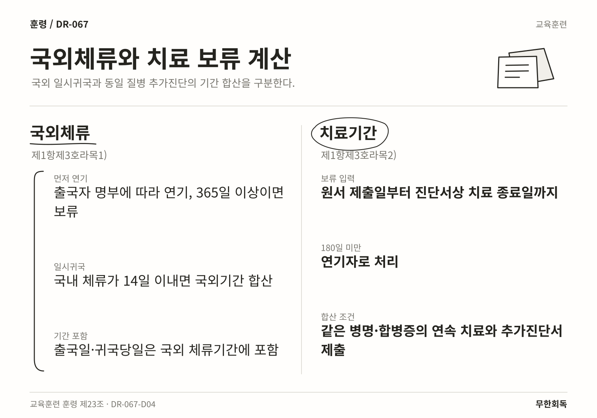
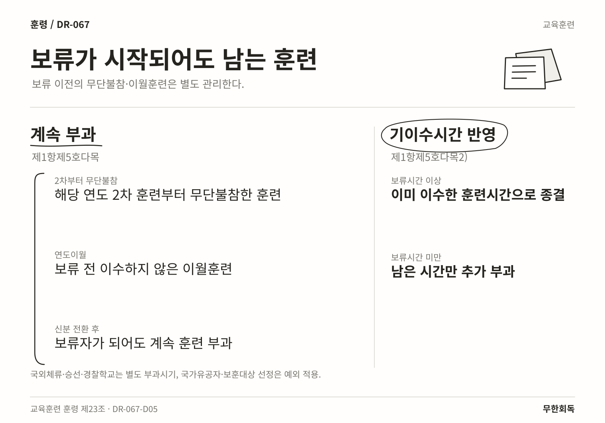

# DR-067 · 예비군 교육훈련 훈령 제23조, 예비군훈련 보류

도식 **5장** · 1600 × 1120 · 흑백 편집형 디자인

[훈령 전체 목록](../../README.md) · [전체 매니페스트](../../diagrams-manifest.json)

## DR-067-D01 · 보류의 결정과 적용기간

[WebP](DR-067-D01-editorial-v1.webp) · [PNG](DR-067-D01-editorial-v1.png) · [SVG 원본](DR-067-D01-editorial-v1.svg)

근거: [교육훈련 훈령 제23조](https://www.law.go.kr/LSW/admRulLsInfoP.do?admRulSeq=2100000286712#J23-0:0) · 국방부훈령 제3216호

## DR-067-D02 · 보류 적용에 필요한 기간

[WebP](DR-067-D02-editorial-v1.webp) · [PNG](DR-067-D02-editorial-v1.png) · [SVG 원본](DR-067-D02-editorial-v1.svg)

근거: [교육훈련 훈령 제23조](https://www.law.go.kr/LSW/admRulLsInfoP.do?admRulSeq=2100000286712#J23-0:0) · 국방부훈령 제3216호

국외체류·치료·일부보류의 정해진 기간 미달 시 그 기간은 연기 처리.

## DR-067-D03 · 보류원서 제출과 직권처리

[WebP](DR-067-D03-editorial-v1.webp) · [PNG](DR-067-D03-editorial-v1.png) · [SVG 원본](DR-067-D03-editorial-v1.svg)

근거: [교육훈련 훈령 제23조](https://www.law.go.kr/LSW/admRulLsInfoP.do?admRulSeq=2100000286712#J23-0:0) · 국방부훈령 제3216호

## DR-067-D04 · 국외체류와 치료 보류 계산

[WebP](DR-067-D04-editorial-v1.webp) · [PNG](DR-067-D04-editorial-v1.png) · [SVG 원본](DR-067-D04-editorial-v1.svg)

근거: [교육훈련 훈령 제23조](https://www.law.go.kr/LSW/admRulLsInfoP.do?admRulSeq=2100000286712#J23-0:0) · 국방부훈령 제3216호

## DR-067-D05 · 보류가 시작되어도 남는 훈련

[WebP](DR-067-D05-editorial-v1.webp) · [PNG](DR-067-D05-editorial-v1.png) · [SVG 원본](DR-067-D05-editorial-v1.svg)

근거: [교육훈련 훈령 제23조](https://www.law.go.kr/LSW/admRulLsInfoP.do?admRulSeq=2100000286712#J23-0:0) · 국방부훈령 제3216호

국외체류·승선·경찰학교는 별도 부과시기, 국가유공자·보훈대상 선정은 예외 적용.
