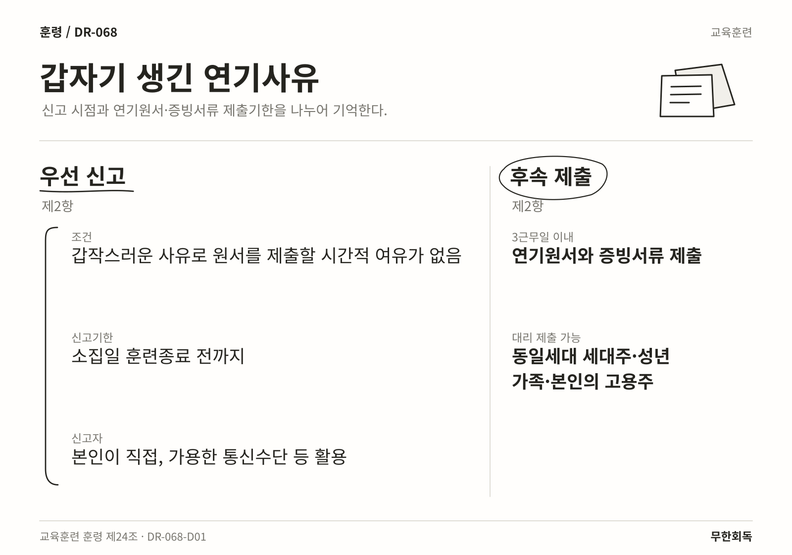
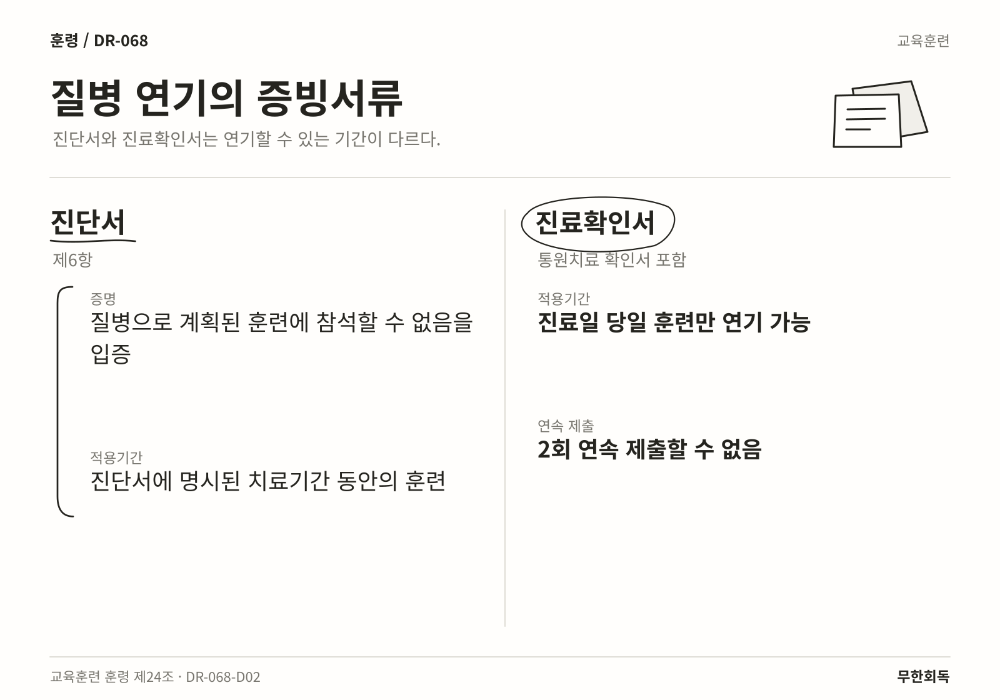
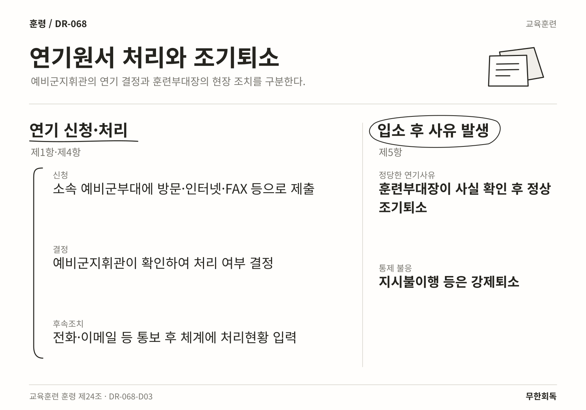

# DR-068 · 예비군 교육훈련 훈령 제24조, 예비군훈련 연기

도식 **3장** · 1600 × 1120 · 흑백 편집형 디자인

[훈령 전체 목록](../../README.md) · [전체 매니페스트](../../diagrams-manifest.json)

## DR-068-D01 · 갑자기 생긴 연기사유

[WebP](DR-068-D01-editorial-v1.webp) · [PNG](DR-068-D01-editorial-v1.png) · [SVG 원본](DR-068-D01-editorial-v1.svg)

근거: [교육훈련 훈령 제24조](https://www.law.go.kr/LSW/admRulLsInfoP.do?admRulSeq=2100000286712#J24-0:0) · 국방부훈령 제3216호

## DR-068-D02 · 질병 연기의 증빙서류

[WebP](DR-068-D02-editorial-v1.webp) · [PNG](DR-068-D02-editorial-v1.png) · [SVG 원본](DR-068-D02-editorial-v1.svg)

근거: [교육훈련 훈령 제24조](https://www.law.go.kr/LSW/admRulLsInfoP.do?admRulSeq=2100000286712#J24-0:0) · 국방부훈령 제3216호

## DR-068-D03 · 연기원서 처리와 조기퇴소

[WebP](DR-068-D03-editorial-v1.webp) · [PNG](DR-068-D03-editorial-v1.png) · [SVG 원본](DR-068-D03-editorial-v1.svg)

근거: [교육훈련 훈령 제24조](https://www.law.go.kr/LSW/admRulLsInfoP.do?admRulSeq=2100000286712#J24-0:0) · 국방부훈령 제3216호
