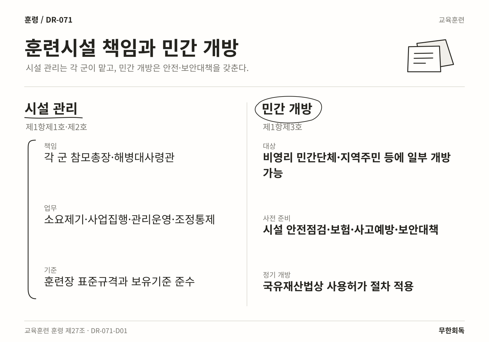
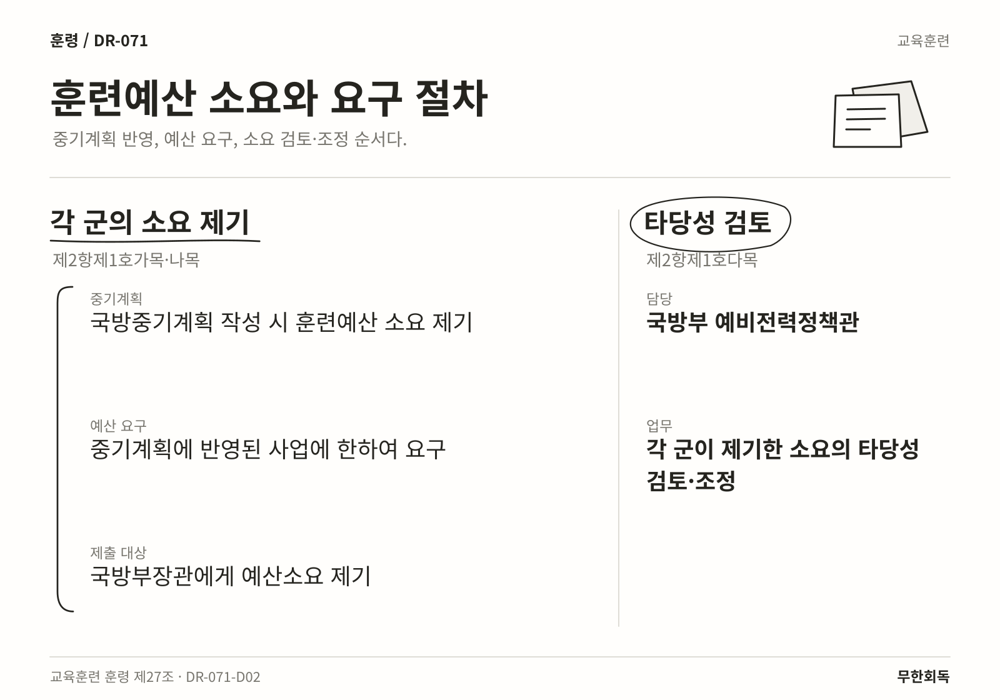
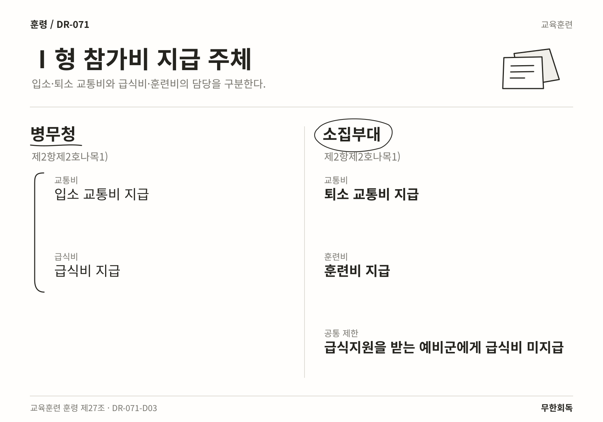
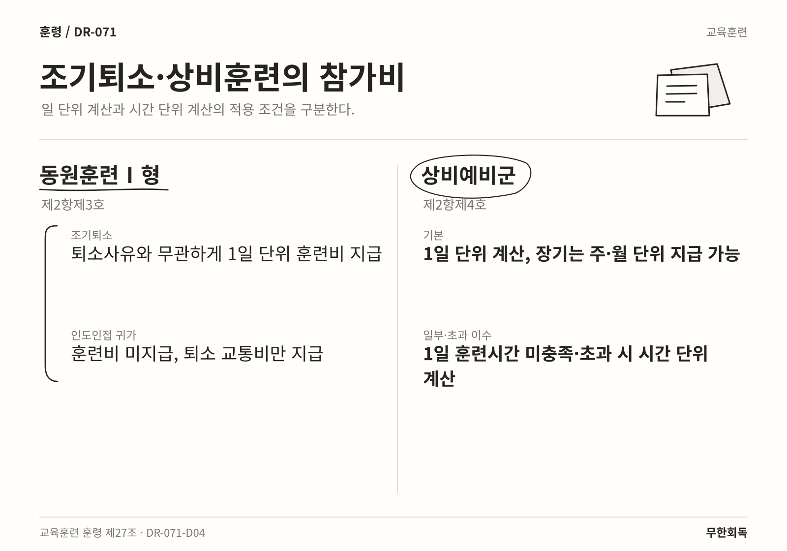

# DR-071 · 예비군 교육훈련 훈령 제27조, 훈련시설 및 예산

도식 **4장** · 1600 × 1120 · 흑백 편집형 디자인

[훈령 전체 목록](../../README.md) · [전체 매니페스트](../../diagrams-manifest.json)

## DR-071-D01 · 훈련시설 책임과 민간 개방

[WebP](DR-071-D01-editorial-v1.webp) · [PNG](DR-071-D01-editorial-v1.png) · [SVG 원본](DR-071-D01-editorial-v1.svg)

근거: [교육훈련 훈령 제27조](https://www.law.go.kr/LSW/admRulLsInfoP.do?admRulSeq=2100000286712#J27-0:0) · 국방부훈령 제3216호

## DR-071-D02 · 훈련예산 소요와 요구 절차

[WebP](DR-071-D02-editorial-v1.webp) · [PNG](DR-071-D02-editorial-v1.png) · [SVG 원본](DR-071-D02-editorial-v1.svg)

근거: [교육훈련 훈령 제27조](https://www.law.go.kr/LSW/admRulLsInfoP.do?admRulSeq=2100000286712#J27-0:0) · 국방부훈령 제3216호

## DR-071-D03 · Ⅰ형 참가비 지급 주체

[WebP](DR-071-D03-editorial-v1.webp) · [PNG](DR-071-D03-editorial-v1.png) · [SVG 원본](DR-071-D03-editorial-v1.svg)

근거: [교육훈련 훈령 제27조](https://www.law.go.kr/LSW/admRulLsInfoP.do?admRulSeq=2100000286712#J27-0:0) · 국방부훈령 제3216호

## DR-071-D04 · 조기퇴소·상비훈련의 참가비

[WebP](DR-071-D04-editorial-v1.webp) · [PNG](DR-071-D04-editorial-v1.png) · [SVG 원본](DR-071-D04-editorial-v1.svg)

근거: [교육훈련 훈령 제27조](https://www.law.go.kr/LSW/admRulLsInfoP.do?admRulSeq=2100000286712#J27-0:0) · 국방부훈령 제3216호
