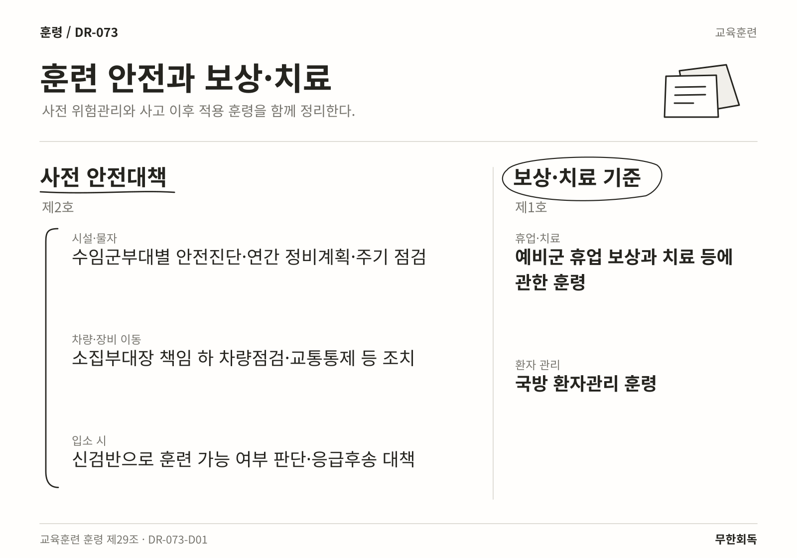
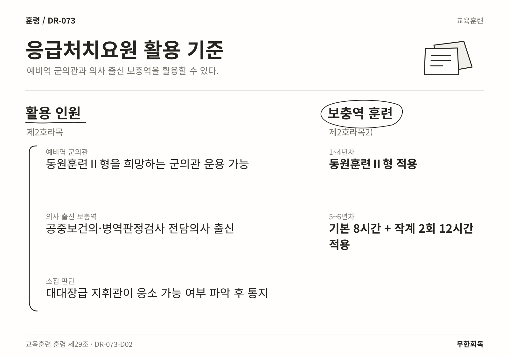

# DR-073 · 예비군 교육훈련 훈령 제29조, 보상·치료 및 안전 활동

도식 **2장** · 1600 × 1120 · 흑백 편집형 디자인

[훈령 전체 목록](../../README.md) · [전체 매니페스트](../../diagrams-manifest.json)

## DR-073-D01 · 훈련 안전과 보상·치료

[WebP](DR-073-D01-editorial-v1.webp) · [PNG](DR-073-D01-editorial-v1.png) · [SVG 원본](DR-073-D01-editorial-v1.svg)

근거: [교육훈련 훈령 제29조](https://www.law.go.kr/LSW/admRulLsInfoP.do?admRulSeq=2100000286712#J29-0:0) · 국방부훈령 제3216호

## DR-073-D02 · 응급처치요원 활용 기준

[WebP](DR-073-D02-editorial-v1.webp) · [PNG](DR-073-D02-editorial-v1.png) · [SVG 원본](DR-073-D02-editorial-v1.svg)

근거: [교육훈련 훈령 제29조](https://www.law.go.kr/LSW/admRulLsInfoP.do?admRulSeq=2100000286712#J29-0:0) · 국방부훈령 제3216호
