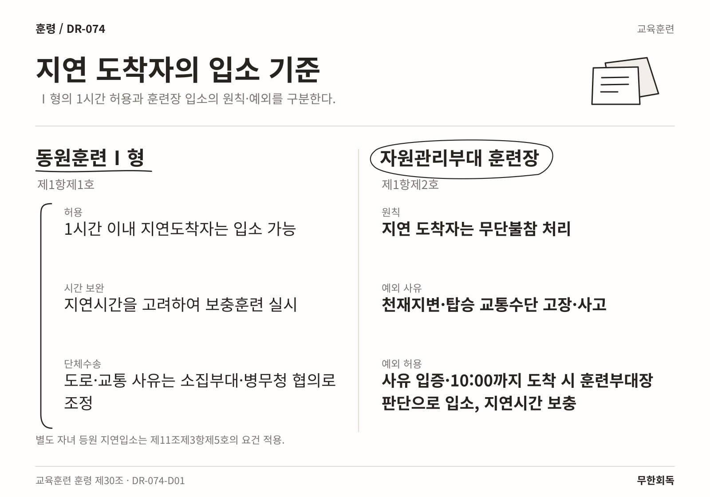
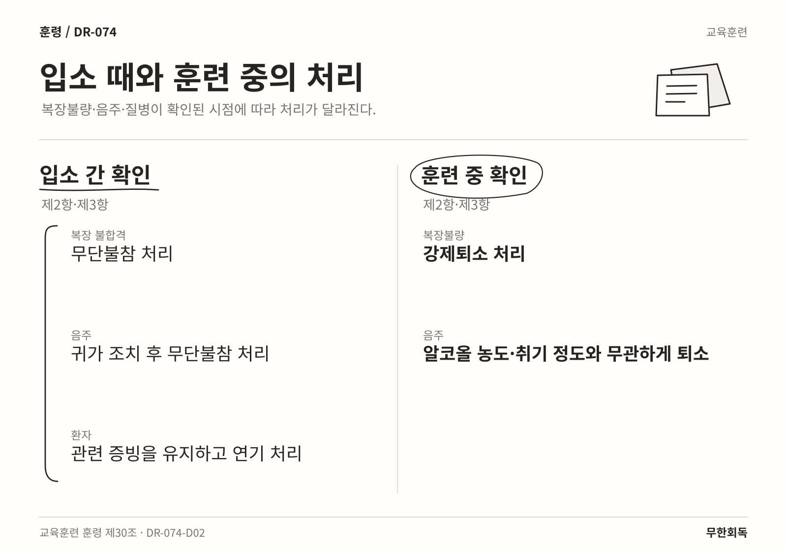
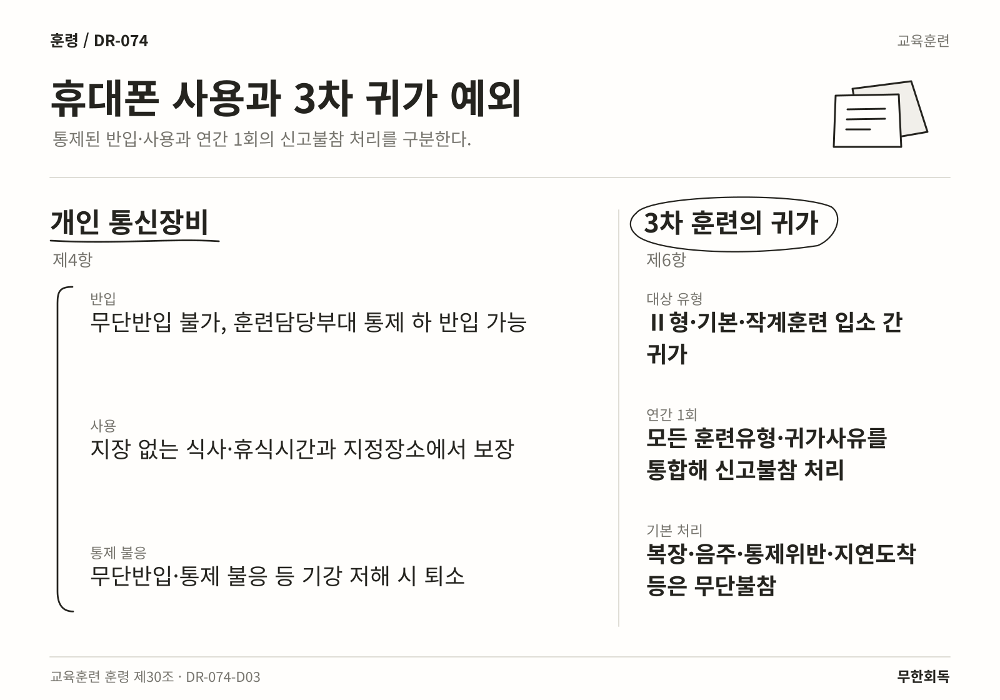
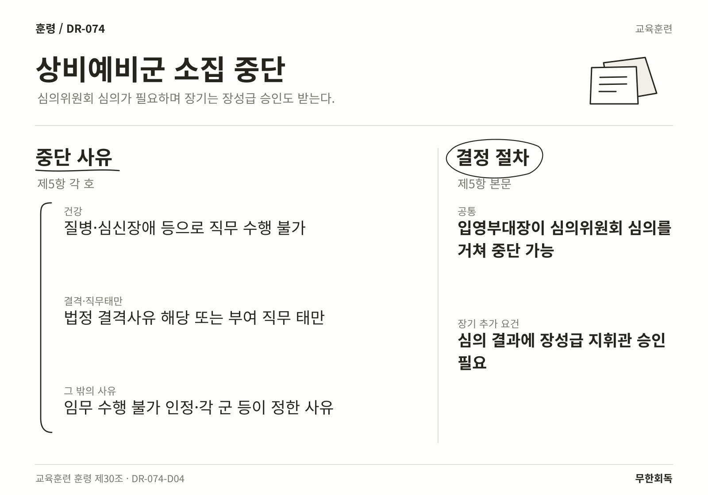

# DR-074 · 예비군 교육훈련 훈령 제30조, 훈련기강 확립

도식 **4장** · 1600 × 1120 · 흑백 편집형 디자인

[훈령 전체 목록](../../README.md) · [전체 매니페스트](../../diagrams-manifest.json)

## DR-074-D01 · 지연 도착자의 입소 기준

[WebP](DR-074-D01-editorial-v1.webp) · [PNG](DR-074-D01-editorial-v1.png) · [SVG 원본](DR-074-D01-editorial-v1.svg)

근거: [교육훈련 훈령 제30조](https://www.law.go.kr/LSW/admRulLsInfoP.do?admRulSeq=2100000286712#J30-0:0) · 국방부훈령 제3216호

별도 자녀 등원 지연입소는 제11조제3항제5호의 요건 적용.

## DR-074-D02 · 입소 때와 훈련 중의 처리

[WebP](DR-074-D02-editorial-v1.webp) · [PNG](DR-074-D02-editorial-v1.png) · [SVG 원본](DR-074-D02-editorial-v1.svg)

근거: [교육훈련 훈령 제30조](https://www.law.go.kr/LSW/admRulLsInfoP.do?admRulSeq=2100000286712#J30-0:0) · 국방부훈령 제3216호

## DR-074-D03 · 휴대폰 사용과 3차 귀가 예외

[WebP](DR-074-D03-editorial-v1.webp) · [PNG](DR-074-D03-editorial-v1.png) · [SVG 원본](DR-074-D03-editorial-v1.svg)

근거: [교육훈련 훈령 제30조](https://www.law.go.kr/LSW/admRulLsInfoP.do?admRulSeq=2100000286712#J30-0:0) · 국방부훈령 제3216호

## DR-074-D04 · 상비예비군 소집 중단

[WebP](DR-074-D04-editorial-v1.webp) · [PNG](DR-074-D04-editorial-v1.png) · [SVG 원본](DR-074-D04-editorial-v1.svg)

근거: [교육훈련 훈령 제30조](https://www.law.go.kr/LSW/admRulLsInfoP.do?admRulSeq=2100000286712#J30-0:0) · 국방부훈령 제3216호
