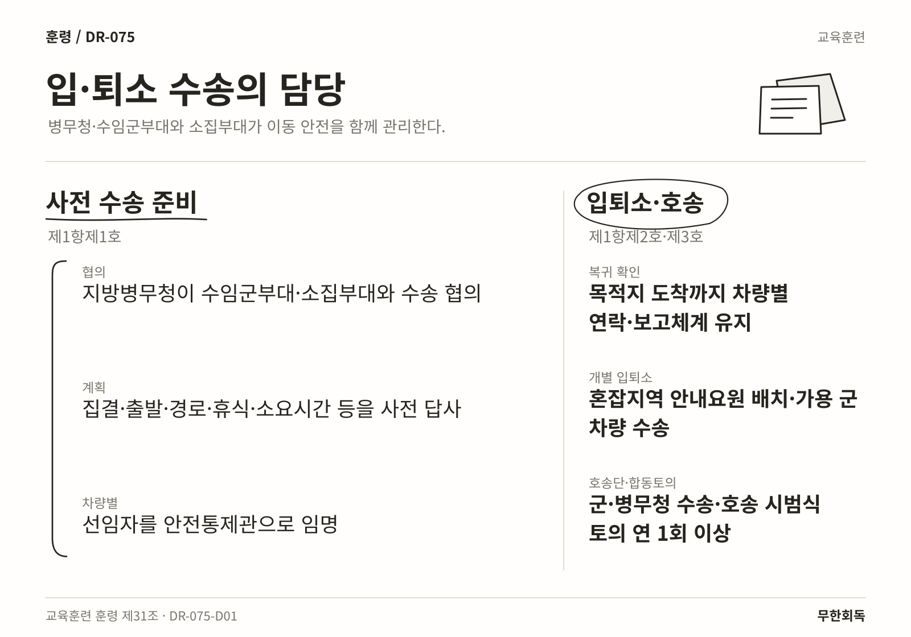
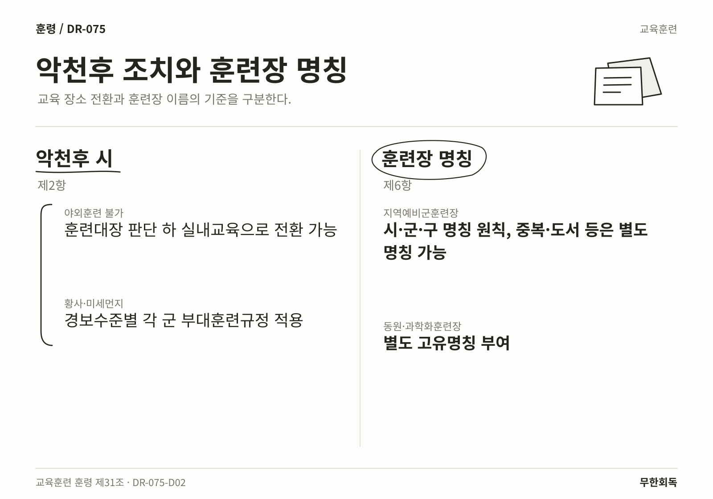
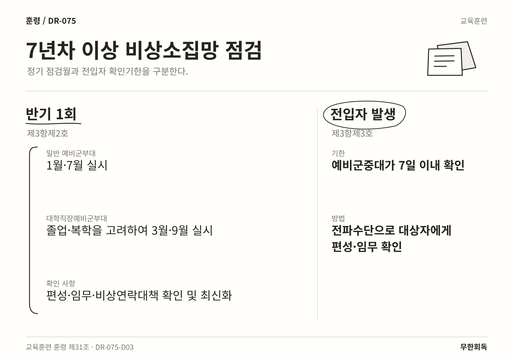

# DR-075 · 예비군 교육훈련 훈령 제31조, 기타

도식 **3장** · 1600 × 1120 · 흑백 편집형 디자인

[훈령 전체 목록](../../README.md) · [전체 매니페스트](../../diagrams-manifest.json)

## DR-075-D01 · 입·퇴소 수송의 담당

[WebP](DR-075-D01-editorial-v1.webp) · [PNG](DR-075-D01-editorial-v1.png) · [SVG 원본](DR-075-D01-editorial-v1.svg)

근거: [교육훈련 훈령 제31조](https://www.law.go.kr/LSW/admRulLsInfoP.do?admRulSeq=2100000286712#J31-0:0) · 국방부훈령 제3216호

## DR-075-D02 · 악천후 조치와 훈련장 명칭

[WebP](DR-075-D02-editorial-v1.webp) · [PNG](DR-075-D02-editorial-v1.png) · [SVG 원본](DR-075-D02-editorial-v1.svg)

근거: [교육훈련 훈령 제31조](https://www.law.go.kr/LSW/admRulLsInfoP.do?admRulSeq=2100000286712#J31-0:0) · 국방부훈령 제3216호

## DR-075-D03 · 7년차 이상 비상소집망 점검

[WebP](DR-075-D03-editorial-v1.webp) · [PNG](DR-075-D03-editorial-v1.png) · [SVG 원본](DR-075-D03-editorial-v1.svg)

근거: [교육훈련 훈령 제31조](https://www.law.go.kr/LSW/admRulLsInfoP.do?admRulSeq=2100000286712#J31-0:0) · 국방부훈령 제3216호
