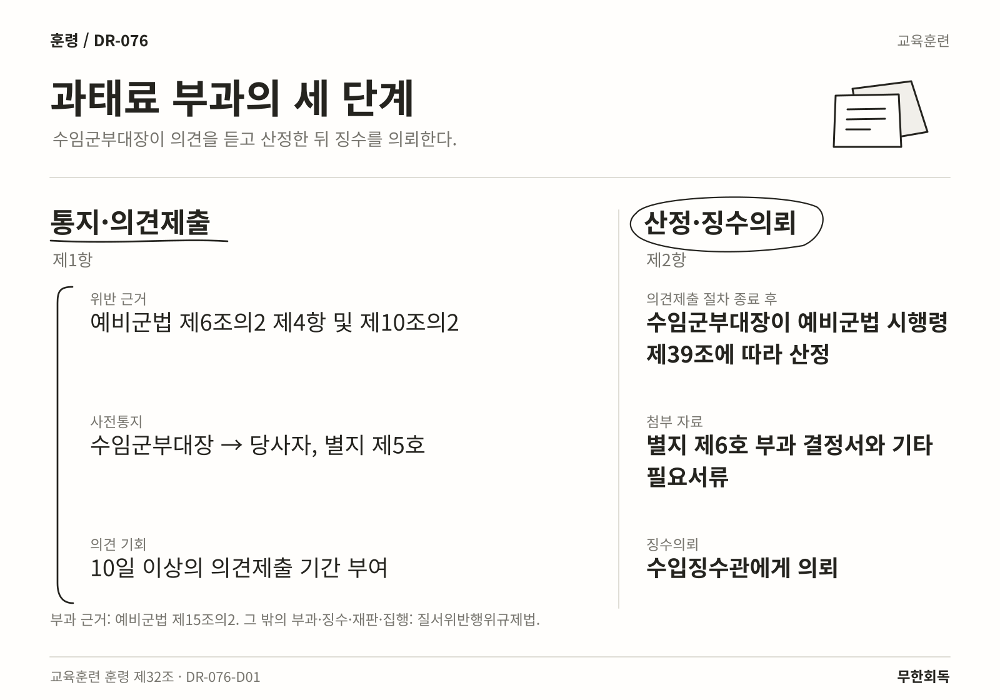
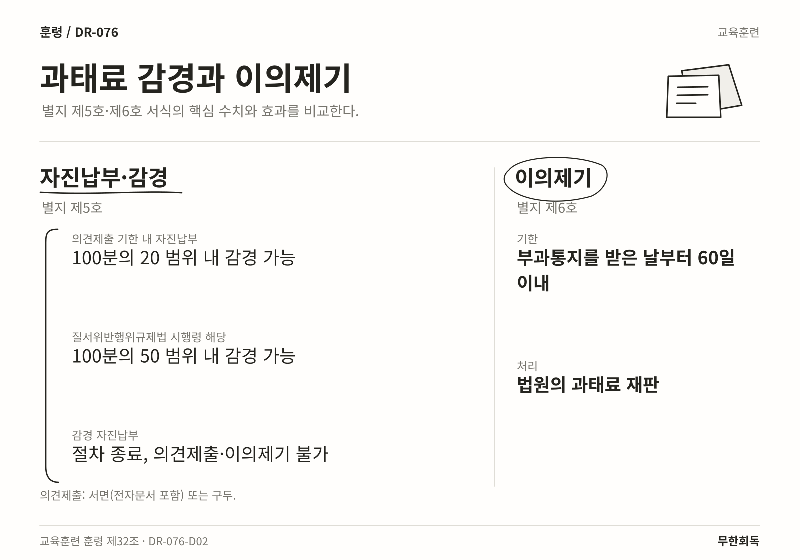
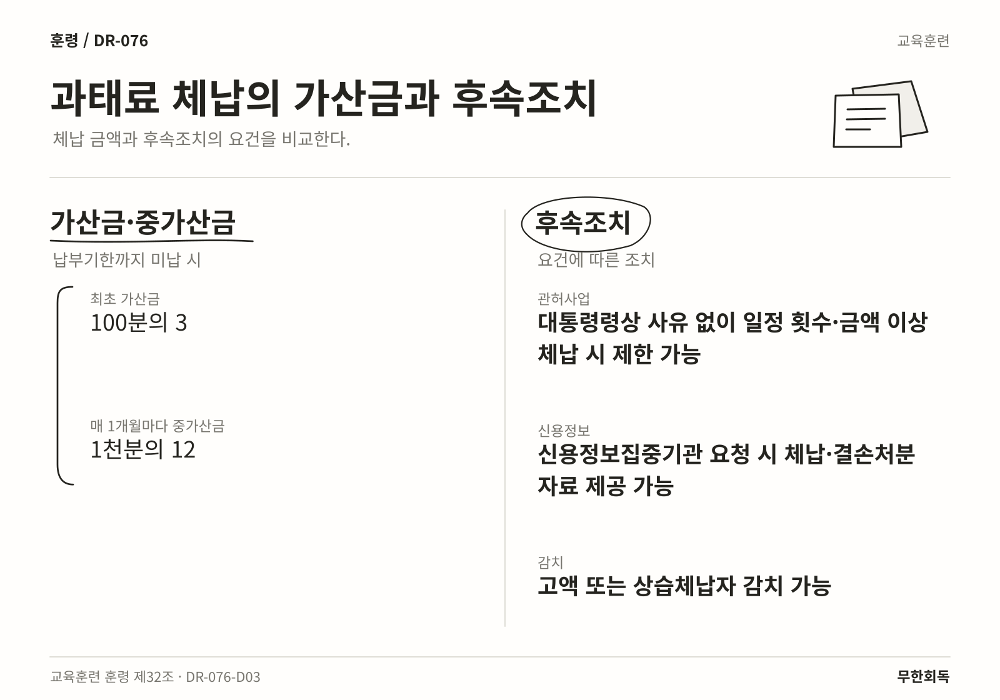

# DR-076 · 예비군 교육훈련 훈령 제32조, 과태료

도식 **3장** · 1600 × 1120 · 흑백 편집형 디자인

[훈령 전체 목록](../../README.md) · [전체 매니페스트](../../diagrams-manifest.json)

## DR-076-D01 · 과태료 부과의 세 단계

[WebP](DR-076-D01-editorial-v1.webp) · [PNG](DR-076-D01-editorial-v1.png) · [SVG 원본](DR-076-D01-editorial-v1.svg)

근거: [교육훈련 훈령 제32조](https://www.law.go.kr/LSW/admRulLsInfoP.do?admRulSeq=2100000286712#J32-0:0) · 국방부훈령 제3216호

## DR-076-D02 · 과태료 감경과 이의제기

[WebP](DR-076-D02-editorial-v1.webp) · [PNG](DR-076-D02-editorial-v1.png) · [SVG 원본](DR-076-D02-editorial-v1.svg)

근거: [교육훈련 훈령 제32조](https://www.law.go.kr/LSW/admRulLsInfoP.do?admRulSeq=2100000286712#J32-0:0) · 국방부훈령 제3216호

## DR-076-D03 · 과태료 체납의 가산금과 후속조치

[WebP](DR-076-D03-editorial-v1.webp) · [PNG](DR-076-D03-editorial-v1.png) · [SVG 원본](DR-076-D03-editorial-v1.svg)

근거: [교육훈련 훈령 제32조](https://www.law.go.kr/LSW/admRulLsInfoP.do?admRulSeq=2100000286712#J32-0:0) · 국방부훈령 제3216호

