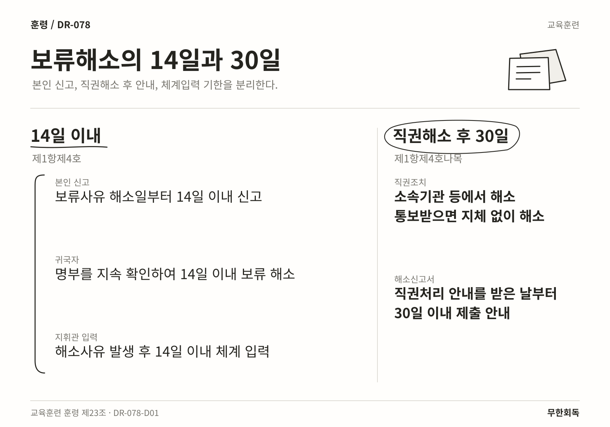
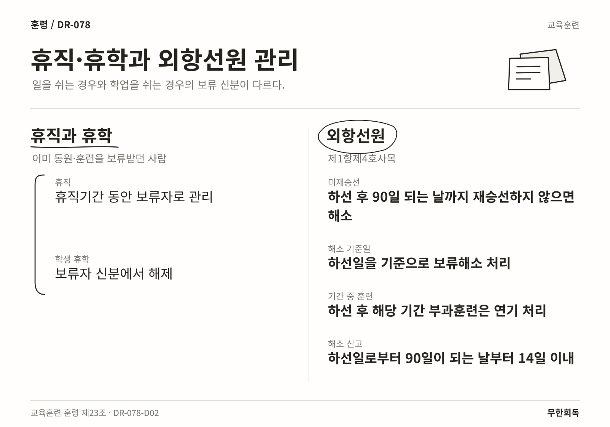
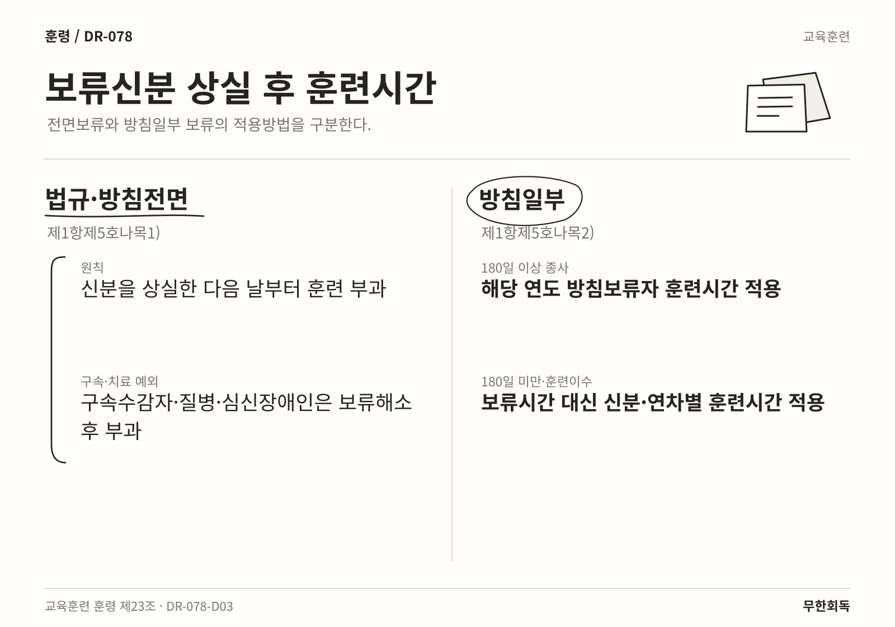
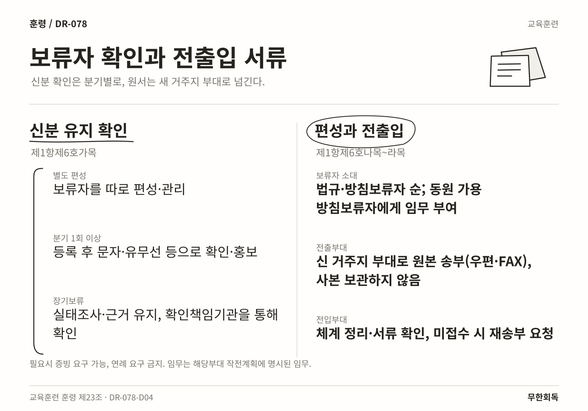

# DR-078 · 예비군 교육훈련 훈령 제23조, 예비군훈련 보류의 해소와 관리

도식 **4장** · 1600 × 1120 · 흑백 편집형 디자인

[훈령 전체 목록](../../README.md) · [전체 매니페스트](../../diagrams-manifest.json)

## DR-078-D01 · 보류해소의 14일과 30일

[WebP](DR-078-D01-editorial-v1.webp) · [PNG](DR-078-D01-editorial-v1.png) · [SVG 원본](DR-078-D01-editorial-v1.svg)

근거: [교육훈련 훈령 제23조](https://www.law.go.kr/LSW/admRulLsInfoP.do?admRulSeq=2100000286712#J23-0:0) · 국방부훈령 제3216호

## DR-078-D02 · 휴직·휴학과 외항선원 관리

[WebP](DR-078-D02-editorial-v1.webp) · [PNG](DR-078-D02-editorial-v1.png) · [SVG 원본](DR-078-D02-editorial-v1.svg)

근거: [교육훈련 훈령 제23조](https://www.law.go.kr/LSW/admRulLsInfoP.do?admRulSeq=2100000286712#J23-0:0) · 국방부훈령 제3216호

## DR-078-D03 · 보류신분 상실 후 훈련시간

[WebP](DR-078-D03-editorial-v1.webp) · [PNG](DR-078-D03-editorial-v1.png) · [SVG 원본](DR-078-D03-editorial-v1.svg)

근거: [교육훈련 훈령 제23조](https://www.law.go.kr/LSW/admRulLsInfoP.do?admRulSeq=2100000286712#J23-0:0) · 국방부훈령 제3216호

## DR-078-D04 · 보류자 확인과 전출입 서류

[WebP](DR-078-D04-editorial-v1.webp) · [PNG](DR-078-D04-editorial-v1.png) · [SVG 원본](DR-078-D04-editorial-v1.svg)

근거: [교육훈련 훈령 제23조](https://www.law.go.kr/LSW/admRulLsInfoP.do?admRulSeq=2100000286712#J23-0:0) · 국방부훈령 제3216호
