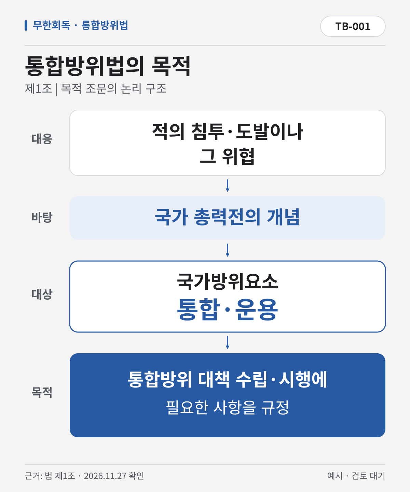
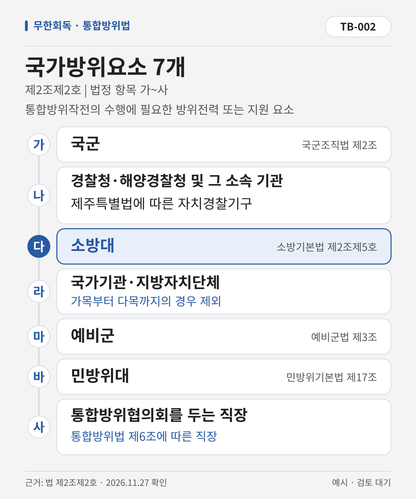
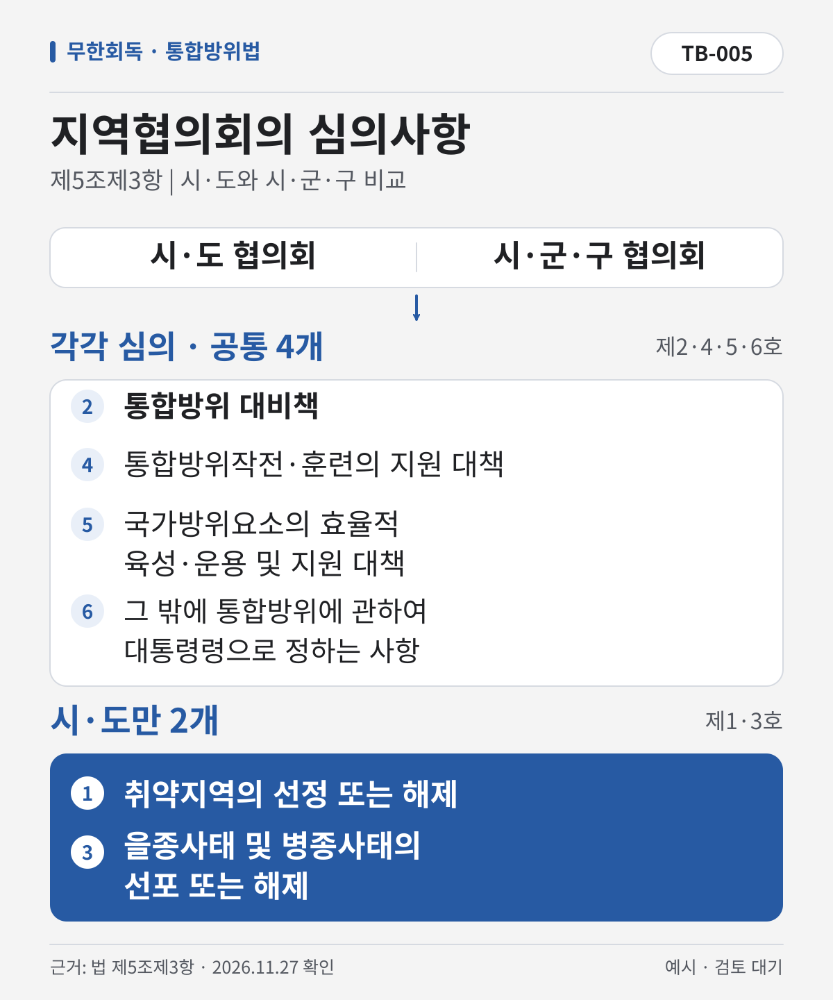

# 통합방위법 강의 자료

## 도식: 7번 선택 스타일 적용

**25강 · 핵심 도식 49장 · SVG / PNG / WebP · 2026년 11월 27일**

[전체 도식·강의별 목록](notion-v1/) · [파일·해시 목록](notion-v1/manifest.json) · [강의 연결표](notion-v1/lecture-map.json)

사용자가 선택한 7번의 흑백 편집 스타일을 적용했습니다. 실제 강의 번호별 폴더의 `diagrams/notion-v1/`에 정리했으며, 각 폴더에 이미지와 내용·근거를 함께 담았습니다.

[선택한 디자인 비교 시안](lesson-005/diagrams/style-studies-v2/07-notion-editorial.png) · [제작 기준](notion-v1/style-guide.md)

각 강의의 핵심 관계를 요약한 자료입니다. 사진 카탈로그는 저장소의 별도 `catalog.json`을 사용합니다.

## 후속 도식 제작 큐

**30개 작업 등록:** 내용 보완 3건, 25강 모바일 세로형 재구성, 공통 제작 틀과 최종 검수. 매시간 전용 예약을 활성화했습니다. 2026년 11월 27일 11:49(KST)부터 매시간 49분에 최신 큐를 읽고 당시 가용 슬롯을 최대로 사용해 제작·검수·저장을 이어갑니다.

[작업 목록·진행 상태](production-queue/) · [예약 상태](production-queue/automation.json)

이전 도식 예시와 10종 비교 기록

# 통합방위법 강의 도식 예시

## 최신 검토본: 회사 디자인 참고 시안 10종

기존 시안의 디자인 개선 요청을 반영해 **통합방위법 5강의 같은 내용으로 10종**을 새로 만들었습니다. 7번 Notion 참고 편집형을 선택했습니다. 최신 제작본은 위의 25강 도식 목록에서 확인할 수 있습니다.

**[10종 시안과 개별 원본 보기](lesson-005/diagrams/style-studies-v2/)**

---

## 이전 예시 v1 — 디자인 개선 요청 기록

아래 3장은 이전 검토본으로 보관합니다.  
작성·법령 확인일: 2026년 11월 27일(KST)

무한회독 통합방위법 강의에 사용할 도식의 구성과 시각 표현을 검토하기 위한 예시다. 사용자가 이 예시를 검토한 뒤 전체 강의로 제작 범위를 넓힌다. 현재 파일은 강의 서비스에 연결하거나 배포하지 않았다.

## 예시

| 강의 | 도식 | 근거 | 편집 원본 | 미리보기 | 웹용 |
|---|---|---|---|---|---|
| TB-001 · 1강 | 목적 조문의 논리 구조 | 법 제1조 | [SVG](lesson-001/diagrams/TB-001-D01-purpose-review-v1.svg) | [PNG](lesson-001/diagrams/TB-001-D01-purpose-review-v1.png) | [WebP](lesson-001/diagrams/TB-001-D01-purpose-review-v1.webp) |
| TB-002 · 2강 | 국가방위요소 가~사 7개 | 법 제2조제2호 | [SVG](lesson-002/diagrams/TB-002-D01-national-defense-elements-review-v1.svg) | [PNG](lesson-002/diagrams/TB-002-D01-national-defense-elements-review-v1.png) | [WebP](lesson-002/diagrams/TB-002-D01-national-defense-elements-review-v1.webp) |
| TB-005 · 5강 | 지역협의회 공통 4개와 시·도만 2개 | 법 제5조제3항 | [SVG](lesson-005/diagrams/TB-005-D01-regional-deliberation-review-v1.svg) | [PNG](lesson-005/diagrams/TB-005-D01-regional-deliberation-review-v1.png) | [WebP](lesson-005/diagrams/TB-005-D01-regional-deliberation-review-v1.webp) |

### 1강 — 목적

제1조의 대응 대상, 바탕, 통합·운용 대상, 법의 목적을 연결했다. 화살표는 목적 조문의 논리 구조이며 시간 순서나 작전 절차를 뜻하지 않는다.

### 2강 — 국가방위요소

소방대를 포함한 가목부터 사목까지 7개 법정 항목이다. 나목의 여러 경찰기관을 각각 별도 항목으로 세지 않는다. 라목의 가~다목 제외 조건과 사목의 법 제6조 조건을 보존했다. 그림 속 '제주특별법'은 「제주특별자치도 설치 및 국제자유도시 조성을 위한 특별법」을 줄여 쓴 표현이다.

### 5강 — 지역협의회

시·도 협의회와 시·군·구 통합방위협의회가 각각 심의하는 공통 사항은 제2·4·5·6호다. 제1·3호는 시·도 협의회에 한정된다. 여기서 '시·도만'은 지역협의회 사이의 비교다. 사태 선포권자나 두 협의회의 공동 심의를 설명하는 도식이 아니다.

## 제작 기준

- 원본 1200×1440, 편집 가능한 SVG와 동일 크기 PNG·WebP를 제공한다.
- 배경 `#F4F4F4`, 본문 `#202124`, 보조 `#545860`, 강조 `#275AA3`.
- 제목·도식은 본고딕(Noto Sans CJK KR)을 사용한다. SVG의 한글을 임의의 시스템 글꼴로 대체하지 않도록 렌더 환경에 이 글꼴을 설치한다. PNG·WebP에는 글자가 이미 고정돼 있다.
- 긴 어절을 글자 중간에서 자르지 않고 의미 단위로 줄바꿈한다.
- 범위, 조건, '또는', '해제'처럼 의미가 바뀌는 표현을 보존한다.
- 휴대전화 세로 화면에서는 도식을 전체 폭으로 보여준다. 가로 화면에서는 강의 우측 패널에 비율을 유지해 놓는다. 작은 가로 영상 전체에 두 패널을 고정한 상태로 축소하지 않는다.
- 390px 전체 폭에서 핵심 문구를 확인했다. 하단 출처와 개별 법령명은 보조정보이며, 자세한 대조에는 원본 또는 이 문서를 사용한다.
- 검토본에는 '예시 · 검토 대기'를 표시한다. 승인 전에는 이 문구를 지우거나 강의에 연결하지 않는다.

## 공식 근거

확인한 법률: 통합방위법, 법률 제21065호, 2025년 10월 1일 타법개정·시행 표기.

- [통합방위법 본문](https://www.law.go.kr/LSW/lsInfoP.do?lsId=000920)
- [제1조를 포함한 해당 법률 버전](https://www.law.go.kr/LSW/lsInfoP.do?ancYnChk=0&chrClsCd=010202&efYd=20251001&lsiSeq=276315&urlMode=lsInfoP)
- [제2조](https://www.law.go.kr/lsLawLinkInfo.do?chrClsCd=010202&lsJoLnkSeq=900150946)
- [제5조](https://www.law.go.kr/lsLawLinkInfo.do?chrClsCd=010202&lsJoLnkSeq=1000774174)

도식은 학습을 위한 요약이다. 정확한 원문과 전체 조문 범위는 위 공식 법령을 기준으로 한다. 시행령이나 전체 강의의 모든 내용을 검수 완료했다는 의미는 아니다.

## 파일 정리

`integrated-defense/lesson-NNN/diagrams/TB-NNN-DNN-topic-review-v1.{svg,png,webp}`

- `integrated-defense`: 통합방위법
- `lesson-NNN`: 실제 강의 번호. 제9조의2처럼 조문 번호와 강의 번호가 다른 경우 실제 강의 목차를 따른다.
- `DNN`: 해당 강의 안의 도식 번호
- `review-v1`: 사용자 검토 전 첫 버전

메타데이터·파일 크기·SHA-256은 [diagrams-manifest.json](diagrams-manifest.json)에 기록했다.

