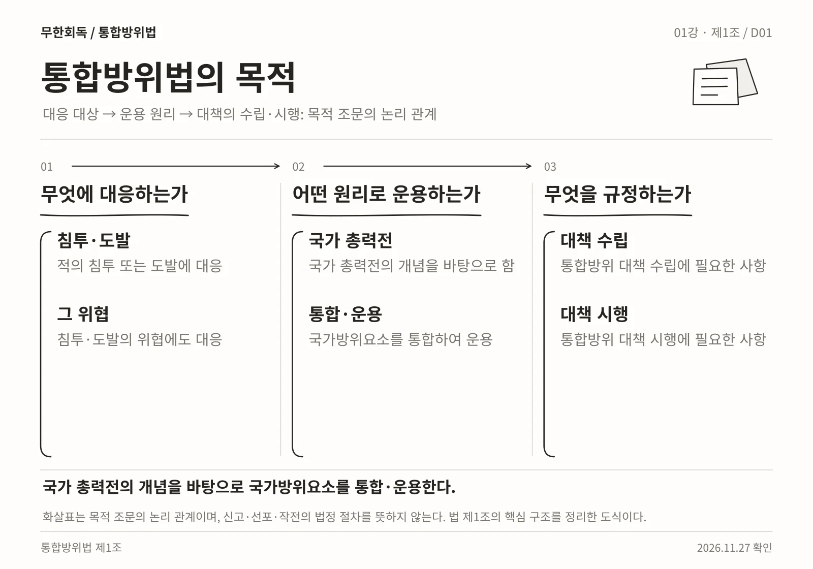

# 01강 · 목적

**TB-001 · 통합방위법 제1조 · 7번 선택 스타일 적용**

[전체 도식 목록](../../../notion-v1/)

## D01 · 통합방위법의 목적

대응 대상 → 운용 원리 → 대책의 수립·시행: 목적 조문의 논리 관계

[PNG](TB-001-D01-purpose-logic.png) · [SVG](TB-001-D01-purpose-logic.svg) · [WebP](TB-001-D01-purpose-logic.webp)

### 무엇에 대응하는가

| 구분 | 내용 |
|---|---|
| 침투·도발 | 적의 침투 또는 도발에 대응 |
| 그 위협 | 침투·도발의 위협에도 대응 |

### 어떤 원리로 운용하는가

| 구분 | 내용 |
|---|---|
| 국가 총력전 | 국가 총력전의 개념을 바탕으로 함 |
| 통합·운용 | 국가방위요소를 통합하여 운용 |

### 무엇을 규정하는가

| 구분 | 내용 |
|---|---|
| 대책 수립 | 통합방위 대책 수립에 필요한 사항 |
| 대책 시행 | 통합방위 대책 시행에 필요한 사항 |

**기억할 문장:** 국가 총력전의 개념을 바탕으로 국가방위요소를 통합·운용한다.

### 조건·범위

- 화살표는 목적 조문의 논리 관계이며, 신고·선포·작전의 법정 절차를 뜻하지 않는다.
- 법 제1조의 핵심 구조를 정리한 도식이다.

### 근거

- [통합방위법 제1조](https://www.law.go.kr/LSW/lsInfoR.do?ancYnChk=0&chrClsCd=010202&efYd=20251001&lsiSeq=276315)

