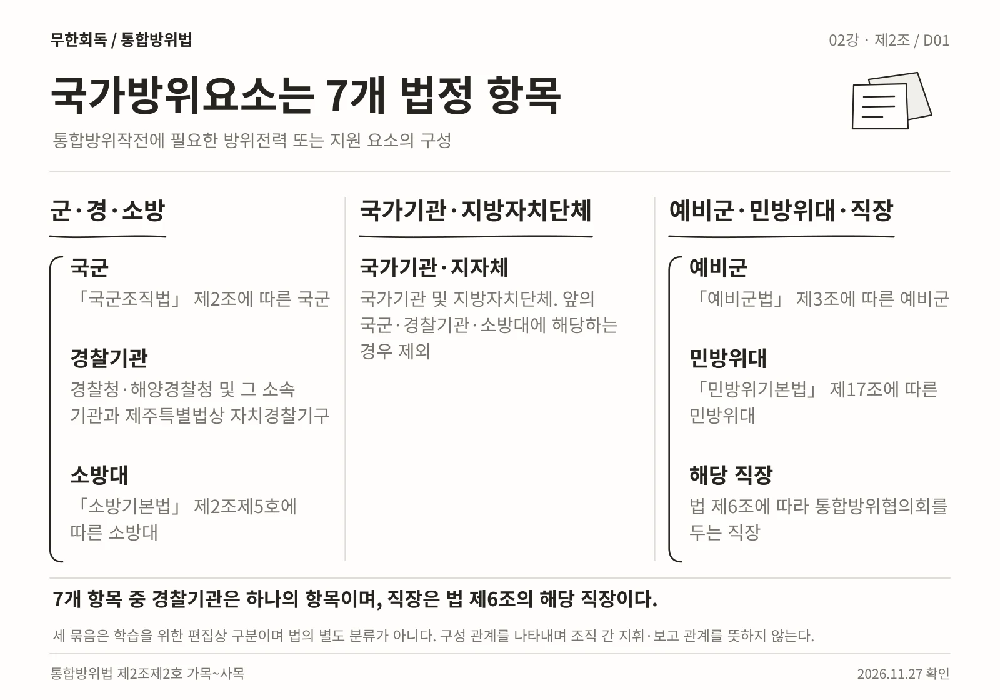
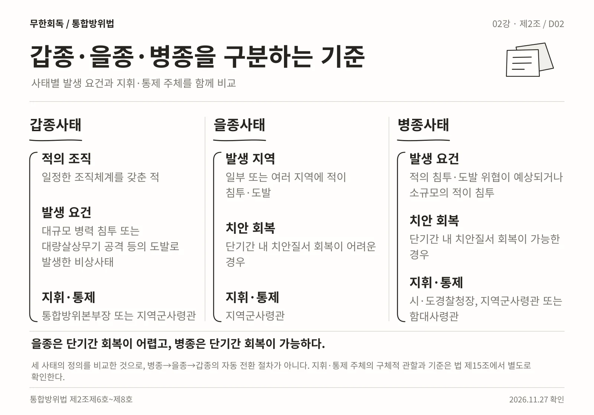
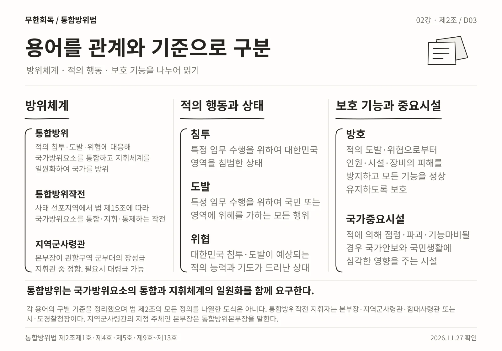

# 02강 · 정의

**TB-002 · 통합방위법 제2조 · 7번 선택 스타일 적용**

[전체 도식 목록](../../../notion-v1/)

## D01 · 국가방위요소는 7개 법정 항목

통합방위작전에 필요한 방위전력 또는 지원 요소의 구성

[PNG](TB-002-D01-seven-defense-elements.png) · [SVG](TB-002-D01-seven-defense-elements.svg) · [WebP](TB-002-D01-seven-defense-elements.webp)

### 군·경·소방

| 구분 | 내용 |
|---|---|
| 국군 | 「국군조직법」 제2조에 따른 국군 |
| 경찰기관 | 경찰청·해양경찰청 및 그 소속 기관과 제주특별법상 자치경찰기구 |
| 소방대 | 「소방기본법」 제2조제5호에 따른 소방대 |

### 국가기관·지방자치단체

| 구분 | 내용 |
|---|---|
| 국가기관·지자체 | 국가기관 및 지방자치단체. 앞의 국군·경찰기관·소방대에 해당하는 경우 제외 |

### 예비군·민방위대·직장

| 구분 | 내용 |
|---|---|
| 예비군 | 「예비군법」 제3조에 따른 예비군 |
| 민방위대 | 「민방위기본법」 제17조에 따른 민방위대 |
| 해당 직장 | 법 제6조에 따라 통합방위협의회를 두는 직장 |

**기억할 문장:** 7개 항목 중 경찰기관은 하나의 항목이며, 직장은 법 제6조의 해당 직장이다.

### 조건·범위

- 세 묶음은 학습을 위한 편집상 구분이며 법의 별도 분류가 아니다.
- 구성 관계를 나타내며 조직 간 지휘·보고 관계를 뜻하지 않는다.

### 근거

- [통합방위법 제2조제2호 가목~사목](https://www.law.go.kr/LSW/lsInfoR.do?ancYnChk=0&chrClsCd=010202&efYd=20251001&lsiSeq=276315)

## D02 · 갑종·을종·병종을 구분하는 기준

사태별 발생 요건과 지휘·통제 주체를 함께 비교

[PNG](TB-002-D02-emergency-types.png) · [SVG](TB-002-D02-emergency-types.svg) · [WebP](TB-002-D02-emergency-types.webp)

### 갑종사태

| 구분 | 내용 |
|---|---|
| 적의 조직 | 일정한 조직체계를 갖춘 적 |
| 발생 요건 | 대규모 병력 침투 또는 대량살상무기 공격 등의 도발로 발생한 비상사태 |
| 지휘·통제 | 통합방위본부장 또는 지역군사령관 |

### 을종사태

| 구분 | 내용 |
|---|---|
| 발생 지역 | 일부 또는 여러 지역에 적이 침투·도발 |
| 치안 회복 | 단기간 내 치안질서 회복이 어려운 경우 |
| 지휘·통제 | 지역군사령관 |

### 병종사태

| 구분 | 내용 |
|---|---|
| 발생 요건 | 적의 침투·도발 위협이 예상되거나 소규모의 적이 침투 |
| 치안 회복 | 단기간 내 치안질서 회복이 가능한 경우 |
| 지휘·통제 | 시·도경찰청장, 지역군사령관 또는 함대사령관 |

**기억할 문장:** 을종은 단기간 회복이 어렵고, 병종은 단기간 회복이 가능하다.

### 조건·범위

- 세 사태의 정의를 비교한 것으로, 병종→을종→갑종의 자동 전환 절차가 아니다.
- 지휘·통제 주체의 구체적 관할과 기준은 법 제15조에서 별도로 확인한다.

### 근거

- [통합방위법 제2조제6호~제8호](https://www.law.go.kr/LSW/lsInfoR.do?ancYnChk=0&chrClsCd=010202&efYd=20251001&lsiSeq=276315)

## D03 · 용어를 관계와 기준으로 구분

방위체계 · 적의 행동 · 보호 기능을 나누어 읽기

[PNG](TB-002-D03-definition-map.png) · [SVG](TB-002-D03-definition-map.svg) · [WebP](TB-002-D03-definition-map.webp)

### 방위체계

| 구분 | 내용 |
|---|---|
| 통합방위 | 적의 침투·도발·위협에 대응해 국가방위요소를 통합하고 지휘체계를 일원화하여 국가를 방위 |
| 통합방위작전 | 사태 선포지역에서 법 제15조에 따라 국가방위요소를 통합·지휘·통제하는 작전 |
| 지역군사령관 | 본부장이 관할구역 군부대의 장성급 지휘관 중 정함. 필요시 대령급 가능 |

### 적의 행동과 상태

| 구분 | 내용 |
|---|---|
| 침투 | 특정 임무 수행을 위하여 대한민국 영역을 침범한 상태 |
| 도발 | 특정 임무 수행을 위하여 국민 또는 영역에 위해를 가하는 모든 행위 |
| 위협 | 대한민국 침투·도발이 예상되는 적의 능력과 기도가 드러난 상태 |

### 보호 기능과 중요시설

| 구분 | 내용 |
|---|---|
| 방호 | 적의 도발·위협으로부터 인원·시설·장비의 피해를 방지하고 모든 기능을 정상 유지하도록 보호 |
| 국가중요시설 | 적에 의해 점령·파괴·기능마비될 경우 국가안보와 국민생활에 심각한 영향을 주는 시설 |

**기억할 문장:** 통합방위는 국가방위요소의 통합과 지휘체계의 일원화를 함께 요구한다.

### 조건·범위

- 각 용어의 구별 기준을 정리했으며 법 제2조의 모든 정의를 나열한 도식은 아니다.
- 통합방위작전 지휘자는 본부장·지역군사령관·함대사령관 또는 시·도경찰청장이다.
- 지역군사령관의 지정 주체인 본부장은 통합방위본부장을 말한다.

### 근거

- [통합방위법 제2조제1호·제4호·제5호·제9호~제13호](https://www.law.go.kr/LSW/lsInfoR.do?ancYnChk=0&chrClsCd=010202&efYd=20251001&lsiSeq=276315)

