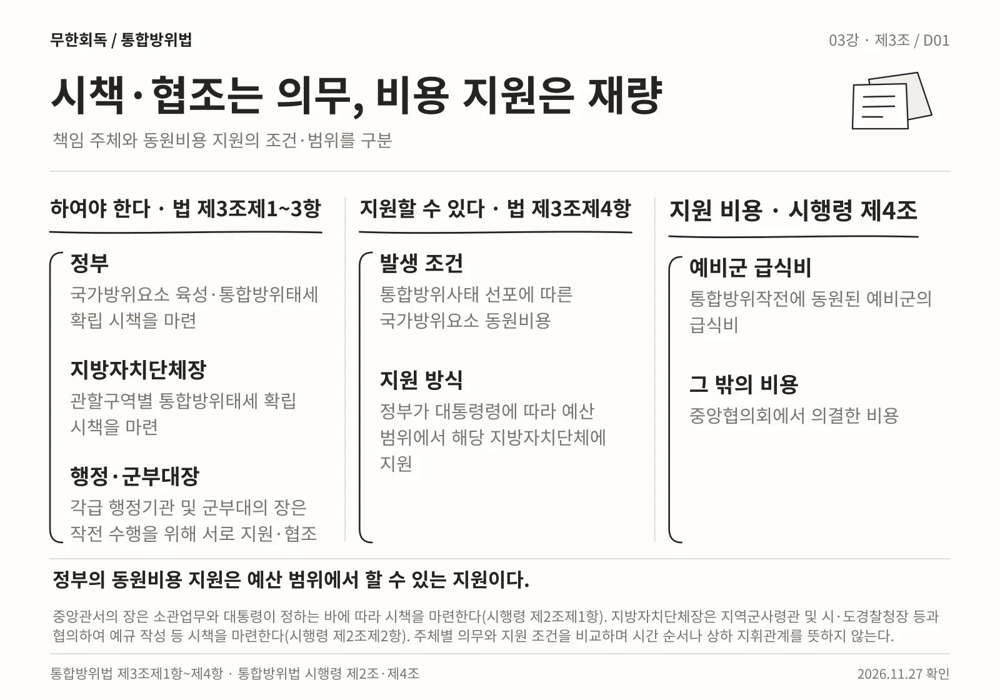
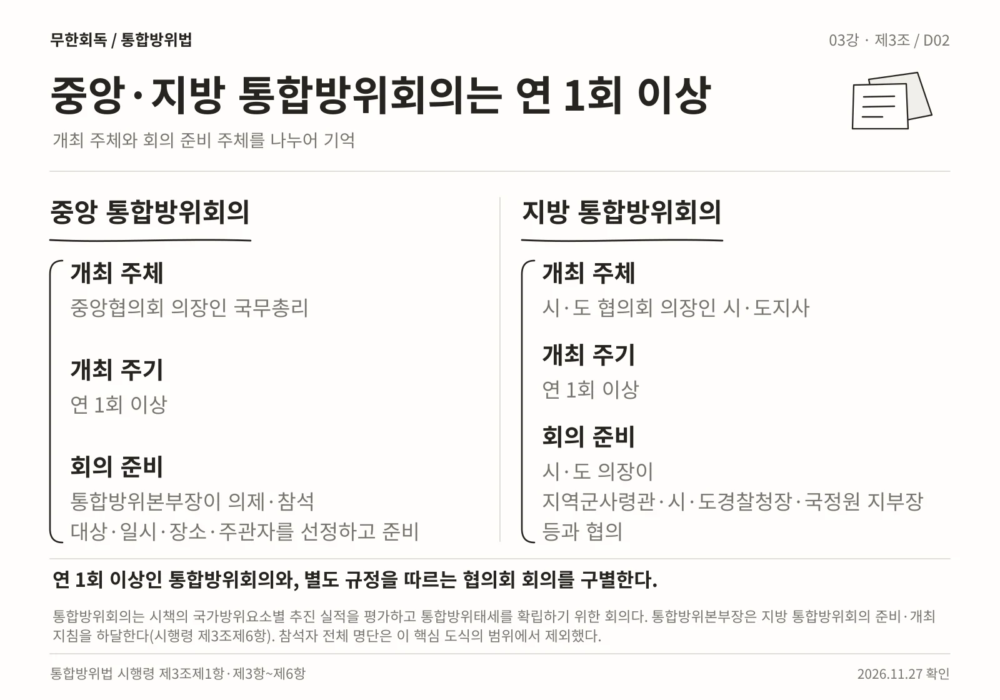
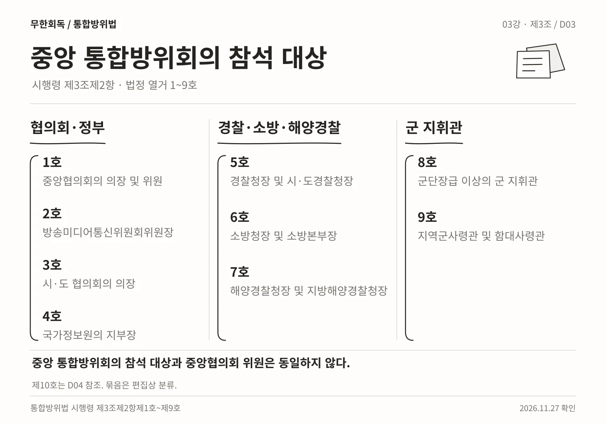
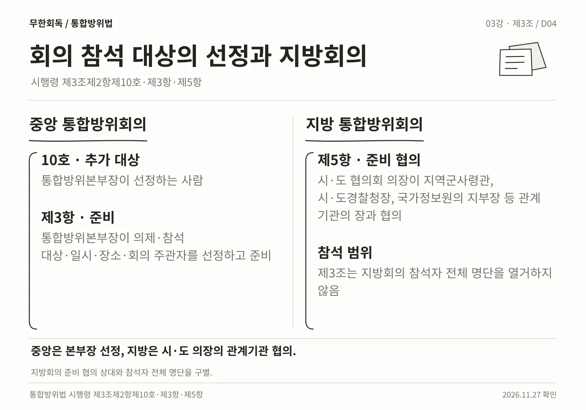

# 03강 · 통합방위태세의 확립 등

**TB-003 · 통합방위법 제3조 · 7번 선택 스타일 적용**

[전체 도식 목록](../../../notion-v1/)

## D01 · 시책·협조는 의무, 비용 지원은 재량

책임 주체와 동원비용 지원의 조건·범위를 구분

[PNG](TB-003-D01-responsibility-and-funding.png) · [SVG](TB-003-D01-responsibility-and-funding.svg) · [WebP](TB-003-D01-responsibility-and-funding.webp)

### 하여야 한다 · 법 제3조제1~3항

| 구분 | 내용 |
|---|---|
| 정부 | 국가방위요소 육성·통합방위태세 확립 시책을 마련 |
| 지방자치단체장 | 관할구역별 통합방위태세 확립 시책을 마련 |
| 행정·군부대장 | 각급 행정기관 및 군부대의 장은 작전 수행을 위해 서로 지원·협조 |

### 지원할 수 있다 · 법 제3조제4항

| 구분 | 내용 |
|---|---|
| 발생 조건 | 통합방위사태 선포에 따른 국가방위요소 동원비용 |
| 지원 방식 | 정부가 대통령령에 따라 예산 범위에서 해당 지방자치단체에 지원 |

### 지원 비용 · 시행령 제4조

| 구분 | 내용 |
|---|---|
| 예비군 급식비 | 통합방위작전에 동원된 예비군의 급식비 |
| 그 밖의 비용 | 중앙협의회에서 의결한 비용 |

**기억할 문장:** 정부의 동원비용 지원은 예산 범위에서 할 수 있는 지원이다.

### 조건·범위

- 중앙관서의 장은 소관업무와 대통령이 정하는 바에 따라 시책을 마련한다(시행령 제2조제1항).
- 지방자치단체장은 지역군사령관 및 시·도경찰청장 등과 협의하여 예규 작성 등 시책을 마련한다(시행령 제2조제2항).
- 주체별 의무와 지원 조건을 비교하며 시간 순서나 상하 지휘관계를 뜻하지 않는다.

### 근거

- [통합방위법 제3조제1항~제4항](https://www.law.go.kr/LSW/lsInfoR.do?ancYnChk=0&chrClsCd=010202&efYd=20251001&lsiSeq=276315)
- [통합방위법 시행령 제2조·제4조](https://www.law.go.kr/LSW/lsInfoR.do?ancYnChk=0&chrClsCd=010202&efYd=20261002&lsiSeq=290507)

## D02 · 중앙·지방 통합방위회의는 연 1회 이상

개최 주체와 회의 준비 주체를 나누어 기억

[PNG](TB-003-D02-annual-defense-meetings.png) · [SVG](TB-003-D02-annual-defense-meetings.svg) · [WebP](TB-003-D02-annual-defense-meetings.webp)

### 중앙 통합방위회의

| 구분 | 내용 |
|---|---|
| 개최 주체 | 중앙협의회 의장인 국무총리 |
| 개최 주기 | 연 1회 이상 |
| 회의 준비 | 통합방위본부장이 의제·참석 대상·일시·장소·주관자를 선정하고 준비 |

### 지방 통합방위회의

| 구분 | 내용 |
|---|---|
| 개최 주체 | 시·도 협의회 의장인 시·도지사 |
| 개최 주기 | 연 1회 이상 |
| 회의 준비 | 시·도 의장이 지역군사령관·시·도경찰청장·국정원 지부장 등과 협의 |

**기억할 문장:** 연 1회 이상인 통합방위회의와, 별도 규정을 따르는 협의회 회의를 구별한다.

### 조건·범위

- 통합방위회의는 시책의 국가방위요소별 추진 실적을 평가하고 통합방위태세를 확립하기 위한 회의다.
- 통합방위본부장은 지방 통합방위회의 준비·개최 지침을 하달한다(시행령 제3조제6항).
- 참석자 전체 명단은 이 핵심 도식의 범위에서 제외했다.

### 근거

- [통합방위법 시행령 제3조제1항·제3항~제6항](https://www.law.go.kr/LSW/lsInfoR.do?ancYnChk=0&chrClsCd=010202&efYd=20261002&lsiSeq=290507)

## D03 · 중앙 통합방위회의 참석 대상

시행령 제3조제2항 · 법정 열거 1~9호

[PNG](TB-003-D03-central-conference-attendees.png) · [SVG](TB-003-D03-central-conference-attendees.svg) · [WebP](TB-003-D03-central-conference-attendees.webp)

### 협의회·정부

| 구분 | 내용 |
|---|---|
| 1호 | 중앙협의회의 의장 및 위원 |
| 2호 | 방송미디어통신위원회위원장 |
| 3호 | 시·도 협의회의 의장 |
| 4호 | 국가정보원의 지부장 |

### 경찰·소방·해양경찰

| 구분 | 내용 |
|---|---|
| 5호 | 경찰청장 및 시·도경찰청장 |
| 6호 | 소방청장 및 소방본부장 |
| 7호 | 해양경찰청장 및 지방해양경찰청장 |

### 군 지휘관

| 구분 | 내용 |
|---|---|
| 8호 | 군단장급 이상의 군 지휘관 |
| 9호 | 지역군사령관 및 함대사령관 |

**기억할 문장:** 중앙 통합방위회의 참석 대상과 중앙협의회 위원은 동일하지 않다.

### 조건·범위

- 제10호의 추가 선정 및 지방회의 준비 관계는 D04에서 확인한다.
- 세 묶음은 학습용 편집 구분이며 법정 분류는 호 번호를 따른다.

### 근거

- [통합방위법 시행령 제3조제2항제1호~제9호](https://www.law.go.kr/LSW/lsInfoR.do?ancYnChk=0&chrClsCd=010202&efYd=20261002&lsiSeq=290507)

## D04 · 회의 참석 대상의 선정과 지방회의

시행령 제3조제2항제10호·제3항·제5항

[PNG](TB-003-D04-conference-selection-and-local-scope.png) · [SVG](TB-003-D04-conference-selection-and-local-scope.svg) · [WebP](TB-003-D04-conference-selection-and-local-scope.webp)

### 중앙 통합방위회의

| 구분 | 내용 |
|---|---|
| 10호 · 추가 대상 | 통합방위본부장이 선정하는 사람 |
| 제3항 · 준비 | 통합방위본부장이 의제·참석 대상·일시·장소·회의 주관자를 선정하고 준비 |

### 지방 통합방위회의

| 구분 | 내용 |
|---|---|
| 제5항 · 준비 협의 | 시·도 협의회 의장이 지역군사령관, 시·도경찰청장, 국가정보원의 지부장 등 관계 기관의 장과 협의 |
| 참석 범위 | 제3조는 지방회의 참석자 전체 명단을 열거하지 않음 |

**기억할 문장:** 중앙은 본부장 선정, 지방은 시·도 의장의 관계기관 협의.

### 조건·범위

- 지방회의 준비 협의 상대를 지방회의 참석자 전체 명단으로 해석하지 않는다.
- 회의 개최·준비 주기와 지침은 TB-003-D02 참조.

### 근거

- [통합방위법 시행령 제3조제2항제10호·제3항·제5항](https://www.law.go.kr/LSW/lsInfoR.do?ancYnChk=0&chrClsCd=010202&efYd=20261002&lsiSeq=290507)

