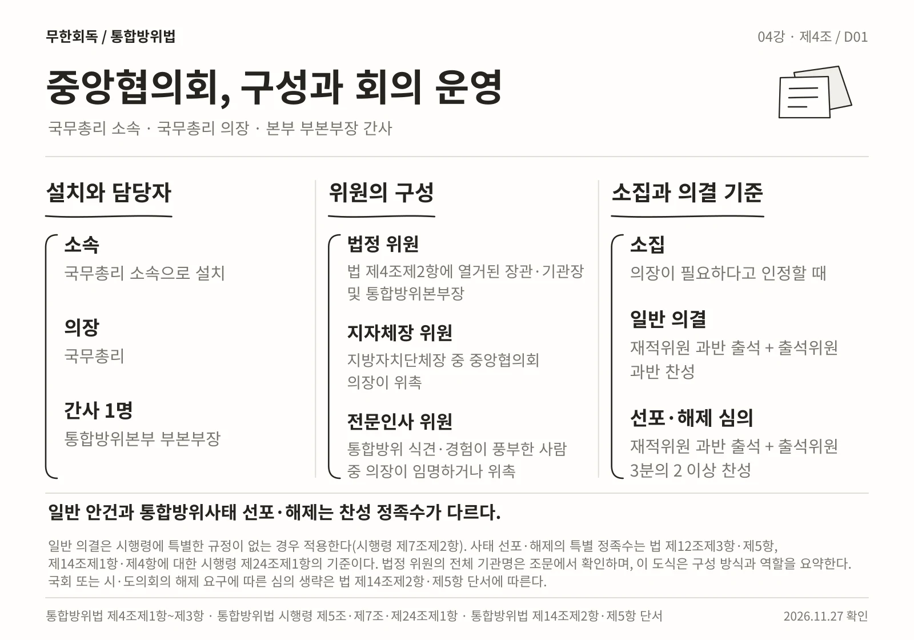
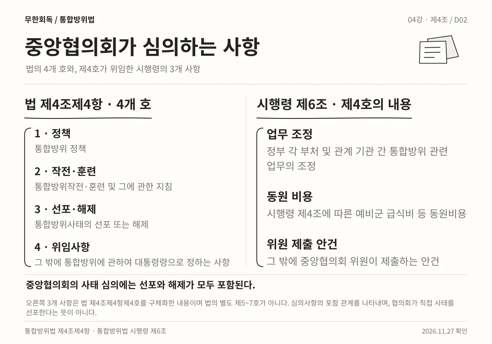
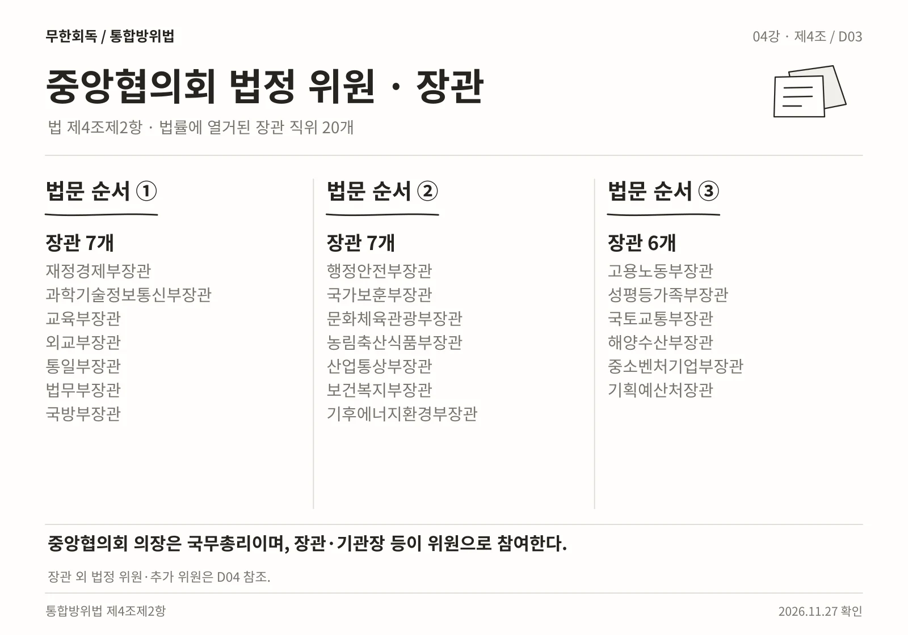
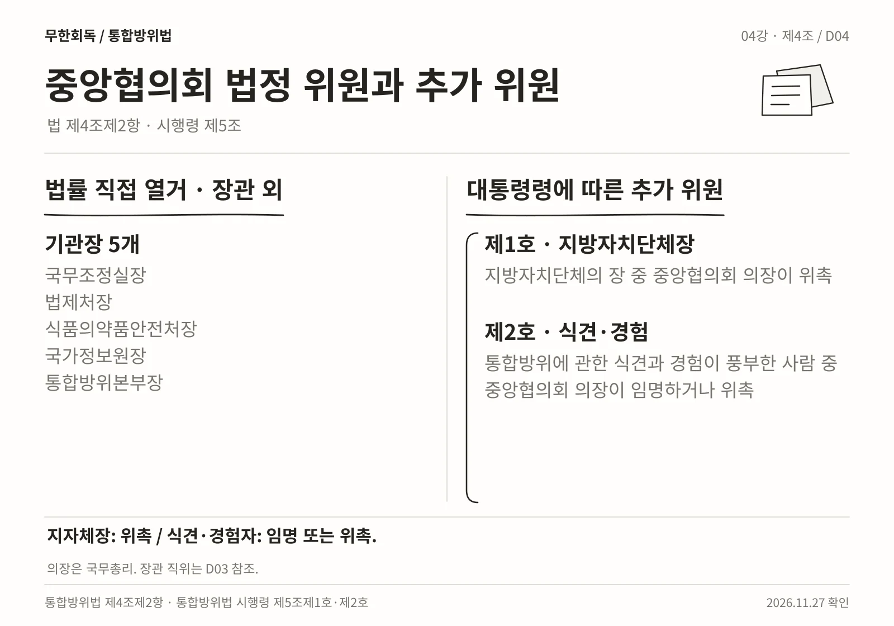

# 04강 · 중앙 통합방위협의회

**제80회 기존 강의 스크립트 기준 · TB-004 · 7번 선택 스타일**

[전체 도식 목록](../../../notion-v1/)

## D01 · 중앙협의회, 구성과 회의 운영

국무총리 소속 · 국무총리 의장 · 본부 부본부장 간사

[PNG](TB-004-D01-central-council-organization.png) · [SVG](TB-004-D01-central-council-organization.svg) · [WebP](TB-004-D01-central-council-organization.webp)

### 설치와 담당자

| 구분 | 내용 |
|---|---|
| 소속 | 국무총리 소속으로 설치 |
| 의장 | 국무총리 |
| 간사 1명 | 통합방위본부 부본부장 |

### 위원의 구성

| 구분 | 내용 |
|---|---|
| 법정 위원 | 법 제4조제2항에 열거된 장관·기관장 및 통합방위본부장 |
| 지자체장 위원 | 지방자치단체장 중 중앙협의회 의장이 위촉 |
| 전문인사 위원 | 통합방위 식견·경험이 풍부한 사람 중 의장이 임명하거나 위촉 |

### 소집과 의결 기준

| 구분 | 내용 |
|---|---|
| 소집 | 의장이 필요하다고 인정할 때 |
| 일반 의결 | 재적위원 과반 출석 + 출석위원 과반 찬성 |
| 선포·해제 심의 | 재적위원 과반 출석 + 출석위원 3분의 2 이상 찬성 |

**기억할 문장:** 일반 안건과 통합방위사태 선포·해제는 찬성 정족수가 다르다.

### 조건·범위

- 일반 의결은 시행령에 특별한 규정이 없는 경우 적용한다(시행령 제7조제2항).
- 사태 선포·해제의 특별 정족수는 법 제12조제3항·제5항, 제14조제1항·제4항에 대한 시행령 제24조제1항의 기준이다.
- 법정 위원의 전체 기관명은 조문에서 확인하며, 이 도식은 구성 방식과 역할을 요약한다.
- 국회 또는 시·도의회의 해제 요구에 따른 심의 생략은 법 제14조제2항·제5항 단서에 따른다.

### 근거

- [통합방위법 제4조제1항~제3항](https://www.law.go.kr/LSW/lsInfoR.do?ancYnChk=0&chrClsCd=010202&efYd=20251001&lsiSeq=276315)
- [통합방위법 시행령 제5조·제7조·제24조제1항](https://www.law.go.kr/LSW/lsInfoR.do?ancYnChk=0&chrClsCd=010202&efYd=20261002&lsiSeq=290507)
- [통합방위법 제14조제2항·제5항 단서](https://www.law.go.kr/LSW/lsInfoR.do?ancYnChk=0&chrClsCd=010202&efYd=20251001&lsiSeq=276315)

## D02 · 중앙협의회가 심의하는 사항

법의 4개 호와, 제4호가 위임한 시행령의 3개 사항

[PNG](TB-004-D02-central-council-deliberation.png) · [SVG](TB-004-D02-central-council-deliberation.svg) · [WebP](TB-004-D02-central-council-deliberation.webp)

### 법 제4조제4항 · 4개 호

| 구분 | 내용 |
|---|---|
| 1 · 정책 | 통합방위 정책 |
| 2 · 작전·훈련 | 통합방위작전·훈련 및 그에 관한 지침 |
| 3 · 선포·해제 | 통합방위사태의 선포 또는 해제 |
| 4 · 위임사항 | 그 밖에 통합방위에 관하여 대통령령으로 정하는 사항 |

### 시행령 제6조 · 제4호의 내용

| 구분 | 내용 |
|---|---|
| 업무 조정 | 정부 각 부처 및 관계 기관 간 통합방위 관련 업무의 조정 |
| 동원 비용 | 시행령 제4조에 따른 예비군 급식비 등 동원비용 |
| 위원 제출 안건 | 그 밖에 중앙협의회 위원이 제출하는 안건 |

**기억할 문장:** 중앙협의회의 사태 심의에는 선포와 해제가 모두 포함된다.

### 조건·범위

- 오른쪽 3개 사항은 법 제4조제4항제4호를 구체화한 내용이며 법의 별도 제5~7호가 아니다.
- 심의사항의 포함 관계를 나타내며, 협의회가 직접 사태를 선포한다는 뜻이 아니다.

### 근거

- [통합방위법 제4조제4항](https://www.law.go.kr/LSW/lsInfoR.do?ancYnChk=0&chrClsCd=010202&efYd=20251001&lsiSeq=276315)
- [통합방위법 시행령 제6조](https://www.law.go.kr/LSW/lsInfoR.do?ancYnChk=0&chrClsCd=010202&efYd=20261002&lsiSeq=290507)

## D03 · 중앙협의회 법정 위원 · 장관

법 제4조제2항 · 법률에 열거된 장관 직위 20개

[PNG](TB-004-D03-central-council-ministers.png) · [SVG](TB-004-D03-central-council-ministers.svg) · [WebP](TB-004-D03-central-council-ministers.webp)

### 법문 순서 ①

| 구분 | 내용 |
|---|---|
| 장관 7개 | 재정경제부장관 · 과학기술정보통신부장관 · 교육부장관 · 외교부장관 · 통일부장관 · 법무부장관 · 국방부장관 |

### 법문 순서 ②

| 구분 | 내용 |
|---|---|
| 장관 7개 | 행정안전부장관 · 국가보훈부장관 · 문화체육관광부장관 · 농림축산식품부장관 · 산업통상부장관 · 보건복지부장관 · 기후에너지환경부장관 |

### 법문 순서 ③

| 구분 | 내용 |
|---|---|
| 장관 6개 | 고용노동부장관 · 성평등가족부장관 · 국토교통부장관 · 해양수산부장관 · 중소벤처기업부장관 · 기획예산처장관 |

**기억할 문장:** 중앙협의회 의장은 국무총리이며, 장관·기관장 등이 위원으로 참여한다.

### 조건·범위

- 장관 직위의 묶음은 편집상 구분이다. 장관 외 법정 위원 및 추가 위원은 D04 참조.

### 근거

- [통합방위법 제4조제2항](https://www.law.go.kr/LSW/lsInfoR.do?ancYnChk=0&chrClsCd=010202&efYd=20251001&lsiSeq=276315)

## D04 · 중앙협의회 법정 위원과 추가 위원

법 제4조제2항 · 시행령 제5조

[PNG](TB-004-D04-central-council-other-members.png) · [SVG](TB-004-D04-central-council-other-members.svg) · [WebP](TB-004-D04-central-council-other-members.webp)

### 법률 직접 열거 · 장관 외

| 구분 | 내용 |
|---|---|
| 기관장 5개 | 국무조정실장 · 법제처장 · 식품의약품안전처장 · 국가정보원장 · 통합방위본부장 |

### 대통령령에 따른 추가 위원

| 구분 | 내용 |
|---|---|
| 제1호 · 지방자치단체장 | 지방자치단체의 장 중 중앙협의회 의장이 위촉 |
| 제2호 · 식견·경험 | 통합방위에 관한 식견과 경험이 풍부한 사람 중 중앙협의회 의장이 임명하거나 위촉 |

**기억할 문장:** 지자체장: 위촉 / 식견·경험자: 임명 또는 위촉.

### 조건·범위

- 의장은 국무총리이다. 장관 직위는 D03 참조.
- 직위 열거와 추가 위원 자격을 구별하며 전체 정원을 고정하지 않는다.

### 근거

- [통합방위법 제4조제2항](https://www.law.go.kr/LSW/lsInfoR.do?ancYnChk=0&chrClsCd=010202&efYd=20251001&lsiSeq=276315)
- [통합방위법 시행령 제5조제1호·제2호](https://www.law.go.kr/LSW/lsInfoR.do?ancYnChk=0&chrClsCd=010202&efYd=20261002&lsiSeq=290507)

